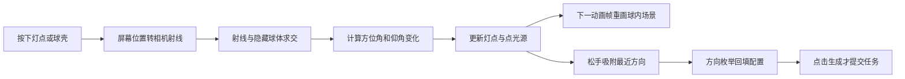

# LibTV 灯球交互实现分析

核查日期：2026年11月9日；开发导航更新：2026年11月9日。对象为用户指定的 LibTV 画布页面及其引用的公开前端资源。本文记录读取代码得到的事实，与 [打光效果技术方案](./打光效果技术方案与实施步骤.md) 中的产品实现建议分开。实际开发从技术方案第11节L00开始，本文作为对照资料，不单独维护另一套实现进度。

## 1. 结论与证据范围

**LibTV 的灯球确实使用 Three.js，版本为 r159。** 它通过 React 管理组件生命周期，在组件内直接创建 Three 场景和渲染器；该灯球没有使用 React Three Fiber 的场景封装。

本次沿页面真实引用的懒加载关系，读取完整灯球组件、对应 Three 库及上层参数／提交代码。只读取公开资源，没有使用用户提供的鉴权信息，没有提交生成，也没有把静态代码核查写成已完成的拖动实测。结论适用于本次抓取的部署，不能证明旧截图或旧请求必定使用同一版本。

| 关键资源 | 在调用链中的作用 | 核查位置 |
| --- | --- | --- |
| [场景加载映射](https://liblibai-web-static.liblib.cloud/liblibtv_online/static/_next/static/chunks/3iwb2fm51hnop.js) | 模块320279列出灯球所需脚本 | 字符偏移215 |
| [打光编辑器](https://liblibai-web-static.liblib.cloud/liblibtv_online/static/_next/static/chunks/0wrfckjk97sxk.js) | 懒加载 `LightScene3D`，传入图、方向、亮度、颜色、轮廓开关 | 字符偏移259947及其后 |
| [灯球组件](https://liblibai-web-static.liblib.cloud/liblibtv_online/static/_next/static/chunks/0i7j11yh_-683.js) | 模块571050导入模块23027，直接创建 `WebGLRenderer` | 字符偏移188、5760 |
| [Three 渲染库](https://liblibai-web-static.liblib.cloud/liblibtv_online/static/_next/static/chunks/03k3zynlgmelt.js) | 模块23027导出 `REVISION` 值159 | 字符偏移644894 |
| [方向定义](https://liblibai-web-static.liblib.cloud/liblibtv_online/static/_next/static/chunks/19ua4rmzsja_5.js) | 模块18076定义26个灯向及其单位向量 | 字符偏移27271 |
| [请求组装](https://liblibai-web-static.liblib.cloud/liblibtv_online/static/_next/static/chunks/2nm7tilaeuhzw.js) | 组装原图、方向枚举及其他生效项 | 字符偏移1135及其后 |

偏移从0开始，按 UTF-8 解码后的文本字符计数。资源 SHA-256、字节偏移及定位标记保存于 [证据清单](./assets/liblib-lighting/lib-light-sphere-evidence.json)，便于之后区分部署变化。核查使用 REA 6.8.0 静态解析两个核心脚本，并人工阅读组件及上层调用；REA 对压缩库的语义图覆盖不完整，未使用图中“缺失关系”证明某功能不存在。

## 2. 球、灯点和光束怎么画出来

球内是一套真正的三维示意场景：

| 画面元素 | 实际实现 | 通俗解释 |
| --- | --- | --- |
| 透明外球 | `SphereGeometry` 加自定义 `ShaderMaterial` | 球形网格配上按视角改变颜色和透明度的小程序，形成有厚度感的球壳 |
| 隐藏交互球 | 半径6的球体，材质不可见 | 看不见，只负责判断鼠标点到了球面哪里 |
| 球心图片 | 薄 `BoxGeometry` 加 `MeshStandardMaterial`，正反面使用照片纹理 | 相当于将照片贴到一块薄展示板上 |
| 主灯与轮廓灯 | 两组 `PointLight` 和小球 | 点光源负责照亮展示板，小球负责让用户看到并抓住灯的位置 |
| 光束 | `ConeGeometry` 加自定义透明着色、叠加混合 | 发光锥体是视觉辅助，不是空气中的物理光线模拟 |
| 经纬线与吸附点 | 线段、小球和按灯位变化的着色 | 帮助用户理解光源的方位及可停靠位置 |

每个灯组的位置沿半径6的球面移动，灯组始终朝向球心。动画循环用 `requestAnimationFrame` 更新位置、颜色、强度与相机，再渲染一帧。快捷切换等状态通过插值平滑靠近目标；拖动时会同步更新显示角度，使灯点立即跟随。

“透视”和“正面”使用同一个透视相机：前者位置约为 `(11,8,10)`，后者约为 `(0,1,15)`，都看向球心。“正面”只是观察位置接近正前方，并没有换成正交相机。

## 3. 鼠标拖动怎样变成灯的位置

完整链路如下：



1. 按下时，将鼠标在灯球画布内的位置转换成范围为 `-1～1` 的坐标。用 `Raycaster` 从当前相机发出一条虚拟射线，检测主灯点、轮廓灯点和隐藏球体。命中灯点或球面后启动拖动，并捕获指针，使拖出画布后仍可收到后续事件。**球壳也能启动主灯拖动，不只灯点可以拖。**
2. 移动时，取射线与隐藏球体的最近交点；若鼠标已到球外，则用射线上离球心最近的位置，归一化到球面。它是球外位置的替代映射，并不是本项目方案中的连续轨道旋转。
3. 把球面交点转换为方位角和仰角，将“本次减上次”的角度差累加到灯的角度。方位角跨越 `±180°` 时修正差值，避免突然转一整圈；仰角限制在正下方到正上方。
4. 立即更新灯的本地位置；动画帧重绘灯点、光锥和球内图片的受光效果。主灯方向的上层回调在松手吸附后触发，不是在每次移动时发送。

坐标换算的含义如下；这里为解释算法而重命名变量，并非复制完整竞品代码：

```text
p = normalize(hitPoint)          // hitPoint是射线落点；p是从球心指向落点的单位向量。
azimuth = degrees(atan2(p.z, p.x)) // azimuth是左右方位角；atan2求角度，degrees把弧度换成度数。
elevation = degrees(asin(p.y))     // elevation是上下仰角；asin根据高度比例求角度，再换成度数。
deltaAz = wrap(azimuth - prevAz) // prevAz是上次方位角；wrap将差值换到最短的±180度范围。
deltaEl = elevation - prevEl     // prevEl是上次仰角；deltaEl是本次上下移动量。
lampAz += deltaAz               // lampAz是灯自己的方位角，累加本次左右变化。
lampEl = clamp(lampEl + deltaEl, -90°, 90°) // lampEl是灯的仰角，clamp防止超过上下极点。
```

注意竞品这里的方位角零点沿 `+x`，本仓技术方案第5.1节零点沿正前方 `+z`；不能混用两套公式而不转换。

**松手吸附是关键差异。** 三个仰角层 `-35°、0°、35°`，每层8个方位，再加顶部、底部，共26个吸附点。松手时选择单位向量距离最近的点，再映射到 `Front`、`High-Front-Left`、`Top` 等方向。看起来可以连续拖动，但最终配置采用离散方向枚举，不能据拖动动画推断服务支持任意连续灯向。

轮廓光也有自己的可拖灯点，方位限制在后半面；主光为正后方时关闭轮廓光。它不是任意数量的自由多灯系统。当前实现未使用本方案所写的四元数虚拟轨迹球算法。

## 4. 球内小图为什么会变化，大图是否也会变化

球内照片由 `TextureLoader` 载入，设置为薄盒标准受光材质的贴图。点光源位置、强度和颜色变化后，展示板表面的明暗、颜色就随之变化。因此用 Three 场景即可实现球内图片的即时受光变化。

但展示板的几何法线只代表这块板的朝向。照片里的猫脸、鼻子、衣服或商品曲面并没有变成三维模型；标准材质不会从照片自动恢复这些结构，也不会正确重算它们的遮挡与投影。即使展示板上出现明暗分布，也不能当作照片内容的真实重打光。

**本次检查的灯球组件只向上层输出主光和轮廓光方向，没有输出预览帧、替换源图或修改大图像素的回调；检查的上层灯光编辑器链路也未见此类传递。** 因而本次能确认球内图片受场景灯光影响，不能将“画布大图随拖动实时重打光”写为已确认的竞品能力。没有执行生成，亦未验证拖动时大图的运行时表现。

用户已要求 Lumina-Muse 的大图即时变化，该能力仍需单独实现：近似明暗／染色可以本地着色；若要猫脸各表面随方向改变阴影，则需要图像法线、主体边界、深度或等效实时模型。Three 负责渲染，图像分析与生成能力还需另行提供。

## 5. 松手以后怎样传给正式生成

当前公开代码中的提交路径是：原始源图 → 激活的方向枚举、亮度、颜色及轮廓方向 → 可选描述与智能参考 → 打光生成任务。拖动处理函数不提交生成请求。

| 请求字段 | 已核查的来源与含义 |
| --- | --- |
| `originImage` | 当前源图地址；不是灯球渲染截图 |
| `UI_KeyLight` | 吸附后的主灯方向映射，例如 `High-Front-Left` |
| `UI_LightBrightness` | 已激活的亮度值；界面值与最终模型效果之间的关系尚未验证 |
| `UI_LightColor` | 已激活的灯颜色 |
| `UI_RimLight` | 生效的轮廓光方向 |
| `Reference_Image_Intent` | 智能参考槽中已上传图片或预设参考的地址；当前链路没有从灯球截图构造此字段 |

对本次部署，参考槽来源可以从选图、上传、回填一直追到请求。旧 cURL 中的那张参考图片是否来自相同部署，仍不能据此追认。前端代码也不能揭示后台模型如何融合参数或保证最终效果。

另外，当前 Lib 智能开关只控制智能区显示并保存开关状态；已读提交函数按仍存在的描述和参考值构参，没有根据智能开关排除它们。本仓 PRD 要求“关闭后不发送隐藏输入”，应保留为本产品规则，不能写成与竞品已确认相同。

## 6. 对当前技术文档的影响

文档第5.4节已经建议使用 Three 相关依赖；此次核查补上了“Lib 实际也使用 Three”的直接证据。无需照搬竞品 r159 版本，本仓继续按已有依赖评估实现。

以下仍属于 Lumina-Muse 自己的设计与交付要求：仅灯点起拖、虚拟轨迹球、松手保留任意连续方向、固定轮廓光、源图与球心共享预览帧、关闭智能后不发送隐藏内容。它们与本次 Lib 代码有差异。若目标是严格还原 Lib，应先明确是否改成26方向吸附及薄图片场景预览；本次分析不擅自降低已有 PRD 的要求。

## 7. 开发时按什么顺序使用本分析

以 [技术方案第11节开发清单](./打光效果技术方案与实施步骤.md#11-可逐步执行的开发清单) 为唯一执行顺序。下表说明每一步应参考本文哪里、交付什么，避免把竞品代码中的行为直接当作本项目需求。

| 开发步骤 | 阅读本分析 | 当前产品要交付的内容 | 应核对的差异 |
| --- | --- | --- | --- |
| L00～L03：规则、源图和面板 | 第1、6节 | 先确定范围、参数、当前源版本与入口 | 图片已清空或受分镜限制时不可打开；不从历史猜源图 |
| L04：静态灯球 | 第2节 | 球壳、灯点、光束、固定相机、图片显示及资源释放 | 使用本仓现有Three依赖；不要求降到竞品r159或增加多灯 |
| L05：拖动与方向按钮 | 第3节 | 连续灯向、前后半球拾取、按钮同源、手势收尾 | Lib是射线球面角度增量并在松手吸附26方向；本产品是第5.4节轨迹球方案，不吸附 |
| L06～L07：即时图片预览 | 第4节 | 独立像素预览、球心及画布源图消费同一帧 | 薄板贴图受光不能代替画布源图像素预览，也不能证明人物结构阴影正确 |
| L08：结构级能力 | 第4节 | 按已定验收等级接分析数据或等效实时能力 | 当前公开灯球没有照片法线／深度恢复证据；不能照搬一个点光源就宣称完成 |
| L09：智能与预设 | 第5节 | 参考上传隔离、完整预设覆盖、隐藏字段排除 | 按本产品规则关闭智能后不发送隐藏输入；送模参考与灯球截图分开 |
| L10～L13：构参、发送、恢复 | 第5节 | 原图＋有效设置，经既有V2生成普通图片结果 | 不接竞品接口，不把竞品方向枚举当成本仓连续方向契约，不新增轮询系统 |
| L14～L15：效果与交付 | 第1、4～6节 | 真实样例、故障回归、PRD验收记录 | 静态脚本、mock请求或球内动画不能证明模型效果与正式项目交付 |

开发时先实现一条可观察链路：`单图打开 → 六向切换 → 灯点可拖 → 独立图片预览 → 球心与大图同步`，再接参考、预设和正式任务。每个箭头对应技术方案中的独立步骤，不需要一次改完画布、三维场景和订单。

每步有差异时，在技术方案的该步记录“竞品事实、当前需求、实际实现、验证结果”，先判断是否影响既定范围，再处理实现问题。不要通过静默增加26点吸附或撤掉源图实时预览来缩短开发。
