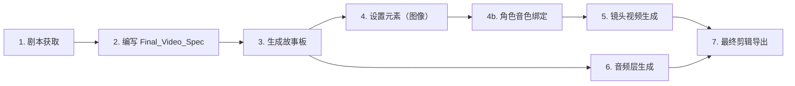

# ChatMain 架构重构实施计划

> 基于 "多模态 Agent 运行时 + FlowOrchestrator 工作流编排" 架构

---

## 一、架构总览

### 目标架构

```
┌─────────────────────────────────────────────────────────────────┐
│                        前端 (React + Zustand)                     │
│                                                                  │
│  DialogView ──── ChatMessages (ContentBlock 驱动渲染)              │
│  (~300行)  ──── ChatInput (纯用户输入)                             │
│              ──── useChatFlow (Flow 逻辑 Hook)                     │
│                                                                   │
│  InteractiveFlowUI ─── ToolEvent → ComponentMap (动态组件渲染)       │
│                                                                   │
│  各面板 ──── 统一从 Zustand Store 读取状态                           │
│                                                                  │
│  API 层 ──── 按业务领域拆分: chat.ts / flow.ts / generation.ts ...│
└──────────────────────┬──────────────────────────────────────────┘
                       │ REST + SSE
                       ▼
┌─────────────────────────────────────────────────────────────────┐
│                        后端 (Spring Boot)                        │
│                                                                  │
│  POST /v2/chat (SSE) ─── ChatStreamService                      │
│  │                      └─ 纯 LLM 对话透传 (OpenAI SSE格式)        │
│  │                      └─ 消息持久化                              │
│  │                                                                 │
│  POST /v2/flow ──────── FlowOrchestrator (新增)                    │
│  │  /analyze            ├─ 意图分析                                │
│  │  /step               ├─ 步骤执行 + 状态持久化                    │
│  │  /state              └─ 状态查询/恢复                           │
│  │                                                                 │
│  POST /Chat.* ───────── ConversionService (会话管理)               │
│                                                                  │
│  ToolRegistry (新增) ──── ChatTool[] (动态注册)                    │
│    ├─ GenerateTool     ← 现有 ChatToolService.executeGenerate     │
│    ├─ ListModelsTool   ← 现有 executeListModels                   │
│    ├─ QueryResultTool  ← 现有 executeQueryResult                  │
│    ├─ OptimizeTool     ← 现有 executeOptimizePrompt               │
│    └─ LayoutTool       ← 现有 executeLayoutSelector               │
└─────────────────────────────────────────────────────────────────┘
```

### 路由映射

| 功能 | 当前 | 目标 |
|------|------|------|
| 纯聊天 SSE | `/v2/chat` | `/v2/chat`（不变，优化流处理） |
| 意图分析 | `/Chat.IntentAnalyze` (RPC) | **由 FlowOrchestrator 内部调用** |
| 提示词优化 | `/Chat.OptimizePrompt` (RPC) | **由 FlowOrchestrator 内部调用** |
| 创作流程编排 | **前端驱动 7 个 useRef** | `POST /v2/flow/analyze` + `POST /v2/flow/step` |
| 工具 schema | 前端硬编码 tools 数组 | `POST /v2/Chat.GetToolSchemas` (动态获取) |
| 交互事件 | 混入 SSE 流 | **REST 响应** `{type, component, data}` |

---

## 二、实施路线图

```
Phase 1 (优先级高，预计 3-4 周)
  ├─ 后端: ToolRegistry + ChatTool 接口抽象
  ├─ 后端: FlowOrchestrator 骨架 + 状态管理
  ├─ 前端: Zustand store (useChatFlowStore)
  ├─ 前端: Content Blocks 消息模型
  └─ 前端: DialogView 拆分

Phase 2 (优先级中，预计 2-3 周)
  ├─ 后端: 标准化 ToolEvent 协议
  ├─ 前端: ToolEvent → Component 映射表
  ├─ 前端: SSE 解析器改为事件驱动
  ├─ 后端: /v2/Chat.GetToolSchemas 接口
  └─ 前端: PreviewPanel 对接 generation_ref

Phase 3 (优先级低，预计 2-3 周)
  ├─ 后端: Storyboard CRUD 接口
  ├─ 后端: Timeline/EditSession 接口
  ├─ 前端: FilePanel 对接真实 MaterialApi
  ├─ 前端: StoryPanel 对接 Storyboard API
  └─ EditPanel 保持 mock，等产品方案确认
```

---

## 三、Phase 1 详细方案

### 3.1 后端：ToolRegistry + ChatTool 接口抽象

#### 3.1.1 ChatTool 接口

**文件**: `domain/chat/tool/ChatTool.java` (新增)

```java
public interface ChatTool {
    String getName();                    // 工具唯一标识 (对应 function name)
    String getDescription();             // LLM function description
    JSONObject getParameterSchema();     // function parameters JSON Schema
    boolean isInteractive();             // 是否交互型工具（需要前端渲染组件）
    String execute(JSONObject args, String userId);
}
```

#### 3.1.2 ToolRegistry 组件

**文件**: `application/service/support/ToolRegistry.java` (新增)

```java
@Component
public class ToolRegistry implements InitializingBean {
    
    private final Map<String, ChatTool> tools = new LinkedHashMap<>();
    
    @Autowired
    private List<ChatTool> toolList;  // Spring 自动注入所有 ChatTool Bean
    
    @Override
    public void afterPropertiesSet() {
        for (ChatTool tool : toolList) {
            tools.put(tool.getName(), tool);
            log.info("注册工具: {}", tool.getName());
        }
    }
    
    public ChatTool getTool(String name) { return tools.get(name); }
    
    public JSONArray getToolSchemas() {
        JSONArray schemas = new JSONArray();
        for (ChatTool tool : tools.values()) {
            JSONObject schema = new JSONObject();
            schema.put("type", "function");
            JSONObject func = new JSONObject();
            func.put("name", tool.getName());
            func.put("description", tool.getDescription());
            func.put("parameters", tool.getParameterSchema());
            schema.put("function", func);
            schemas.add(schema);
        }
        return schemas;
    }
    
    public String execute(String name, JSONObject args, String userId) {
        ChatTool tool = tools.get(name);
        if (tool == null) return "未知工具: " + name;
        return tool.execute(args, userId);
    }
}
```

#### 3.1.3 迁移现有工具

将 `ChatToolService` 中的 switch/case 分解为独立的 Tool 实现类：

| 新类 | 文件名 | 原代码来源 |
|------|--------|-----------|
| `GenerateTool` | `domain/chat/tool/impl/GenerateTool.java` | `ChatToolService.executeGenerate()` |
| `ListModelsTool` | `domain/chat/tool/impl/ListModelsTool.java` | `ChatToolService.executeListModels()` |
| `QueryResultTool` | `domain/chat/tool/impl/QueryResultTool.java` | `ChatToolService.executeQueryResult()` |
| `OptimizePromptTool` | `domain/chat/tool/impl/OptimizePromptTool.java` | `ChatToolService.executeOptimizePrompt()` |
| `LayoutSelectorTool` | `domain/chat/tool/impl/LayoutSelectorTool.java` | `ChatToolService.executeLayoutSelector()` |

**迁移原则**：
- 旧 `ChatToolService` 保留，内部改为委托 `ToolRegistry` 执行
- 等所有调用方迁移完成后再删除旧代码
- **不允许删除旧代码，只能注释**，确保可回滚

#### 3.1.4 端点变化

| 端点 | 变化 |
|------|------|
| `/v2/chat` | 不再内嵌 tools 处理，退化为纯 SSE 透传 |
| `POST /v2/Chat.GetToolSchemas` | **新增**，返回 ToolRegistry 中的全部工具 schema |
| `POST /v2/flow/*` | **新增**，FlowOrchestrator 端点 |

---

### 3.2 后端：FlowOrchestrator 骨架 + 状态管理

#### 3.2.1 Controller

**文件**: `api/app/controller/v2/flow/FlowController.java` (新增)

```java
@RestController
@RequestMapping("/v2/flow")
public class FlowController {
    
    @PostMapping("/analyze")
    public FlowAnalyzeReply analyze(@RequestBody FlowAnalyzeRequest req);
    // 1. 调用 LLM 分析用户输入意图
    // 2. 匹配 Skill（image_creation / video_creation / chat 等）
    // 3. 返回第一步交互组件
    
    @PostMapping("/step")
    public FlowStepReply executeStep(@RequestBody FlowStepRequest req);
    // 1. 根据 sessionId 恢复 FlowState
    // 2. 执行当前步骤
    // 3. 返回交互组件/文本/生成结果
    
    @PostMapping("/state")
    public FlowStateReply getState(@RequestBody FlowStateRequest req);
    // 1. 查询指定会话的 FlowState
    // 2. 用于断连恢复
}
```

#### 3.2.2 FlowState 持久化

**要求**：
- 每个会话（conversationId）维护一个 FlowState
- 存储介质：Redis（推荐）或 内存 Map（开发阶段）
- FlowState 内容：

```java
@Data
public class FlowState {
    private String conversationId;
    private String currentStepId;       // 当前步骤 ID
    private String skillId;             // 匹配的 Skill ID
    private Map<String, Object> data;   // 步骤执行数据累积 { prompt, modelId, ratio, ... }
    private List<FlowLog> logs;         // 执行日志（可选）
    private long createdAt;
    private long updatedAt;
}
```

#### 3.2.3 关键流程示例

```
用户输入 "画一只猫在月球上"

POST /v2/flow/analyze { text: "画一只猫在月球上", conversationId: "xxx" }

→ 后端:
  1. 调用 LLM 分析意图 → { intent: "image_creation", confidence: 0.95 }
  2. 匹配 Skill → "image_creation"
  3. 创建 FlowState, step=0
  4. 返回 → { type: "card", component: "ConfirmButtons",
               data: { question: "需要生成图片吗？" } }

前端渲染 ConfirmButtons → 用户点击"是"

POST /v2/flow/step { 
    conversationId: "xxx", 
    stepId: "confirm_intent", 
    value: { confirmed: true } 
}

→ 后端:
  1. 恢复 FlowState
  2. 执行 step: 查询模型列表
  3. 更新 FlowState.data.modelOptions = [...]
  4. 返回 → { type: "card", component: "ModelSelector",
               data: { models: [...] } }

...
（后续步骤类似）
```

#### 3.2.4 响应协议标准

```typescript
// FlowOrchestrator 的所有响应遵循同一协议：
type FlowResponse = {
    type: 'text' | 'card' | 'generation' | 'route' | 'error';
    component?: string;       // 当 type=card 时，前端渲染的组件名
    data?: Record<string, unknown>;  // 组件所需数据
    text?: string;            // 当 type=text 时，纯文本内容
    generation?: {            // 当 type=generation 时
        orderId: string;
        status: string;
        resultUrl?: string;
    };
    route?: {                 // 当 type=route 时
        channel: 'chat' | 'flow';
    };
    meta?: {
        stepId: string;
        skillId: string;
    };
};
```

---

### 3.3 前端：Zustand Store (useChatFlowStore)

#### 3.3.1 Store 定义

**文件**: `src/stores/chatFlowStore.ts` (新增)

```typescript
import { create } from 'zustand';

// ====== 消息模型 ======
type ContentBlock =
    | { type: 'text'; text: string }
    | { type: 'card'; component: string; data: Record<string, unknown> }
    | { type: 'generation_ref'; refId: string; resultUrl?: string }
    | { type: 'tool_event'; event: ToolEvent };

type AgentMessage = {
    id: string;
    role: 'user' | 'assistant' | 'tool' | 'system';
    content: ContentBlock[];
    createdAt: number;
};

// ====== Flow 状态 ======
type FlowState = {
    conversationId: string;
    skillId: string | null;
    currentStepId: string | null;
    stepData: Record<string, unknown>;   // 各步骤累积数据
    isActive: boolean;
};

// ====== Store ======
interface ChatFlowStore {
    // 会话
    conversationId: string;
    setConversationId: (id: string) => void;
    
    // 消息
    messages: AgentMessage[];
    addMessage: (msg: AgentMessage) => void;
    updateLastMessage: (updater: (msg: AgentMessage) => AgentMessage) => void;
    clearMessages: () => void;
    
    // 流状态
    isStreaming: boolean;
    setStreaming: (v: boolean) => void;
    streamingText: string;
    appendStreamText: (text: string) => void;
    clearStreamText: () => void;
    
    // Flow 状态
    flowState: FlowState;
    setFlowState: (partial: Partial<FlowState>) => void;
    setStepData: (key: string, value: unknown) => void;
    clearFlow: () => void;
    
    // Actions
    createConversation: () => Promise<void>;
    sendUserMessage: (text: string) => Promise<void>;
    executeFlowStep: (stepId: string, value: unknown) => Promise<void>;
    analyzeUserInput: (text: string) => Promise<void>;
}
```

#### 3.3.2 替换关系

| 当前（删除） | 替换为 |
|-------------|--------|
| `messagesRef` + `setRenderTick` | `store.messages`（Zustand 自动触发渲染） |
| `flowPromptRef` ~ `flowModelNameRef` (7 个 ref) | `store.flowState.stepData` |
| `isRequesting` (useState) | `store.isStreaming` |
| `streamingTexts` (useState) | 由 store 管理和 `streamingText` 驱动 |
| `streamBuf` (useStreamBuffer) | store 内部自动处理流式缓冲 |

**优势**：
- 所有面板直接从 store 读取数据，无需 prop drilling
- Zustand 的 `subscribe` 机制让 PreviewPanel 可以响应式监听生成结果
- 消息变更自动触发 React 重渲染

---

### 3.4 前端：Content Blocks 消息模型

#### 3.4.1 类型定义

**文件**: `src/pages/ChatMain/types/index.ts` (重写)

```typescript
// ====== 消息内容块 ======
export type ContentBlock =
    | { type: 'text'; text: string }
    | { type: 'card'; component: string; data: Record<string, unknown> }
    | { type: 'generation_ref'; refId: string; resultUrl?: string; thumbnailUrl?: string }
    | { type: 'tool_event'; event: ToolEvent }
    | { type: 'error'; message: string };

// ====== 消息 ======
export type AgentMessage = {
    id: string;
    role: 'user' | 'assistant' | 'tool' | 'system';
    content: ContentBlock[];
    createdAt: number;
};

// ====== 工具事件 ======
export type ToolEvent = {
    type: 'editPrompt' | 'layout' | 'confirm' | 'modelSelect' | 'parameterSelect' | 'generationResult';
    data: Record<string, unknown>;
    component: string;
    meta?: { stepId: string; skillId: string; };
};

// ====== Flow 相关 ======
export type FlowStep = 
    | 'idle'
    | 'confirm_intent'
    | 'select_model'
    | 'select_prompt'
    | 'edit_prompt'
    | 'select_ratio'
    | 'select_resolution'
    | 'generating';

export type FlowState = {
    conversationId: string;
    skillId: string | null;
    currentStepId: string | null;
    stepData: Record<string, unknown>;
    isActive: boolean;
};

// ====== FlowResponse 协议 ======
export type FlowResponse = {
    type: 'text' | 'card' | 'generation' | 'route' | 'error';
    component?: string;
    data?: Record<string, unknown>;
    text?: string;
    generation?: { orderId: string; status: string; resultUrl?: string; };
    route?: { channel: 'chat' | 'flow'; };
    meta?: { stepId: string; skillId: string; };
};
```

#### 3.4.2 渲染器

```tsx
// 根据 ContentBlock.type 自动选择渲染组件
function ContentBlockRenderer({ block }: { block: ContentBlock }) {
    switch (block.type) {
        case 'text':
            return <TextContent text={block.text} />;
        case 'card':
            return <CardRenderer component={block.component} data={block.data} />;
        case 'generation_ref':
            return <GenerationPreview refId={block.refId} thumbnailUrl={block.thumbnailUrl} />;
        case 'tool_event':
            return <ToolEventHandler event={block.event} />;
        case 'error':
            return <ErrorMessage message={block.message} />;
    }
}
```

#### 3.4.3 组件映射表

```typescript
// src/pages/ChatMain/componentMap.ts (新增)
const COMPONENT_MAP: Record<string, React.ComponentType<any>> = {
    ConfirmButtons,
    ModelSelector,
    EditablePrompt,
    RatioSelector,
    ResolutionSelector,
    PromptOptionCards,
    RerouteOptions,
};
```

---

### 3.5 前端：DialogView 拆分

#### 3.5.1 拆分结构

```
DialogView/
  ├── index.tsx           ← 约 100 行，只做组装
  ├── ChatMessages.tsx    ← 消息列表渲染 + ContentBlock 分发
  ├── ChatInput.tsx       ← 输入框 + 发送逻辑
  ├── useChatFlow.ts      ← Flow 业务逻辑 Hook
  ├── hooks/
  │   └── useChatSSE.ts   ← SSE 流式文本 Hook（从当前 DialogView 提取）
  └── index.less
```

#### 3.5.2 组件职责

**`ChatMessages.tsx`** (~150 行)
- 从 store 读取 `messages`
- 按角色渲染消息气泡
- 调用 `ContentBlockRenderer` 渲染内容块
- 流式文字动画（之前由 `useStreamBuffer` 驱动）

**`ChatInput.tsx`** (~80 行)
- TagTextArea 输入框
- 发送按钮
- 推荐卡片
- @mention 角色面板
- 调用 `store.sendUserMessage(text)`

**`useChatFlow.ts`** (~200 行)
- 监听 store 变化
- 处理 Flow 步骤回调
- 调用 store.analyzeUserInput / executeFlowStep
- 处理生成结果事件（dispatch CustomEvent → 屏蔽，改为 store 驱动）

**新旧行数对比**：
| 文件 | 当前 | 目标 |
|------|------|------|
| `DialogView/index.tsx` | ~940 | ~100 |
| `InteractiveFlowUI/index.tsx` | ~213 | ~80 |
| 新增 `stores/chatFlowStore.ts` | - | ~200 |
| 新增 `ChatMessages.tsx` | - | ~150 |
| 新增 `ChatInput.tsx` | - | ~80 |
| 新增 `useChatFlow.ts` | - | ~200 |
| 新增 `useChatSSE.ts` | - | ~100 |
| **总计** | ~1153 | ~910 (降低 20%) |

---

## 四、Phase 2 详细方案

### 4.1 后端：标准化 ToolEvent 协议

**当前问题**：交互型工具通过 SSE 混入 `data: {"type":"editPrompt","prompt":"..."}` 透传，
前端需要逐 chunk 解析类型。

**目标**：交互型工具改为 REST 响应，前端通过 `type` + `component` 字段直接确定渲染组件。

```json
// 当前 (SSE 混入)
data: {"type":"editPrompt","prompt":"优化后的提示词...","thinking":"思考过程..."}

// 目标 (REST 结构化)
{
    "type": "card",
    "component": "EditablePrompt",
    "data": {
        "prompt": "优化后的提示词...",
        "originalPrompt": "原始提示词",
        "thinking": "思考过程..."
    },
    "meta": {
        "stepId": "select_prompt",
        "skillId": "image_creation"
    }
}
```

### 4.2 前端：SSE 解析器改为事件驱动

**当前**：DialogView 中 `postChunkedRequest` 的 onChunk 回调混合了：
- 标准 OpenAI delta content 解析
- 工具事件解析 (data.type === 'editPrompt')
- 思考过程提取 (data.thinking)

**目标**：SSE 解析器只处理标准 OpenAI 格式的 `delta.content`，工具事件走 FlowOrchestrator 的 REST 接口。

```typescript
// useChatSSE.ts — 纯聊天 SSE hook
export function useChatSSE() {
    const appendStreamText = useChatFlowStore(s => s.appendStreamText);
    const setStreaming = useChatFlowStore(s => s.setStreaming);
    
    const sendChatMessage = useCallback((text: string, conversationId: string) => {
        setStreaming(true);
        return postChunkedRequest('/chat', 
            (chunk) => {
                // 只处理 delta.content
                const data = JSON.parse(chunk);
                const content = data.choices?.[0]?.delta?.content;
                if (content) appendStreamText(content);
            },
            { model: '...', messages: [...], conversationId, stream: true },
            () => setStreaming(false),
            (err) => console.error(err)
        );
    }, []);
    
    return { sendChatMessage };
}
```

### 4.3 后端：新增 /v2/Chat.GetToolSchemas 接口

**目的**：前端不再硬编码 tools 数组，动态从后端获取。

```java
@PostMapping("/Chat.GetToolSchemas")
public ToolSchemasReply getToolSchemas() {
    // 从 ToolRegistry 获取所有工具 schema
    JSONArray schemas = toolRegistry.getToolSchemas();
    return new ToolSchemasReply(schemas);
}
```

前端在初始化时调用：

```typescript
async function initTools() {
    const schemas = await apiGetToolSchemas();
    setChatTools(schemas);  // 存入缓存（localStorage + TTL）
}
```

### 4.4 PreviewPanel 对接

**当前**：PreviewPanel 使用纯 mock 数据。

**对接方案**：
1. 从 `useChatFlowStore` 的 `messages` 中查找最后一条 `generation_ref` 类型块
2. 该 `generation_ref` 包含 `refId` / `resultUrl`
3. PreviewPanel 的生成结果列表 = 所有 `generation_ref` 块的集合

```typescript
// PreviewPanel 数据源
function useGenerationRefs() {
    const messages = useChatFlowStore(s => s.messages);
    return useMemo(() => 
        messages.flatMap(m => m.content)
            .filter((b): b is ContentBlock & { type: 'generation_ref' } => 
                b.type === 'generation_ref'
            )
            .map(b => ({
                id: b.refId,
                thumbnailUrl: b.thumbnailUrl || '',
                resultUrl: b.resultUrl || '',
            })),
    [messages]);
}
```

---

## 五、Phase 3 详细方案

### 5.1 后端新增 Storyboard CRUD

| 端点 | 方法 | 说明 |
|------|------|------|
| `POST /Story.Create` | 创建故事板 | 绑定到会话/项目 |
| `POST /Story.List` | 查询故事板列表 | 按会话 ID 过滤 |
| `POST /Story.UpdateElement` | 更新故事板元素 | 排序、删除、修改 |
| `POST /Story.DeleteElement` | 删除元素 | |

### 5.2 后端新增 Timeline/EditSession

| 端点 | 方法 | 说明 |
|------|------|------|
| `POST /Canvas.SaveTimeline` | 保存时间线编辑会话 | |
| `POST /Canvas.GetTimeline` | 获取时间线 | |

**注意**：EditPanel 的时间线产品方案尚未确定，此接口保留 mock 优先级。

### 5.3 FilePanel 对接 MaterialApi

**当前**：FilePanel 使用 mock 数据。

**对接方案**：

```typescript
// 使用现有 MaterialApi 接口
const files = useQuery({
    queryKey: ['files', folderId],
    queryFn: () => apiListMaterial(0, undefined, projectId, undefined, folderId),
});

const folders = useQuery({
    queryKey: ['folders'],
    queryFn: () => apiListFolders(),
});
```

---

## 六、任务细分与耗时估算

### Phase 1 任务分解

| # | 任务 | 文件 | 预估人天 | 依赖 |
|---|------|------|---------|------|
| 1.1 | 后端：定义 ChatTool 接口 + ToolRegistry | `ChatTool.java`, `ToolRegistry.java` | 1 | 无 |
| 1.2 | 后端：提取现有工具为独立 Tool 类 | `GenerateTool.java` 等 5 个 | 2 | 1.1 |
| 1.3 | 后端：FlowOrchestrator Controller + 请求/响应 DTO | `FlowController.java`, `FlowAnalyzeRequest.java` 等 | 1 | 1.2 |
| 1.4 | 后端：FlowState 管理（内存/Redis） | `FlowStateManager.java` | 1 | 1.3 |
| 1.5 | 后端：GenTextChatServiceImpl 拆分 | `ChatStreamService.java` | 1.5 | 1.2 |
| 1.6 | 前端：Zustand store 定义 | `stores/chatFlowStore.ts` | 1 | 无 |
| 1.7 | 前端：ContentBlock 类型定义 | `types/index.ts` (重写) | 0.5 | 1.6 |
| 1.8 | 前端：拆分 DialogView → ChatMessages + ChatInput | `ChatMessages.tsx`, `ChatInput.tsx` | 2 | 1.6, 1.7 |
| 1.9 | 前端：提取 useChatFlow hook | `useChatFlow.ts` | 1.5 | 1.6, 1.7 |
| 1.10 | 前端：简化 InteractiveFlowUI（ContentBlock 驱动） | `InteractiveFlowUI/index.tsx` | 1 | 1.7 |
| 1.11 | 前端：组件映射表 | `componentMap.ts` | 0.5 | 1.10 |
| **合计** | | | **~13 人天** | |

### Phase 2 任务分解

| # | 任务 | 预估人天 |
|---|------|---------|
| 2.1 | 后端：标准化 ToolEvent 协议 | 1 |
| 2.2 | 后端：/v2/Chat.GetToolSchemas 接口 | 0.5 |
| 2.3 | 前端：useChatSSE hook（纯 SSE 透传） | 0.5 |
| 2.4 | 前端：FlowResponse 解析分发 | 1 |
| 2.5 | 前端：PreviewPanel 对接 generation_ref | 1 |
| **合计** | | **~4 人天** |

### Phase 3 任务分解

| # | 任务 | 预估人天 |
|---|------|---------|
| 3.1 | 后端：Storyboard CRUD | 2 |
| 3.2 | 后端：Timeline/EditSession mock | 1 |
| 3.3 | 前端：FilePanel 对接 MaterialApi | 1 |
| 3.4 | 前端：StoryPanel 对接 Storyboard API | 1.5 |
| 3.5 | 端到端联调 | 2 |
| **合计** | | **~7.5 人天** |

---

## 七、风险与注意事项

### 风险

1. **SSE 双通道风险**：Phase 1 过渡期间，部分场景仍走 `/v2/chat` SSE，部分走 `/v2/flow` REST，前端需兼容两种模式。建议使用 `type: 'route'` 协议让后端决定每条用户输入走哪条通道。

2. **FlowState 数据一致性**：用户可能同时操作多个会话，FlowState 需按 `conversationId` 隔离。Redis 方案更安全，开发阶段可用内存 Map。

3. **前后端联调节奏**：建议按"先后端独立开发 → 后端 mock 响应 → 前端 mock 并行开发 → 集成联调"的顺序，避免互相阻塞。

### 注意事项

- **不允许删除后端旧代码**，只能注释。确保每个阶段都可回滚
- Front `ref` + `renderTick` 模式替换为 Zustand 后，需确保 `streamText` 动画行为一致
- 新 FlowOrchestrator 端点开发期间，前端可以先用 mock 数据验证 Zustand store + ContentBlock 渲染逻辑
- `InteractiveFlowUI` 的 14 个回调 props 拆后，原组件先保留，等所有调用方迁移完再删除

---

## 八、建议启动顺序

```
Day 1-3:   1.6 + 1.7 (前端数据结构先行)
           1.1 + 1.2 (后端工具抽象并行)

Day 4-7:   1.3 + 1.4 (后端 FlowOrchestrator)
           1.8 + 1.9 (前端 Store + 组件拆分)

Day 8-10:  1.5 (后端 Service 拆分)
           1.10 + 1.11 (前端 InteractiveFlowUI 简化)
           开始集成联调

Day 11-13: 联调修复 + 单元测试
           进入 Phase 2
```

---

> **文档版本**: v1.1  
> **最后更新**: 2026-05-25  
> **状态**: 已确认  
> **首个注册 Skill**: 剧情短片 (short_film)

---

## 九、剧情短片 Skill 参考定义

> 本节定义第一个注册到 ChatMain 系统的业务 Skill，作为 FlowOrchestrator + ToolRegistry 的实战验证用例。
> Skill 编排逻辑由 **PlannerProcessor** 统一调度，各子任务通过相应的 ChatTool 执行。

### 9.1 工作流编排 (Planner)

#### 步骤依赖图



#### 完整步骤列表

| Step ID | 名称 | Processor | 检查点 | 条件分支 |
|---------|------|-----------|--------|---------|
| `script_acquire` | 剧本获取 | `planner` | ✅ 确认前不进 Step2 | `has_upload`? → A: analyze / B: card_guide |
| `write_spec` | 编写 Final_Video_Spec | `write_the_prompt` | ✅ 确认后继续 | — |
| `gen_storyboard` | 生成故事板 | `storyboard_designer` | ✅ 确认后继续 | — |
| `gen_elements` | 元素图像生成 | `media_generator` | ✅ 确认后继续 | — |
| `bind_voice` | 角色音色绑定 | `media_generator` | ✅ 确认路径 | `has_voice_ref`? → A: direct / B: gen |
| `gen_shots` | 镜头视频生成 | `media_generator` | ✅ 逐镜头确认 | — |
| `gen_audio` | 音频层生成 | `media_generator` | ✅ 确认后继续 | — |
| `final_assembly` | 最终剪辑导出 | `video_assembler` | ✅ 引导导出 | — |

#### 停止/暂停点

每个步骤完成后必须暂停，通过 `reply_to_user` 或卡片引导用户审阅，收到明确确认（"继续"或"修改"）后方可进入下一步。

---

### 9.2 剧本解析 (multimodal_analyze_tool)

**Tool Name**: `analyze_script`

**调用时机**: 用户上传了剧本文件（图片/PDF/文本）时

**参数**:
```json
{
    "fileRef": "string",        // 上传文件引用 ID
    "fileType": "image|pdf|text",
    "extractionMode": "full"    // 提取模式: full / audio_only
}
```

**功能**:
1. 解析剧本文件，提取：故事结构、角色列表、场景划分、关键对话、动作节点
2. 输出一句话故事摘要 + 结构化信息（角色、场景、故事线索）
3. 如果文件无法解析或内容不完整，向用户说明并请求补充信息
4. **音频提取专用模式**：从 Seedance 2.0 Fast 生成的视频中提取音频，输出独立音频资产

**输出**:
```json
{
    "summary": "一句话故事摘要",
    "characters": [
        { "id": "char_1", "name": "角色名", "description": "角色背景描述" }
    ],
    "scenes": [
        { "id": "scene_1", "name": "场景名", "setting": "场景描述" }
    ],
    "storyLines": [ /* 故事线索 */ ],
    "dialogues": [ /* 关键对话节点 */ ],
    "audioAssets": []  // 提取的音频资产（音频提取模式）
}
```

---

### 9.3 分镜设计 (storyboard_designer)

**Tool Name**: `design_storyboard`

**约束**:
- **脚本忠实度（最高优先级）**：对话、旁白、动作结果和场景顺序必须与上传的脚本严格一致。仅允许技术性编辑（拆分镜头 ≤15s、添加镜头语言字段）。不允许虚构情节或改写台词。
- Agent 代写剧本时：以用户确认后的剧本文本为唯一依据，不得在此阶段修改。

**关键元素设计**:
- 始终包含：**关键主体**（角色、物体）、**关键地点/场景**、**关键道具**
- element_id 命名：`[Element_Detective_Li]`, `[Element_Observation_Room]`
- 角色描述：若有多状态（不同服装/年龄），分别描述每种外观；包含声音/音色信息
- 用户提供资产 → 描述必须与该资产匹配

**镜头设计规则**:
| 规则 | 说明 |
|------|------|
| 单镜头时长 | ≤ 15s |
| 内部剪辑 | 倾向长镜头，按剪切顺序排列内容，使用时间标记 |
| 描述必需字段 | 场景(元素ID引用) + 故事内容(含确切台词) + 镜头语言 |
| 镜头语言 | 景别、角度、运动 |

**独立音频设计**:
- 至少一个全局 BGM 音轨，风格与 Final_Video_Spec 匹配
- 旁白/对话设计在 audio_layers 中（type=narration），含内容、语调、时间范围

**输出**:
```json
{
    "keyElements": [
        { "elementId": "Element_Robot_K", "type": "character", "visualDesc": "...", "voiceDesc": "..." }
    ],
    "shots": [
        {
            "shotId": "shot_01", "duration": 12,
            "sceneRef": "Element_City_Night",
            "content": "故事内容 + 确切口播台词",
            "cameraLanguage": "中景→特写, 推镜头",
            "audioLayers": [ /* 台词引用 */ ]
        }
    ],
    "audioLayers": [
        { "audioId": "bgm_main", "type": "bgm", "style": "悬疑", "range": "全局" }
    ]
}
```

---

### 9.4 媒体生成 (media_generator)

**子功能**: 元素资产生成 + 镜头视频生成

#### 9.4.1 元素图像生成

| 用途 | 模式 | 推荐模型 | 分辨率 |
|------|------|---------|--------|
| 角色参考图 | TextToImage | Nano Banana 2 (Gemini 3.1 Flash Image) | 2K |
| 角色多状态 | ImageToImage（参考已有图像） | Nano Banana 2 | 2K |
| 场景/道具 | TextToImage | Nano Banana 2 | 2K |

**角色图像规范**: 水平并排布局 — 左侧 **头像**（紧凑构图，聚焦面部）、右侧 **全身照**（展示全身、服装、轮廓）

#### 9.4.2 角色音色绑定

| 路径 | 流程 | 消耗 |
|------|------|------|
| **A - 旁白模型** | MiniMax Speech 2.8 HD（中文）/ ElevenLabs v3（英文），从剧本选 3-5s 台词生成语音 | 较少 |
| **B - 视频提取** | Seedance 2.0 Fast (MultiModalToVideo) 生成含角色开口的 5s 视频 → 提取音频 | 较多（需提示用户） |

**用户已上传 voice reference**: 直接绑定，跳过生成。

#### 9.4.3 最终镜头视频生成

| 参数 | 值 |
|------|-----|
| 模式 | MultiModalToVideo |
| 推荐模型 | Seedance 2.0 |
| 分辨率 | 720p |
| 参考输入 | 元素资产（角色图像 + 场景/道具图像）|
| 可选参考 | 前一镜头的连贯性视频参考 |

---

### 9.5 提示词编写规则 (write_the_prompt)

**覆盖场景**: 图像生成 (TextToImage / ImageToImage)、视频生成 (Seedance)、音频生成 (MiniMax Speech)

#### 图像提示词规则

通用原则：自然语言描述内容（主体+行为+环境）+ 简短词组描述美学（风格、颜色、光影、构图）。拒绝文学化修饰。

**电影级提示词 6 大核心规则**：
1. **专业风格术语** — 特定电影视觉锚点（如 Neo-Noir style, David Fincher Style）
2. **构图与镜头** — 景别、角度（如 Over-the-shoulder shot, Dutch angle）
3. **光影** — 主光 + 负补光（如 Strong chiaroscuro contrast）
4. **调色** — 克制色调，90% 区域单色主导（如 deep teal-cyan shadows）
5. **视觉渲染** — 纹理质量（如 fine rendering quality, soft-focus effect）
6. **氛围与潜台词** — 微表情、戏剧性瞬间（如 oppressive suffocation, predatory stillness）

#### 视频提示词规则 (Seedance)

**顺序**: 摄像机 → 主体 → 空间 → 音频

| 层级 | 描述 |
|------|------|
| 摄像机 | 运动/镜头变化（static→push-in, orbit, pan） |
| 主体 | 动作和表情，指定身体部位 + 程度 |
| 空间 | 位置/环境变化 |
| 音频 | 对话、音效、音乐备注 |

**特殊角色约定**：
- 音乐：(...)，如 (fast-paced rock playing)
- 音效：<...>，如 <distant dog barking>
- 对话：{...}，如 {Hello, world}
- 屏幕标题：【...】，如【Chapter One】

**三个必须包含的负面约束**：no music（有独立音轨时）、no subtitles、不写入旁白文本

#### 音频提示词规则 (MiniMax Speech 2.8 HD)

- 停顿：`<#n#>` 其中 n=秒数，推荐 0.26–1.5
- 语气标签：仅使用枚举列表中的英文标签词（如 (laughs), (sighs), (whisper)...），不支持自定义

---

### 9.6 视频组装 (video_assembler)

**Tool Name**: `assemble_video`

**功能**: 按分镜和时间轴顺序组装所有镜头、旁白音轨和 BGM；剪辑就绪后引导用户导出。

**输入**:
```json
{
    "shots": ["shot_01_url", "shot_02_url"],
    "audioLayers": [
        { "audioId": "bgm_main", "url": "...", "startTime": 0, "duration": 60 },
        { "audioId": "narration_01", "url": "...", "startTime": 2, "duration": 5 }
    ],
    "outputSpec": { "resolution": "1080p", "format": "mp4" }
}
```

---

### 9.7 condition_expr 分支逻辑

| 步骤 | 表达式 | 说明 | 跳转目标 |
|------|--------|------|---------|
| `script_acquire` | `has_uploaded_script == true` | 用户已上传剧本 | → `analyze_script` |
| `script_acquire` | `has_uploaded_script == false` | 用户未上传剧本 | → `card_guide_round1`（核心需求）→ `card_guide_round2`（风格约束）→ `agent_draft_script` → 确认检查点 |
| `bind_voice` | `has_voice_ref == true` | 用户已上传 voice reference | → `direct_bind` |
| `bind_voice` | `has_voice_ref == false` | 需生成音色 | → 路径选择卡片（A/B） |

---

### 9.8 SkillDefinition 模型 (后端 Java)

```java
@Data
public class SkillDefinition {
    private String skillId;             // 唯一标识，如 "short_film"
    private String displayName;         // 显示名称，如 "剧情短片"
    private String description;         // LLM 意图匹配描述
    private List<SkillStep> steps;      // 有序步骤列表
    private Map<String, String> stepProcessors;  // stepId → processorType
}

@Data
public class SkillStep {
    private String stepId;              // 步骤唯一标识
    private String name;                // 步骤显示名
    private String description;         // 步骤描述
    private boolean hasCheckpoint;      // 是否含检查点（暂停等待确认）
    private String conditionExpr;       // 可选条件表达式
}
```
