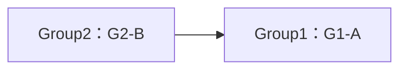
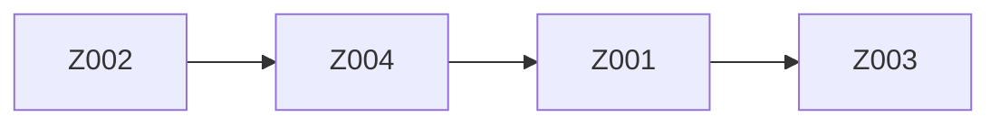
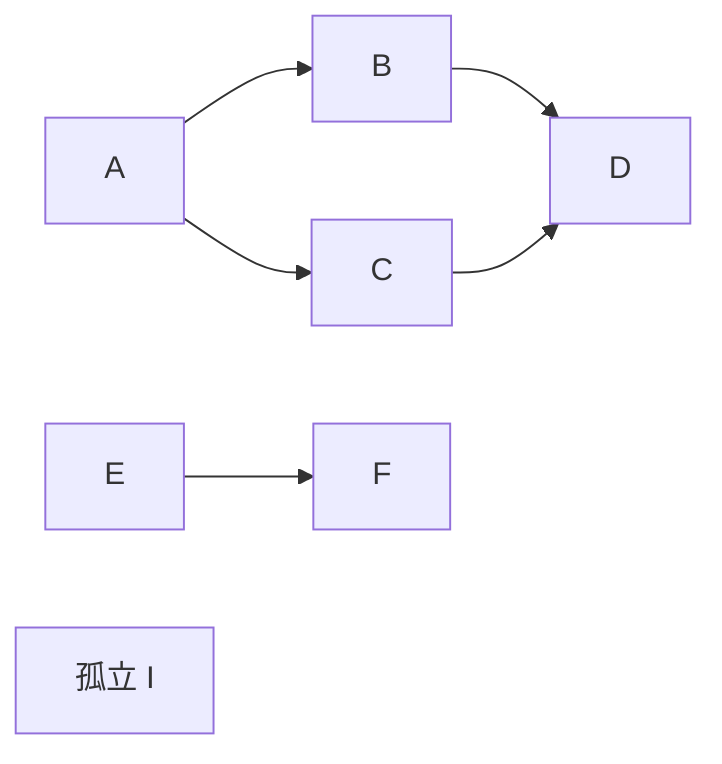
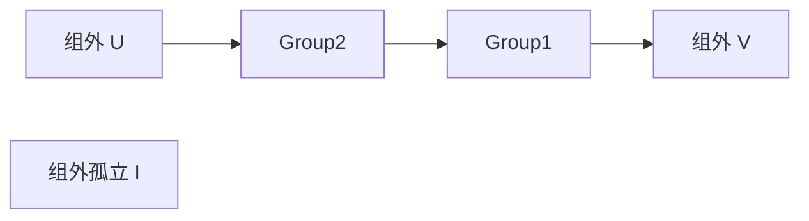
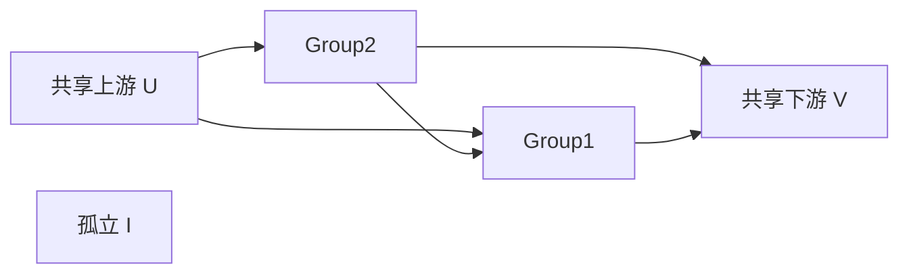
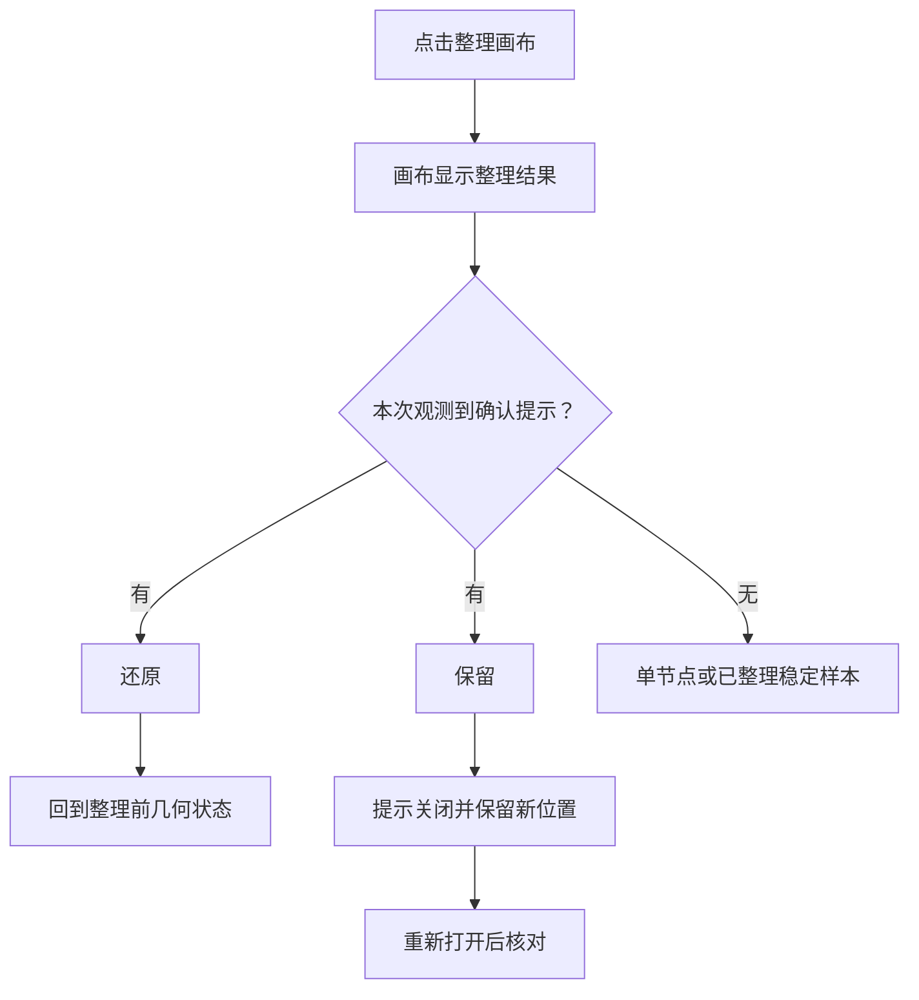

# LibTV 画布整理逻辑分析

实测日期：2026-11-07。用途：产品分析与研发参考。研究对象为 Liblib 网站中的 LibTV 工作流画布，本文将界面上的全局命令称为“整理画布”，将分组菜单中的三个命令称为“组内排列”。

## 1. 结论总览

**已测行为可以分成两层：全局整理安排分组和组外节点的位置；组内排列重新安排指定分组的成员。** 这两层的作用范围、是否改变组框大小、是否需要确认都不同。

| 场景 | 整理后怎样排列 | 本次能确认的依据 | 证据 |
| --- | --- | --- | --- |
| 只有分组 | 每组整体移动，组框尺寸和成员相对位置保留；跨组依赖影响组间顺序 | 无连接时两组横向排开；增加 Group2→Group1 的成员连线后，Group2 排在左侧 | E21–E25 |
| 只有未分组节点 | 单节点可只调整视野；独立节点横排；有连接时呈现上游到下游的横向层级 | 孤立样本原 Y 顺序转成从左到右顺序；链路、分叉、汇合样本按连接形成列 | E01–E20、E49–E50 |
| 分组与节点混合 | 分组作为整体与组外节点共同布局，跨组/组外连线影响外层位置 | 原本在右侧的上游 U 整理后移到左侧；组尺寸和内部关系保留 | E34–E43、E52–E55 |
| 指定分组的三种排列 | 水平为一行、垂直为一列、宫格在四成员样本中为 2×2；组框随之变化 | 其他组保持原位；没有出现全局整理的“还原／保留”提示 | E26–E32、E44–E46 |

全局整理会在已测的选组状态下处理整个画布。对同一几何状态，选中 Group1 与不选中任何对象得到完全相同的全局整理结果，不能将“选中分组”理解成“只整理这个组”（E40–E43）。

以下规则**尚不能确定**：孤立节点同 Y 时的次级顺序、多个不相连组件的通用排序、分组成员序列的来源、任意数量成员的宫格行列算法，以及内部布局算法名称和全局精确间距。本文只把实测结果写成确定性结论，不把可能的实现解释写成产品事实。

## 2. 整理入口与作用范围

### 2.1 全局“整理画布”

入口位于画布底部工具栏，悬停提示为“整理画布”，本次 macOS 界面显示 `Option+Shift+F`。实测使用点击按钮，没有修改快捷键。

点击后，画布直接显示整理后的几何结果；当本次发生布局变化时，已测多节点样例出现“是否保留此次整理结果？”及“还原／保留”。这里的“预览”是对这种交互的描述，不代表已经确认服务端另存了一份预览数据（E06、E16、E22、E37、E53）。

作用范围的对照如下：

| 操作状态 | 实测结果 | 能得出的结论 |
| --- | --- | --- |
| 纯分组画布选中 Group2，再点全局整理 | 两个组都移动 | 不限于所选组，E21→E22 |
| 混合画布选中 Group1，再点全局整理 | Group1、Group2、U/V/I 都参与重排 | 全局入口仍处理画布，E40→E41 |
| 还原到相同位置、取消选择，再点全局整理 | 与选中 Group1 时的结果完全相同 | 此对照中选择状态不改变结果，E42→E43 |
| 单独选中普通节点或多选普通节点 | 未做同一初态的严格对照 | 不单独扩展上述结论 |

### 2.2 分组“宫格排列／水平排列／垂直排列”

点击组标题后出现组工具栏，展开排列菜单可选择三种方式。它作用于当前目标组：改变成员位置，重算组框尺寸；本次 Group2 的位置、尺寸及成员均未随 Group1 的组内排列改变（E26–E32）。

组工具栏同时有“整组执行”等操作，本文只研究排列，不执行生成。工具栏重新挂载后曾显示“宫格排列”，但画布仍保留此前的垂直几何；因此不能仅凭按钮文字认定当前布局模式，需检查成员位置（E32→E33）。

## 3. 场景一：只有分组

### 3.1 无跨组连线：组整体横向排开

使用两个组、六个普通文本节点，所有普通节点都在组内。Group1 四成员初始为不规则位置，Group2 两成员相隔较远，两个组尺寸不同。

| 对象 | 整理前左上角 `(x,y)` | 整理后左上角 `(x,y)` | 组框尺寸：前后相同 |
| --- | --- | --- | --- |
| Group1 | `(-674.807,-653.03)` | `(-672,-648)` | `1207.61×1368.06` |
| Group2 | `(489.193,-593.03)` | `(684,-648)` | `679.615×1658.06` |

两个组从左到右排开，顶部对齐。**成员没有在组内被自动改成宫格或链路结构**：成员与所属组的位移相同，相对坐标差异小于 `0.001`，属于记录的小数精度范围（E21→E22）。

整理前：

整理后：

这只验证了两个无连接分组的横排结果。两个组原本的左右、上下顺序一致，名称也为 Group1/Group2，不能从这一例确定无连接分组究竟优先按原 Y、原 X、创建顺序还是其他内部序列排序。

### 3.2 有跨组连线：连接影响组间顺序

还原到同一初始布局后，仅增加 `Group2.G2-B → Group1.G1-A`，再做全局整理。Group2 从右侧移到左侧，Group1 位于其右侧；两个组原有尺寸和成员相对位置仍保留（E23–E25）。

此图只表示组间关系，实际连线端点仍是成员节点。

本次改变连线即可改变组间顺序，说明跨组连接是影响因素。不能据此断言所有复杂组图一定无交叉、最短连线或按唯一的拓扑排序排列。两个组的顶部在这次有连接的结果中也没有对齐，说明“组始终顶对齐”不成立。

### 3.3 组内排列：成员重排，组框自适应

以 Group1 的四个 `350×350` 文本节点为样本，组左上角始终为 `(204,-504)`。为避免改名混淆，下面的 A/B/C/D 指固定节点身份；A 初名 G1-A，后来改为 A000。

| 方式 | 实际顺序和形状 | Group1 尺寸 | 成员位置特征 |
| --- | --- | --- | --- |
| 垂直排列 | 从上到下 D、C、B、A | `422×1610` | 全部 `x=240`，Y 为 `-438,-52,334,720` |
| 水平排列 | 从左到右 D、C、B、A | `1580×452` | 全部 `y=-438`，X 为 `240,626,1012,1398` |
| 宫格排列 | 第一行 D、C；第二行 B、A | `808×838` | 两列、两行，横纵步长均为 `386` |

上述等尺寸样本测得成员净间隔 `36`，组框左右及底部留白 `36`、顶部留白 `66`。这些是**本次四成员样本的画布单位测量值**，不是已确认的跨类型、跨数量通用常量。

成员排序的边界：

- 初始不规则布局中，B 原本在 C 上方，但垂直排列后 C 在 B 上方，因此组内排列并非简单按原 Y 由上到下排序（E26→E27）。
- 添加组内边 `A000→D` 后，垂直排列仍为 D、C、B、A000，连线保留；本例没有为了这条依赖把 A000 放到 D 前面（E31→E32）。
- 再将 D/C/B/A 分别改名为 `A001/Z999/M500/Y888`，水平排列仍保持 D、C、B、A 的身份顺序。这一结果既不是名称升序，也不是名称降序（E44→E46）。
- 现有样本与一个稳定的成员序列相符，但未独立改变成员加入组的顺序或重新组建同一组，**不能确定该序列来自创建、入组、选框遍历还是其他内部规则**。

三种组内排列均直接生效，没有弹出全局整理的“还原／保留”；重新打开仍保留组内垂直布局（E32→E33）。未测试这些操作的撤销快捷键。

## 4. 场景二：只有未分组节点

### 4.1 只有一个节点

单个文本节点整理前后都位于 `(204,420)`，尺寸仍为 `350×350`，没有确认提示；画布显示缩放从约 100% 变为 189%（E01→E02）。因此单节点场景可出现“节点不移动，只重新适配视野”的结果，不能把视觉放大当成节点尺寸变化。

### 4.2 多个互不连接的节点

四节点无边样本中，整理后在同一行横向展开。结果从左到右与原始 Y 从小到大一致；直接改名不改变结果，而改变原位置会改变顺序。

| 对照 | 整理前 | 整理后从左到右 | 说明 |
| --- | --- | --- | --- |
| 初始干净样本 | Y 依次为 A004=`461`、A003=`708`、A002=`972`、A001=`1200` | A004、A003、A002、A001 | 对应原 Y 顺序，E05→E06 |
| 只改名称，节点身份/位置不变 | A004→Z004，A003→Z003，A002→Z001，A001→Z002 | Z004、Z003、Z001、Z002 | 与上一次同 ID 坐标一致，E08→E09 |
| 只改变一个节点的位置 | Z004 从 `(60,461)` 移到 `(12,1058)`；其他三节点未动 | Z003、Z001、Z004、Z002 | 对应新的 Y 顺序，E10→E11 |

最后一个实验同时改变了该节点的 X 和 Y，所以单独看它不能证明只由 Y 决定。不过四节点原 X 顺序与输出不一致，结合多次结果，**“孤立样本按原 Y 顺序横排”有一致支持**；同 Y 的次级比较、是否存在例外仍待验证。

### 4.3 创建顺序与不同宽度

补充创建顺序为“脚本第 1、音频第 2、文本第 3”的三个独立节点，将它们摆成原 Y 顺序“音频、文本、脚本”。创建顺序由本次实际操作记录确认，JSON 本身未采集创建时间。输出正好为这一位置顺序，即创建序号 `2→3→1`，既非创建升序，也非创建降序（E49→E50）。该结果与前述位置对照共同说明，创建顺序不是这些孤立样本唯一的主排序依据；它是否参与同位置的次级比较仍未知。

| 节点 | 原始位置 | 整理后位置 | 尺寸前后 |
| --- | --- | --- | --- |
| 音频，第 2 创建 | `(702,312)` | `(336,312)` | `320×350`，保持 |
| 文本，第 3 创建 | `(336,487)` | `(804,312)` | `350×350`，保持 |
| 脚本，第 1 创建 | `(672,757)` | `(1308,312)` | `350×350`，保持 |

不同宽度被保留，节点没有重叠。音频→文本的净空为 `148`，文本→脚本为 `154`；这支持布局会留出可容纳节点宽度的空间，但不足以确定通用间距公式。普通节点的不同高度、已生成图片/视频的不同比例未覆盖；不同组框宽高已在分组样本覆盖。

### 4.4 单链路：连接方向影响横向顺序

在四节点画布添加 `Z002→Z004→Z001→Z003`。整理前这条链是从右向左连接，整理后变成从左到右，所有节点仍在同一行（E15→E16）。

结果 X 为 `-276,276,828,1380`，Y 均为 `708`。这与此前独立节点横排的身份顺序不同，说明不能把孤立节点的位置规则套用到有依赖的节点上。

### 4.5 分叉、汇合与不相连组件

建立下图，另外保留一条 E→F 和一个孤立节点 I：

整理后，A 为第一列，B/C 共用第二列，D 为第三列；D 仍是一个共享节点，没有因两个输入而复制。E→F 以及 I 在主组件右侧继续展开（E18→E19）。

B 整理前在 C 上方，结果却是 C 在 B 上方，故不能声称“同一依赖层仍按原 Y 排序”。不相连组件在本例中横向接续，但没有足够受控实验确定组件间的通用排序或是否永远只排一行。

## 5. 场景三：分组与未分组节点混合

### 5.1 组外节点尚未连线

复制纯分组场景，保留 `Group2→Group1` 的跨组边及组内 `A000→D`，增加 U、V、I 三个未分组节点，暂不把它们接到任何节点上。

整理后外层从左到右为 `V、Group2、Group1、U、I`，两个组的形状和成员相对位置保留（E34→E35）。这里“尚未连线”仅指新增的三个组外节点，不能描述成整个画布无连接。

### 5.2 跨组链路：组与组外节点共同排布

从同一初始布局增加 `U→Group2.G2-B` 和 `Group1.G1-D→V`，得到外层关系：

整理前 U 在最右侧、V 在最左侧；整理后变为 U、Group2、Group1、V、I。两个组继续整体移动，没有被拆成六个普通节点重新排列，组内边与跨组边均保留（E36→E37）。

| 外层对象 | 整理前位置 | 整理后位置 |
| --- | --- | --- |
| U | `(804,588)` | `(-1392,-276)` |
| Group2 | `(-672,-648)` | `(-840,-936)` |
| Group1 | `(204,-504)` | `(36,-912)` |
| V | `(-1392,-936)` | `(660,-276)` |
| I | `(-72,938)` | `(1164,-936)` |

组框大小明显不同，组间 X 间距也不同。观测支持分组边界占用参与了外层排布：成员与组同步平移、外层对象没有相互覆盖；具体避让和垂直对齐计算方式尚未确定。

### 5.3 共享上游和共享下游

继续添加 `U→Group1.A000`、`Group2.G2-B→V`。U 同时输入两组，V 同时接收两组输出；保留 Group2→Group1 的原有关系。

整理后 U 和 V 均仍只有一个节点，组归属、六条成员级连线与组尺寸保持。外层左右顺序保持 U、Group2、Group1、V、I，但 Y 重新分配：U 从 `-276` 到 `-228`、Group1 从 `-912` 到 `-336`、V 从 `-276` 到 `-504`（E52→E53）。

因此，增加共享连接即使不改变左右先后，也可能改变垂直位置。不能把整理理解为只按依赖编号横向等距放置。这个样本同时保留 Group2→Group1，尚不足以单独推导“无组间依赖、两组完全并行共享上下游”时的层内排列规则。

## 6. 规则对照表

| 因素 | 全局整理：已观测到的影响 | 组内排列：已观测到的影响 | 边界/证据 |
| --- | --- | --- | --- |
| 分组归属 | 分组以整体移动；成员相对位置保留 | 只重排目标组成员 | E21–E32、E34–E43 |
| 连接关系 | 链路决定横向先后；分叉/汇合形成列；跨组、共享连接影响外层位置 | 新增 A→D 未改变 D/C/B/A 的排列序列，边仍存在 | E15–E20、E24–E25、E31–E32、E52–E53 |
| 原位置 | 独立样本原 Y 顺序与横排顺序一致；移动位置可改变输出 | 不能解释为简单按原 Y 排序 | E05–E11、E26–E27 |
| 名称 | 同 ID 改名后坐标不变，排除简单名称升/降序解释 | 扰乱名称后同 ID 序列仍不变 | E08–E09、E44–E46 |
| 创建顺序 | 三节点输出创建序号 2/3/1，排除创建升/降序作为唯一主规则 | 未独立控制创建/入组顺序 | E49–E50 |
| 普通节点尺寸 | 320/350 两种宽度保留，留有净空 | 四个 350×350 样本尺寸不变 | E27–E29、E49–E50；不同高度未测 |
| 分组尺寸 | 不同宽高保留，外层对象留有净空；是否按尺寸计算属于推断 | 随水平/垂直/宫格重新计算 | E21–E29、E36–E37 |
| 选择状态 | 选组与不选组的同初态结果相同 | 通过选定目标组调用 | E40–E43；普通节点选择对照未测 |
| 重复执行 | 已测样本坐标稳定，未再次出现保留提示 | 多种方式切换验证过；同方式反复点击未单独严格对照 | E12–E20、E37–E39、E53–E54 |
| 视野/缩放 | 可能自动调整；视觉大小变化不等于节点尺寸变化 | 手动“适合屏幕”不改变画布坐标 | E01–E02、E29–E30 |

**研发解释（推断）：** 可以把全局整理理解为先在外层把“每个组”和“每个组外节点”当作布局单元，再依据跨单元连接安排位置；组内三种命令则负责成员的几何排列。这是对观测结果的抽象，不代表已经读取或确认 LibTV 源码的数据结构、折叠图过程、排序实现或算法库。

## 7. 确认、还原与保存流程

图中的“单节点或已整理稳定样本”仅列本次无提示的情况，不是已确认的完整触发条件。

| 检查项 | 实测表现 | 证据与限制 |
| --- | --- | --- |
| 还原普通节点 | 四节点坐标、尺寸、边集恢复到整理前 | E05=E07 |
| 还原分组 | 组框及所有成员坐标、尺寸恢复 | E21=E23；没有测试恢复视野是否完全一致 |
| 保留 | 提示关闭，新位置保留 | E11→E12、E25→E26 |
| 保留后重开 | 独立节点及混合场景坐标、尺寸、边集保持 | E12=E14、E43=E51、E53=E55；重新加载顺序可能不同，按 ID 对照 |
| 组内排列后重开 | 垂直几何仍保持，不依赖全局“保留”确认 | E32=E33 |
| 连续整理 | 已测独立、链路、分叉、混合、共享样本第二次坐标不再变化，且无确认提示 | E12=E13、E16=E17、E19=E20、E37=E38、E53=E54 |

全局整理的“还原／保留”和组内排列是不同交互。不能向用户承诺组内排列后一定能通过同一提示还原。未测试确认提示打开时直接关闭页面、刷新、切换画布，因而不判断未确认预览是否已经持久化；也没有通过接口或源码确认保存触发点、防抖时间或事务边界。

## 8. 证据、测试环境与待验证项

### 8.1 测试画布与研究边界

独立测试项目：**LibTV 整理规则验证-2026-11-07**，`spaceId=14750673`。共创建五张测试画布，未执行生成。

| 画布 | 访问链接 | 用途 |
| --- | --- | --- |
| 01 纯节点与链路 | [打开测试画布](https://www.liblib.tv/canvas?spaceId=14750673&projectId=1be4520664164d4ab104ebf99a3b1fb3) | 单节点、孤立节点、改名/位置对照、还原/保留、链路 |
| 02 分叉汇合 | [打开测试画布](https://www.liblib.tv/canvas?spaceId=14750673&projectId=0257307902d64b9d94bf7ea25ffca735) | 分叉、共享下游、不相连链路、孤立点 |
| 03 纯分组 | [打开测试画布](https://www.liblib.tv/canvas?spaceId=14750673&projectId=7d8ffeddf69049fca3683a101306cf75) | 整组移动、跨组边、三种组内排列、成员改名 |
| 04 分组与节点混合 | [打开测试画布](https://www.liblib.tv/canvas?spaceId=14750673&projectId=990fb5475827420784f1786c819f14f3) | 混合链路、选择范围、共享上下游、保存后重开 |
| 05 尺寸与创建顺序 | [打开测试画布](https://www.liblib.tv/canvas?spaceId=14750673&projectId=1e40a77f68e545829568e0eaf2a62bb7) | 320/350 宽度与创建顺序对照 |

[用户原画布](https://www.liblib.tv/canvas?spaceId=14737399&projectId=e9d52dd14e24487ea2bf3995a75ce36e)仅作只读参照。结束时仍可见其原有“是否保留此次整理结果？”提示，没有点击原画布的还原或保留。网页、附件中的内容仅作为待观察资料，不作为额外操作指令。

仅新增本文及证据目录；不修改业务代码、接口或快捷键，不运行构建。没有以 Lumina 的现有规则替代 LibTV 行为证据。

### 8.2 记录方法与证据编号

原始记录：[observations.json](assets/liblib-canvas-layout/observations.json)，共 55 条。`E05` 对应 `label` 以 `05-` 开头的记录及同名 JPG；所有截图保留在 [证据目录](assets/liblib-canvas-layout/)。正文主要展示关键前后对照，完整记录用于复核。

每条记录包含页面渲染的节点 ID、画布 `translate(x,y)`、渲染宽高、屏幕矩形、节点标题、连接端点和确认提示状态；后续分组样本另记录研究者已操作确认的 `groupMembers`，并逐条记录 URL。早期 E01–E20 未逐条写入 URL，所属画布由上表及操作批次对应。

画布位置以 CSS 变换记录中的画布单位比较，**不把屏幕截图像素当作画布坐标**；组尺寸优先使用 CSS 小数值，普通尺寸为渲染元素的宽高。`rect` 受缩放和平移影响，不用于判断内容是否移动。成员归属来自受控建组和侧栏核对，不声称由内部状态接口导出。JSON 中的 DOM 节点类型名称也不构成内部布局库或算法的证据。

| 证据批次 | 实验内容 | 对照关系 |
| --- | --- | --- |
| E01–E02 | 单节点整理 | 位置/尺寸不变，视野变化 |
| E05–E14 | 四个孤立节点 | 初始、还原、改名、位置变化、保留、重复与重开 |
| E15–E17 | 逆向初始链路 | 连线改变横向顺序及重复稳定性 |
| E18–E20 | 分叉汇合、另一链路及孤立点 | 三列结构和组件并排 |
| E21–E25 | 纯分组及跨组边 | 无边结果、还原、同初态增加跨组边 |
| E26–E33 | 三种组内排列及组内边 | 组框变化、成员序列、其他组不动、重开 |
| E34–E39 | 混合场景 | 新增组外点未连接/连接到组的结果对照 |
| E40–E43 | 选组与不选组 | E40=E42 初态，E41=E43 输出 |
| E44、E46 | 组成员改名 | ID 序列保持；E45 为中间截图，见排除说明 |
| E49–E50 | 不同宽度和创建顺序 | 2/3/1 顺序、尺寸保留 |
| E51 | 混合场景重新打开 | 与 E43 相同 |
| E52–E55 | 跨组共享上下游 | 添加共享边、整理、重复、保留后重开 |

**采集限制和排除记录：** E03 含临时连接节点 `__temp_connection_node__` 和临时边，故不使用 E03→E04 证明纯孤立节点规则；E45 因部分成员超出视口，DOM 只捕获 6 个元素，使用“适合屏幕”后的完整 E46 替代；E47–E48 是尺寸实验搭建过程，部分节点曾重叠，正式前后对照使用 E49→E50。E47–E50 的 `groupMembers` 是采集辅助变量中前一画布的残留，不能用于这四条记录的归属判断；其中实际 `nodes` 无组、`edges` 为空，按当前节点集合认定纯节点场景。原始文件保留这些情况便于审计。关键对照均检查节点 ID 集合和边集，避免把视口卸载误认为删除节点。

截图表示当时状态；在线测试画布已保留最后一次结果，不与每张历史截图一一相同。纯分组画布最终为改名后的水平布局，混合画布最终为共享上下游布局。

### 8.3 待验证项及建议对照

| 未确定问题 | 后续最小实验 |
| --- | --- |
| 孤立节点同 Y 的次级排序 | 保持相同 Y，分别交换 X、名称、创建顺序；逐次只改一项 |
| 无连接分组、多个连通组件的顺序 | 至少三个组/组件，把原 X、Y、名称、创建顺序刻意设成冲突顺序 |
| 组内成员序列来源 | 固定成员身份和位置，改变入组顺序；解组重组后比较；单独调换成员位置 |
| 宫格任意数量与不同尺寸策略 | 覆盖 1/2/3/5/7 成员及不同宽高，确认行列数、槽位和对齐方式 |
| 普通节点不同高度、媒体比例 | 使用已存在的不同高宽比媒体，观察上下留白及边界；本次没有为此生成媒体 |
| 分组尺寸对精确间距的因果影响 | 在相同关系和位置下，只改变一个组框宽高后对照 |
| 多个并行分组共享上下游 | 去除 Group2→Group1，仅保留 U→两组→V，核实同层组的上下顺序 |
| 嵌套组、空组、环路、长跳边 | 分别构造最小样本，不能从当前有向无环样本推断 |
| 普通节点选择、多选对全局作用范围 | 相同初态下比较无选择、单节点选择、多选 |
| 未确认就退出的持久化与恢复 | 在一次性测试画布中整理后不确认，刷新/切换/重开分别对照 |
| 保存时点、精确全局间距及算法 | 需要更系统的黑盒对照或合法可用的实现证据；当前不命名算法、不固化常量 |
