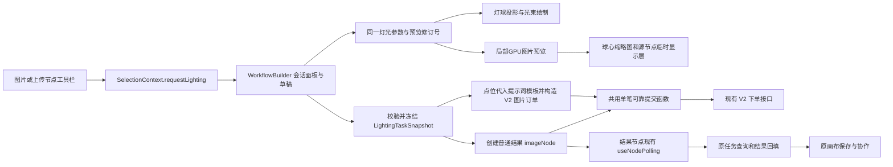
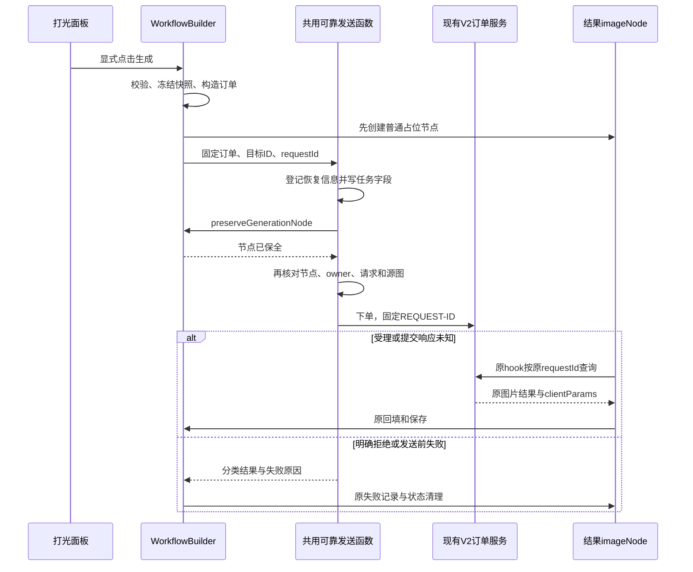

# 打光效果技术方案与实施步骤

版本：v0.6 最终生成链路补充稿（L00～L15逐步实施与验收）｜日期：2026年11月10日｜依据：[# 打光效果 PRD.md](./%23%20打光效果%20PRD.md) v0.5

**开发时从第11节开始。** 第1～10节解释设计，第11节给出按顺序可执行的任务，第12节给出验证范围。当前打光业务尚未实施，步骤均为待办；文档编写、竞品分析完成不等于代码或效果已验收。

## 1. 方案结论与交付边界

在现有画布中增加打光面板，使用普通 `imageNode` 承载结果，通过既有 V2 订单提交，复用图片查询、恢复、协作租约、保存和费用展示。新增代码处理打光参数、可拖动灯球、源图片实时预览、参考资源角色及请求构造。

**本轮需求增补：选择“顶部”等方向或拖动灯点时，灯点、光束、球心缩略图和画布中的当前源图显示必须立即联动，不能只移动球上的光束。** 上一版只有灯位示意与最终生成，缺少图片实时预览链路；本稿第5.4～5.7节补齐。实时预览改变本地显示，点击生成才提交原始源图和参数，生成新的正式结果。

**智能模式与全局配置并用。** 全局配置始终有效；智能开关只决定描述和光影参考是否参与本次任务。关闭智能保留草稿，但隐藏内容不进入请求、有效性判断或本次资源校验。

**最终生成方式已明确：把灯点位置和生效光照参数代入提示词模板，将完整提示词与原始源图一起交给现有图片生成接口。** 具体模板、图片引用绑定及调用顺序见第7.5节；结构化配置仍保存在任务快照中，不再以空 `prompt` 加未确认的 `params.lighting` 作为必需协议。

当前仓库具备通用生图链路，具体模型的打光效果尚待验证。完成前端面板、提示词拼装或接口调用，只能算交互及接入准备；必须通过连续灯位、亮度、颜色、轮廓光、参考角色及主体保留的效果验证，才能交付完整功能。

本方案覆盖单张生成图、上传图、可拖动连续单主光、六向快捷配置、图片实时预览、亮度、颜色、轮廓光、智能描述、一张光影参考、八种完整预设及单张结果。首期不扩展批量、视频、多灯、局部蒙版，也不修改快捷键。用户本轮第二张图中的色温数值及多个发光标记不自动扩大为色温或多灯需求，当前仍沿用 RGB 颜色与单主光加轮廓光。

### 1.1 事实、设计与待确认项

| 分类 | 内容 |
| --- | --- |
| PRD／本轮用户已确定 | 界面并用、默认值、提交条件、完整预设、草稿隔离、固定任务快照、结果独立节点；可拖动灯球、调整方向时图片实时变化 |
| LibTV 本次公开代码已确认 | 灯球直接使用 Three.js r159；射线拾取球面并累加角度变化；松手吸附26方向；球内源图贴在薄盒材质上受点光照明。详见第1.3节，不能将其等同画布大图的实时重打光 |
| 仓库已存在 | V2 下单、同请求标识的有限网络重试、按客户端请求标识查询、普通图片恢复、owner 租约、上传、素材库、费用组件；`canvas-main` 已声明三维渲染相关依赖，但没有打光预览业务实现 |
| 本文提出 | 方向坐标、轨迹球拖动、局部 GPU 图片预览、局部数据类型、可靠提交函数的窄范围提取、点位转提示词、版本化任务快照、能力声明和服务组合策略 |
| 服务尚待确认 | 具体模型及版本、字段映射、0%语义、显式白光、连续方向、全局与智能的冲突规则、参考角色、规格与计费；结构级预览所需法线／主体边界等预处理能力 |

LibTV 的界面结论和截图沿用 PRD 附录A；其请求样本只作为需求证据。本文不复制竞品鉴权信息、项目数据、模型路由或素材地址。本次公开代码已追踪到 `Reference_Image_Intent` 来自智能参考槽；旧请求样本中具体图片的来源仍不能跨部署版本直接认定，详见新增分析文档。

### 1.2 开发规范与实施前评审点

遵守 [开发规范第十三节](./Skills.md#十三开发规范)：沿用现有模块和状态流，不新增打光节点类型、全局状态库、任务管理器、轮询系统、恢复存储或协作锁。

当前 `genImageSingle` 位于图片组件内部，外部面板无法直接调用其中的可靠提交序列。本文建议仅提取单笔订单的登记、节点状态、保全、发送和异常分类，供普通生图与打光共用；不移动普通构参、批量循环或 UI 通知。该项触及原调用关系，应作为 13.2 的实施前冲突评审点：**实施相关代码前，须向用户说明最小提取方案和普通生图回归范围并取得明确同意。** 本次只编写技术文档，无须为此中止文档交付。

### 1.3 LibTV 实际灯球实现与本方案的区别

2026年11月9日读取目标页面引用的公开脚本，沿懒加载关系定位到 `LightScene3D`，确认它直接调用 **Three.js r159**。这项结论来自组件与渲染库之间的实际引用及版本导出，不是根据截图或站点其他功能用了 Three 来推测。完整过程、资源链接和证据定位见 [LibTV灯球交互实现分析](./LibTV灯球交互实现分析.md)。本次仅做静态核查，没有实测拖动或执行生成。

| 项目 | 本次 LibTV 公开代码 | Lumina-Muse 当前方案 |
| --- | --- | --- |
| 三维实现 | React 包裹命令式 Three 场景类，直接创建 `WebGLRenderer` | 复用本仓 Three 相关依赖；是否使用 Fiber 封装是本项目实施选择，不是竞品事实 |
| 拖动 | 鼠标射线与隐藏球体求交，计算方位／仰角增量；灯点和球壳均可起拖 | 第5.4节提出仅灯点起拖、虚拟轨迹球旋转；属于不同的交互设计 |
| 灯位落点 | 拖动中连续显示；松手吸附26方向，之后回调并提交方向枚举 | 按当前 PRD 保留任意连续方向，不能冒充对 Lib 提交行为的原样还原 |
| 轮廓光 | 有可拖动的辅助灯点，限制在后半面；主光为后方时关闭 | 当前范围为开关加固定辅助示意，不自动扩展独立轮廓灯位参数 |
| 球内图片 | 原图纹理贴到薄盒，使用标准受光材质，由点光源照明 | 球心消费第5.5节统一预览帧；与 Lib 的薄盒受光方式不同 |
| 画布源图 | 已检查的组件及上层调用没有输出渲染帧或回写源图预览的链路 | 用户已明确要求源图即时变化，第5.5～5.7节是额外交付能力，仍须实现与验收 |

因此，**“灯球用 Three.js”已确认；“Three.js 自动让照片里猫脸的结构阴影变化”不能成立。** Lib 的球内薄盒受光只拥有盒子的几何法线，照片里人物、猫和商品的立体结构并没有因此被恢复。正式打光仍由原图与参数进入生成接口，前端场景和生成模型各自承担不同职责。

新增证据不改变当前 PRD 的交付范围。连续灯位、源图实时预览、关闭智能后排除隐藏输入等仍是本产品规则；若希望改为完全遵循 Lib 的离散吸附与预览范围，应先修订 PRD，再调整实现，不能在开发时静默降级。

## 2. 现有代码与复用方式

以下 `WB/` 均指 `packages/canvas-main/src/components/WorkflowBuilder/`，位置以当前工作区的符号为准。

| 范围 | 当前实现 | 本次接入 |
| --- | --- | --- |
| 图片工具栏 | `WB/nodes/view/NodeToolbar.tsx` 的 `ToolbarContentProps`、`NodeToolbarProps`；生成图和上传图共用 | 添加可选 `onLighting`，入口放在重绘后 |
| 画布到节点操作 | `WB/contexts/SelectionContext.tsx` 已传递 `requestMediaReplacement` 等操作 | 同一上下文增加可选 `requestLighting(nodeId)`；不把回调塞入持久化 `node.data` |
| 当前图片 | `WB/hooks/useSetMainImage.ts`、`WB/utils/mediaResults.ts` | 从当前 `data.output` 取图，结合当前结果身份区分版本，不使用结果数组第一张 |
| 图片像素 | `WB/utils/dataUtils.ts` 的 `getImageDimensions` | 获取自然尺寸；画布节点宽高及 `getConstrainedImageDimensions` 仅作显示尺寸 |
| 浮层 | `WB/nodes/view/NodeInputPanel.tsx`、`WB/ui/DirectorDeskOverlay.tsx` | 复用 Portal 和事件隔离方式，面板位于画布变换层外 |
| 上传 | `packages/core/src/api/modules/upload.ts` 的 `uploadFile` | 复用上传与进度回调，打光维护自己的单参考槽 |
| 素材库 | `WB/ui/ScriptAssetCreateModal.tsx` 的嵌入式 `AssetLibraryPanel` 选择方式 | 选择图片后回填参考槽；不使用带画布连线语义的 `ReferencePickButton` |
| 普通构参 | `WB/utils/imageGeneration.ts` 的 `buildImageGenerationOrder` | 普通生图不变；打光另加纯构造器，输入为已冻结快照，避免混入当前上游内容 |
| 可靠下单 | `WB/nodes/ImageNodeWithBaseNode.tsx` 的 `genImageSingle` | 窄范围提取单笔可靠发送序列，批次控制仍留在原入口 |
| 发送与拒绝分类 | `WB/utils/generationOrder.ts` 的 `submitGenerationOrder` | 原样调用；明确业务拒绝与网络响应未知分开处理 |
| 轮询和回填 | `WB/hooks/useNodePolling.ts` | 结果 `imageNode` 自己查询和回填，保留原结果去重、历史、余额和倒计时能力 |
| 恢复 | `WB/utils/generationRecovery.ts`、`WorkflowBuilder.tsx` 的 `preserveGenerationNode` | 请求前登记标识并保全新节点；刷新走原恢复流程 |
| 协作 | `WB/hooks/useGenerationCollaborationLease.ts`、现有协作 Context | 复用 owner、30秒租约及接管；不加打光专用锁 |
| 节点与位置 | `WB/utils/nodeUtils.ts` 的 `createNodeConfig`、`findAvailableNodePosition`、`createEdgeConfig` | 创建源图右侧普通结果节点和来源连线，沿用避让、分组和保存规则 |
| 费用 | `WB/utils/costEstimate.ts`、`WB/nodes/view/GenerationCostEstimate.tsx` | 费用由实际打光模型与规格构造；复用权限、开关、占位和金额格式化 |

旧重绘流程不能作为任务生命周期模板：它使用 `imageRedrawNode`，不在当前普通图片恢复白名单内。打光不新增或复制该类节点。

## 3. 组件、状态与数据流



### 3.1 面板归属

由 `WorkflowBuilder` 持有唯一的当前打光会话及会话内草稿 Map。可将这些局部操作封装为 `hooks/useLightingPanel.ts`，不增加全局 store 或新的 Context。

- `requestLighting(nodeId)` 从最新节点读取当前图片，校验单选、媒体类型、有效输出及现有操作权限，再打开相应草稿。
- `LightingPanel` 为受控面板，接收草稿、源图状态、能力状态、估价状态及回调。
- `LightingSphere` 为受控灯位组件，输出单位方向，绘制灯点、透明球壳、图片平面与光锥；球内图片使用统一预览纹理，不上传图片、不修改节点、不提交订单。
- `useLightingPreview` 在当前页面会话内管理图片纹理、预览修订号和 GPU 资源，向球心与源图临时显示层输出同一帧像素结果；两处不各自计算一套灯光。不同 WebGL 上下文各自持有纹理，不能跨上下文共享同一个纹理对象，传递路径见第5.5节。
- 面板提交调用 `WorkflowBuilder` 中的显式命令；组件挂载、参数变化、远端同步和页面恢复均不得触发下单。

浮层固定在浏览器视口底部并留边距，最大宽高受可视区域约束。窄窗口改为纵向布局，内容区滚动，标题和提交区保持可达。沿用 `nodrag nopan nowheel`、编辑输入标识与事件隔离，避免滚轮、拖动、文字编辑穿透画布。关闭只关闭编辑面板，不取消已提交任务，不改原快捷键映射。

### 3.2 状态分开保存

| 状态 | 存放位置 | 保存规则 |
| --- | --- | --- |
| 未提交草稿 | `WorkflowBuilder` 会话 Map | 同页面关闭再开恢复；按项目、源节点及图片版本隔离；切换项目或卸载时释放 |
| 上传及交互瞬态 | 面板会话状态 | 文件、进度、错误、异步操作标识、拖动和观察视角不进入共享节点 |
| 实时预览瞬态 | 当前打光会话内预览控制器 | 源纹理、预览纹理、GPU对象、动画帧、原始输入图和修订号不进入节点保存或协作；关闭停止渲染并恢复原图 |
| 已提交任务快照 | 结果节点 `data.lightingTask`，并写入订单 `clientParams.lightingTask` | 纯 JSON、带版本、提交后不可变，随原画布和结果详情保存 |

未提交草稿不要求刷新恢复，不写 `localStorage`、新的恢复表或源节点 `data`。当前持久化基本保留业务字段，协作按整个节点合并；每帧把灯位写入源节点会产生无必要的脏状态和协作冲突。

## 4. 数据结构与源图身份

以下类型是新增业务数据的设计稿，最终字段名在实施评审确定。

阅读方式：`type` 表示“一组数据长什么样”；`string` 是文字，`number` 是数字，`boolean` 是开关（`true`开启、`false`关闭）；字段名后的 `?` 表示可以不提供。`A | B` 表示二选一，`Pick` 表示沿用另一组数据中列出的几个字段。下面每行 `//` 后面的中文只是解释，不会作为业务数据提交。

```ts
// 主灯方向：表示灯在图片的哪一侧；三个数合起来只表达方向，不表达距离。
type LightDirection = {
  x: number; // 左右分量：正数偏右，负数偏左，0表示没有左右偏移。
  y: number; // 上下分量：正数偏上，负数偏下；顶光是(0,1,0)。
  z: number; // 前后分量：正数在主体前方、朝观察者，负数在主体后方。
};

// 灯光颜色：明确告诉服务“使用什么颜色的灯”。
type LightColor = {
  mode: 'explicit'; // explicit表示明确指定颜色；白色也要明确传，不能当作没选颜色。
  hex: string; // 颜色代码，例如#ffffff是白色、#2d34fa是蓝色。
};

// 源图信息：这次究竟给哪张图片打光。
type LightingSource = {
  projectId: string; // 图片属于哪个画布项目，用于项目隔离和权限检查。
  nodeId: string; // 图片所在节点的编号，用于找到画布上的源节点。
  sourceKey: string; // 当前页面查找草稿的唯一键，区分项目、节点和具体图片版本。
  sourceVersion: string; // 具体是哪一版图片；同节点换了一张图，不能继续串用旧配置。
  url: string; // 原始源图的可访问地址，不是实时预览截图的地址。
  naturalWidth: number; // 原始图片宽度，单位像素；不是节点在画布上显示多宽。
  naturalHeight: number; // 原始图片高度，单位像素；用于保持原图比例。
  assetId?: string; // 如果图片来自素材库，填真实素材编号；没有就不填。
};

// 已经可以使用的光影参考图：只借鉴光照，不替换源图里的人或物。
type ReadyLightReference = {
  url: string; // 参考图片的可访问地址，上传或解析完成后才能使用。
  source: 'upload' | 'library' | 'preset'; // 参考来源：本地上传／素材库选择／预设自带。
  assetId?: string; // 参考图有真实素材库编号时才填写，不用节点或生成结果编号冒充。
  naturalWidth: number; // 参考图片原始宽度，单位像素，用于图片有效性和规格检查。
  naturalHeight: number; // 参考图片原始高度，单位像素。
};

// 本次真正生效的打光配置：生成任务只使用这些已经确认的值。
type LightingSettings = {
  keyLight: LightDirection; // 主灯方向；六向按钮、灯球和订单共用这一份值。
  intensity: number; // 灯光强度，0～100的整数，对应界面的亮度百分比。
  color: LightColor; // 灯光颜色，例如白光、蓝光或暖色光。
  rimLight: boolean; // 是否开启轮廓光，让主体边缘更容易与背景区分。
  smartEnabled: boolean; // 是否使用智能附加输入；关闭时仍保留全局灯光控制。
  description?: string; // 光效文字描述；仅智能开启且去掉两端空格后仍有内容时提供。
  lightReference?: ReadyLightReference; // 光影参考图；仅智能开启且图片已就绪时提供。
};

// 编辑草稿：记录用户在面板里正在调整、但还没正式提交的内容。
type LightingDraft = {
  // 全局四项设置，直接沿用LightingSettings的字段定义，智能关闭时也继续生效。
  global: Pick<LightingSettings,
    'keyLight' | 'intensity' | 'color' | 'rimLight'>;
  smartEnabled: boolean; // 面板里的智能开关；控制描述和参考图是否参与本次生成。
  smartDescription: string; // 正在编辑的描述原文；关闭智能后保留，重新打开可继续编辑。
  reference: // 参考槽当前状态，下面四种情况只能处于其中一种。
    | {
        status: 'empty'; // 没有选择参考图。
      }
    | {
        status: 'loading'; // 正在上传或读取参考图；智能开启时要等待完成才能提交。
        operationId: number; // 这次资源操作的编号，用于忽略被替换的旧操作回调。
      }
    | {
        status: 'failed'; // 上传或解析失败，需要重试、替换或移除。
        operationId: number; // 失败的是哪一次操作，避免把旧错误显示到新参考图上。
        message: string; // 给用户看的失败原因，例如“图片上传失败，请重试”。
      }
    | {
        status: 'ready'; // 参考图已经准备好，可以预览和提交。
        value: ReadyLightReference; // 该参考图的地址、来源、尺寸等完整信息。
      };
  selectedPresetId?: string; // 当前选中的预设编号；手动改动生效设置后清除选中态。
  view: 'perspective' | 'front'; // 灯球观察视角：斜着看／正面看；不改变实际光向。
};

// 已提交快照：相当于下单时的“配置留底”，后续修改面板不改变这一单。
type LightingTaskSnapshot = {
  schemaVersion: 1; // 这份快照的数据格式版本，方便以后识别格式；不是模型版本。
  requestId: string; // 本次下单的唯一编号，与HTTP的REQUEST-ID一致；超时重试不换号。
  source: LightingSource; // 下单时固定的原始源图信息，之后换主图也不改这一单。
  settings: LightingSettings; // 下单时实际使用的灯光和智能配置，不包含被隐藏的智能草稿。
  model: { // 使用哪个生成模型，三个字段一起确定实际服务。
    name: string; // 模型的服务名称，用于后台路由，不是界面展示标题。
    version: string; // 模型版本，用于区分同一模型的不同能力或效果。
    type: number; // 生成结果的媒体类型；本功能是图片，沿用项目图片类型常量。
  };
  output: { // 希望正式生成的图片规格，与低清实时预览规格分开。
    width: number; // 输出图片宽度，单位像素。
    height: number; // 输出图片高度，单位像素。
    resolution?: string; // 服务使用的分辨率档位，例如1K；模型需要时才提供。
  };
  preset?: { // 记录用了哪套预设，仅用于追溯；实际生成仍看settings里的明确参数。
    id: string; // 预设编号，例如blue-backlight（蓝色逆光）。
    version: number; // 预设配置版本，便于区分调参前后的同名预设。
  };
  seed?: number; // 随机种子；模型支持时记录，配合同源图和同参数用于尽量复现结果。
};
```

容易混淆的区别：`sourceKey` 是页面查草稿的“抽屉标签”，`sourceVersion` 是图片版本的“身份证”，`requestId` 是本次生成订单的“流水号”。同一张图可以产生多次生成，每次有不同流水号；同一笔订单因网络问题重试，仍使用原流水号。`schemaVersion` 管数据格式，`model.version` 管生成模型，`preset.version` 管预设配置，三者不能混用。

上传重试所需的 `File` 等信息存放会话瞬态，不放进 `LightingDraft` 的可序列化部分或任务快照。快照只保留本次实际生效的配置；智能关闭时不携带隐藏描述、参考图或预设来源。

数值／颜色输入另在会话控件状态中保留原始字符串和解析错误；只有解析通过才更新合法草稿。提交校验同时接收控件错误，不能在输入空值、非法值或越界时仍沿用上次合法值放行，也不能把空串转成0。该状态与上传操作均由页面内 `useLightingPanel` 持有，面板卸载不使校验状态丢失。

### 4.1 确认当前图片版本

下表解释当前项目中用于“找到正在操作的那张图”的字段：

| 字段 | 通俗说明 |
| --- | --- |
| `data.output` | 节点当前展示的图片地址；用户切换主图后它会变化 |
| `currentImageResultKey` | 当前选中的那条结果的标记；两条结果即使地址相同，也能区分 |
| `resultId` | 服务端给一条生成结果分配的编号，不是素材编号 |
| `orderId` | 服务端订单编号；与前端生成的 `requestId` 不是同一个编号 |
| `outputArray` | 节点的历史结果集合，可能包含多批生成；第一项不一定是当前展示图 |

1. 图片地址必须取当前 `data.output`；先用 `getMediaResultGroups` 兼容历史二维数组、字符串及只有输出的旧节点。
2. 有明确当前结果时，使用结果 `resultId`，其次使用可唯一定位该结果的请求／资源身份，并结合当前媒体身份构成 `sourceVersion`。`sourceKey` 使用 `JSON.stringify([projectId, nodeId, sourceVersion])`，避免字符串拼接碰撞。
3. 当前图片若唯一匹配历史结果，可据此确定身份；同 URL 对应多个批次时不能选第一条。需在原主图／堆叠结果选择回调补充可选的当前结果标记，例如 `currentImageResultKey`，选择同 URL 的另一结果也更新该标记。轮询切换新主图时同步更新；普通上传替换时清除旧结果标记。
4. 旧图没有结果身份时，完整 URL 可作为本页面会话回退。不得移除签名参数后合并 URL；服务若允许原址覆盖内容，必须另提供资源版本。存在多条结果但无法确认当前条目时，提示重新选择结果后打开，不猜测来源。
5. 图片自然尺寸优先读取可信资源元数据，否则通过 `getImageDimensions(url)` 获取。节点显示宽高、手动 resize 尺寸和历史受约束显示尺寸不能充当原始像素。

源图解析完成前禁用提交。打开期间源节点被删除、主图切换或资源被替换，原会话停止提交并重新绑定当前源图对应的草稿；旧异步结果不能写入新会话。

提交冻结后，任务只使用快照中的源图。后续切换主图不会改变订单，也不会使返回结果覆盖新主图。发送前仍检查源节点和版本有效；不一致时停止本次未发送请求，绝不静默替换源图。

## 5. 灯位、参数与有效性

### 5.1 统一方向约定

使用面对图片的观察者坐标系：`+x` 向右，`+y` 向上，`+z` 从主体指向观察者。方向表示**主体指向主光源的位置方向**，不是光线传播方向；服务如使用相反方向，由适配层统一取反。

| 快捷方向 | 单位向量 `(x, y, z)` |
| --- | --- |
| 左侧 | `(-1, 0, 0)` |
| 顶部 | `(0, 1, 0)` |
| 右侧 | `(1, 0, 0)` |
| 前方（默认） | `(0, 0, 1)` |
| 底部 | `(0, -1, 0)` |
| 后方 | `(0, 0, -1)` |

连续方向以方位角 `a`、仰角 `e` 计算：

```text
// a是方位角：灯围绕主体左右转了多少；0表示正前方，π/2表示右侧。
// e是仰角：灯比主体高或低多少；正数在上方，负数在下方。
// sin/cos是把角度换成方向分量的计算函数；π弧度相当于180度。
x = cos(e) * sin(a)  // 算出左右方向分量。
y = sin(e)           // 算出上下方向分量。
z = cos(e) * cos(a)  // 算出前后方向分量。
a ∈ [-π, π)，e ∈ [-π/2, π/2] // 方位角可绕一圈，仰角范围为正下方到正上方。
```

以一个单位向量作为草稿、快捷按钮、示意图和任务快照的唯一灯位值。角度用于拖动计算及第7.5节提示词转换，不再持久化第二套灯位枚举。拒绝非有限值和零向量，计算后规范化，快照保留数值精度，不量化成六方向。

**前后半球操作**：采用第5.4节的相机空间虚拟轨迹球增量旋转，支持连续或多次拖动到前后半球。控制点在远侧也使用可拾取的空心／虚线标记，不能只用射线与球体的最近交点，否则灯位会被锁在可见半球。用户也可点“后方”后继续拖动。

透视／正面通过不同固定相机显示同一向量，视图变化不反写实际方向。三维场景和图片像素渲染职责分开：场景负责灯球及光束，图片预览负责受光明暗；普通照片贴在平面上不会自动获得照片内容的三维几何。渲染方案见第5.4～5.7节，替代上一版仅用 SVG 示意的范围。

标准方向显示容差建议为 `0.5°`：落在容差内显示相应快捷方向，否则显示“自定义”。该容差只决定标签，不暗中吸附或改写方向；点击快捷按钮才写入精确轴向量。有效变化另用角距离 `1e-4 rad` 容差排除浮点噪声，不能与显示容差混用。上述交互灵敏度与容差纳入 UI 评审和测试。

### 5.2 参数规范化

- 亮度：整数 `0～100`，默认 `50`。空输入、非法数值和越界在控件旁提示，不静默夹到有效值；`0` 是有效值，不能用 `value || 50` 回退。
- 颜色：规范化为小写 `#rrggbb`，默认 `{ mode: 'explicit', hex: '#ffffff' }`。首期没有“未指定”入口，白色必须显式发送，不能因等于默认颜色而省略。与服务“未指定”的区别须联调确认。
- 轮廓光：默认 `false`，任务快照明确保留布尔值；关闭时不拼接开启轮廓光的分句。
- 描述：提交时 `trim`，空白视为空；仅智能开启时加入模板。拼装完成后，对整个 `params.prompt` 复用既有 `parsePromptLimit`、`assertPromptWithinLimit` 校验，模板和图片引用文字均计入长度；不能只检查智能描述，也不能把参考图名称或预设名称自动补成描述。
- 参考：智能开启时，选中资源必须处于 `ready`；加载／失败均阻止提交，用户可重试、替换或移除。智能关闭则忽略隐藏参考的加载／失败状态。

建议服务语义为“0%不新增主光贡献，其他生效控制仍可作用”，不等于整图变黑；这仍是待验证建议。模型若无法实现，先固定经验证的定义并评审 PRD，不能由前端数值假装实现。

### 5.3 有效变化与统一提交校验

增加功能内纯函数 `getEffectiveLightingSettings(draft)` 和 `validateLightingSubmission(...)`，面板按钮、点击提交及测试共用，避免各自实现条件。

```text
// 以下变量都是判断结果：true表示条件满足，false表示不满足。
// &&表示“都要满足”，||表示“至少满足一个”；trim表示去掉文字两端空格。
globalChanged = 与前方、50%、显式白色、轮廓光关闭的基准比较 // 全局光效是否真正改过。
smartHasInput = smartEnabled && (trim(description) 非空 || reference ready) // 智能开启且有有效描述或已就绪参考图。
hasEffectiveChange = globalChanged || smartHasInput // 本次是否存在真正会影响光效的输入。
// canSubmit表示现在是否允许生成；不是“费用是否估算成功”。
canSubmit = 有效源图 && 参数合法 && hasEffectiveChange
            && 智能开启时参考非 loading/failed
            && 已验证服务能力可用 && 原权限允许 && 非提交中
```

观察视角、智能开关、预设选中标记不参与有效变化。有效配置成功生成后仍可再次提交，不拿“上一次已提交配置”当禁用基准。关闭智能的请求完全排除智能输入；不能只隐藏控件却继续校验或发送隐藏资源。

重置保留智能开关，恢复四项全局基准，清空描述、参考和预设选中态，同时使旧参考操作失效；视图是否保留不影响提交，建议回到默认透视。

### 5.4 可拖动灯球：场景、拾取与坐标计算

**场景组成**：球心 `O=(0,0,0)`；源图放在球心的图片平面，保持原比例；外层半透明球壳；主灯控制点位于 `P=R×d`，其中 `d` 是唯一单位方向，`R` 是固定交互半径。光锥顶点是 `P`，轴向始终朝 `O-P`，透明度和颜色对应当前亮度及灯色；球壳、光锥是视觉辅助，不被当作真实照片的几何。

这里 `O` 是球心位置，`P` 是灯点位置，`R` 是球的交互半径，`d` 是灯的方向；`R×d` 就是“沿这个方向走到球面上”。`O-P` 表示“从灯点朝球心照”。这些是控制器里的坐标，不是照片中人物的真实空间坐标或米数。

图片平面不随灯移动，不因灯位变更改变透视或构图。轮廓光可显示固定辅助光束，但不新增可独立编辑的第二主灯。

`packages/canvas-main/package.json` 已声明 `three`、`@react-three/fiber`、`@react-three/drei`，可在功能内按需加载实现三维场景，无须为灯球另装一个框架。这里确认的是仓库依赖事实，尚不存在可直接调用的打光场景组件。下述算法使用通用坐标计算，不绑定某个库版本的 API。

**竞品对照**：LibTV 也确实使用 Three，但其实现为直接管理场景、射线球面角度增量和松手26点吸附。下文轨迹球、远侧命中区及不吸附的连续方向是为当前 PRD 提出的实现，不能标成 Lib 原算法；无需为了复刻竞品版本而将本仓 Three 降到 r159。

**拾取与拖动步骤**：

1. 用当前相机矩阵把灯位置 `P` 投影到屏幕，在投影位置叠加 DOM/SVG 控制点及至少44px的透明命中区；显示点和命中区分离，远侧点依然可选。
2. `pointerdown` 只在灯点命中区启动拖动，记录当前方向、指针及相机旋转，捕获该指针并阻止画布拖动。拖球壳不自动变更灯位，避免误触。
3. 将指针坐标相对灯球显示矩形转换为相机空间的虚拟轨迹球坐标，屏幕向下先转换成 `+y` 向上。按下时依据灯点实际朝向相机的近／远侧确定映射分支 `h=+1/-1`，远侧使用负的虚拟球深度，不能仍按正半球计算，否则精确后方灯点向右拖会反向。每次移动求上一位置到当前位置的旋转，而非每次重新取球体近侧交点。
4. 将相机空间增量旋转变换回图片坐标，再作用到旧方向，归一化后调用统一 `setLightingDirection`。该方法不会把“顶光”卡在球坐标的方位角奇点。指针拖出虚拟圆周后进入连续轨道旋转，按相机水平／垂直轴和指针增量继续计算；以进入时当前方向为起点，直到抬手前不切回球面拾取，允许绕过边缘进入另一半球。重按灯点时重新确定近／远分支，不能将远侧瞬间吸到近侧。
5. `pointerup`、`pointercancel`、失去捕获时终止当前手势，保留最后合法方向，清理拖动状态。拖出组件边缘仍可以结束手势；会话关闭必须释放捕获。

```text
// pointer是当前鼠标／触摸点；h是当前拾取的半球：近侧+1，远侧-1。
// center是灯球在屏幕上的中心；radius是屏幕上的半径，单位均为像素。
mapTrackball(pointer, h):
  x = (pointer.x - center.x) / radius // 鼠标相对球心偏左或偏右多少，换成与球大小无关的数值。
  y = (center.y - pointer.y) / radius // 相对球心偏上或偏下多少；这里翻转屏幕向下的坐标。
  // v是映射到虚拟球面上的位置；sqrt是开平方，用来补出前后深度。
  若 x²+y² <= 1：v = (x, y, h * sqrt(1-x²-y²))
  否则：切换为以当前方向为锚点的连续轨道旋转

球面映射阶段的 pointermove：
  // vPrevious/vCurrent分别是上一次和这一次映射的球面位置。
  qDeltaCamera = rotationBetween(vPrevious, vCurrent) // 算出从上次到这次转了多少。
  // Q把观察视角里的方向换算回图片自身方向；inverse(Q)表示反向换算。
  qDeltaImage = Q * qDeltaCamera * inverse(Q) // 得到在图片坐标里应执行的旋转。
  // dPrevious是原灯向，rotate应用旋转，normalize把方向向量长度统一为1；灯点距离另由R决定。
  dNext = normalize(rotate(qDeltaImage, dPrevious)) // 得到拖动后的新灯向。
  setLightingDirection(dNext) // 统一更新灯点、按钮状态和图片预览。
```

`rotationBetween` 对近似相同向量返回单位旋转，对接近反向向量选稳定的正交轴，避免零叉积造成 NaN。连续轨道阶段按已记录的相机轴组合增量旋转，使用进入时的屏幕切向确定旋转符号；不在轮廓线附近每帧翻转近／远分支。方向始终连续，但越过球面投影边缘后控制点仍受投影范围限制，不要求与鼠标在球外的位置重合。重按精确后方灯点向右拖时，其屏幕投影必须先向右，此项单独验收。

正面视图相机位于图片正前方，透视视图使用固定斜前方相机。切视图只更新相机、投影和手势变换矩阵，不能更改 `d`，也不能让源图预览的实际光向跟相机旋转。切相机或灯球显示尺寸改变时，先结束当前拖动并释放捕获，再更新矩阵／显示矩形；下一次按下重新采样，避免混用旧指针基准与新相机造成灯位跳变。

### 5.5 选择顶光后，图片如何立即变化

统一入口 `setLightingDirection` 供六向按钮和灯球拖动共同使用。点击“顶部”的完整链路是：

```text
顶部按钮 → d=(0,1,0) → 更新同一份全局草稿和 previewRevision
         → 下一动画帧移动灯点到球顶、光锥转向球心
         → 用同一方向重绘图片预览
         → 球心缩略图与画布源节点临时显示层同时更新
         → 不上传、不下单、不替换源图URL

点击生成 → 冻结同一个d和其余生效参数
         → 原始源图 + 打光参数 → 既有V2任务 → 新结果imageNode
```

亮度、RGB颜色、轮廓光和预设全局部分也进入同一个预览更新入口。每帧只渲染最新合法参数；不能把每次指针移动写入 React Flow 节点或创建订单。输入非法时保留最后合法预览并展示错误，提交仍禁用。

**源图显示接入**：在生成图及上传图现有图片视图上增加仅当前会话生效的预览覆盖层，尺寸与实际图片内容矩形一致，并保留原图作为底层。沿用 `SelectionContext` 可选字段／回调传递当前 `sourceKey` 与预览表面，不把 Canvas、纹理或临时 data URL 写入 `node.data`。预览字段需使用当前节点的定向订阅／回调，逐帧绘制留在局部 Canvas，不能逐帧更新整个 Context value 引发所有节点重绘。

只有节点ID、图片版本和当前会话都匹配时显示预览。源节点和球心消费同一帧像素及 `previewRevision`，不是两套参数或两个独立计算结果。关闭打光或切换源图立即撤掉覆盖层；恢复原图的行为不写历史、不触发协作保存。重新打开按保存草稿重建预览。

**像素传递采用明确的单次计算路径**：一个会话内的离屏预览画布负责计算最终预览帧；渲染完成后，在同一次帧调度中将该帧复制到源节点覆盖 Canvas，并标记球心图片在其渲染上下文中的纹理更新。球心持有本上下文纹理并从该帧画布上传，不能拿另一上下文的 GPU 纹理直接引用，也不能把同一个 Canvas DOM 同时挂到两个位置。源图／球心记录所消费的修订号，迟到帧忽略；不逐帧转为 PNG、data URL 或上传资源。复制和纹理上传开销纳入第5.7节的性能实测，关闭时一起释放。

### 5.6 图片预览算法：先明确所需效果等级

本节术语：**纹理**是交给绘图程序读取的图片；**像素着色器**是对每个像素快速计算颜色的小程序；**GPU**是电脑负责快速绘图的部件；**UV**是图片内部的位置坐标。**线性RGB**是适合做光照计算的颜色数值，计算完再转换成屏幕显示颜色，避免把图片错误地算得过亮或过暗。

| 层次 | 能做到什么 | 如何实现／依赖 |
| --- | --- | --- |
| 必做：即时图片近似预览 | 顶光时图片上部受光更明显，左右光改变对应明暗分布，亮度与颜色即时变化 | 原图纹理＋图像空间光照场／自定义像素着色，不需要每帧请求服务；它属于近似效果，不能保证正确的人脸或物体阴影 |
| 结构增强预览 | 猫脸、人物、商品不同表面依据朝向产生不同受光，轮廓遵循主体边界 | 对同源版本预处理得到法线图、主体 mask，按需增加深度；仓库当前没有这项模型／服务能力，须补契约并验证 |
| 正式生成 | 形成可保存的打光结果，处理复杂阴影、原始照明和智能氛围 | 原始源图＋同一份参数，调用确认后的打光模型；由既有订单链路处理 |

首期图片实时变化至少交付第一层，灯球能拖但图片不变不算完成。若验收要求“拖动时人物／猫的结构阴影也准确改变”，第二层或等效的实时模型能力就是交付门槛，不能用一层方向渐变冒充。用户截图可说明想要的交互形态，不能仅据截图判断竞品使用了法线、三维场景或某种生成算法。

本次公开代码核查已能确认 Lib 灯球使用三维场景，但球内照片实际采用薄盒加标准受光材质，不是下文A的图像方向场，也未在该组件中使用B的照片法线／主体边界。第1.3节及独立分析文档记录了证据边界；A／B仍属于本项目满足源图预览要求的候选方案。

**A. 即时图片近似预览的具体实现**

源图首次打开时解码为纹理，建立一个与图片等比例的预览渲染目标。像素着色器从原图采样，再依据方向、强度、色彩和像素位置计算明暗／色彩调制；参数变化只更新少量数值，不重新上传或解码原图。

图片坐标采用 `u∈[0,1]` 从左到右、`v∈[0,1]` 从上到下，先得到 `q=(2u-1,1-2v)`。方向场的核心示例为：

```text
// u/v是图片内部的左右／上下位置，范围0～1；v=0在图片顶部。
// q把图片位置换成以中心为0的坐标；d是主灯方向。
// directionalField/field表示该位置按灯向应当更亮还是更暗的相对分布。
directionalField(q,d) = d.x * q.x + d.y * q.y
顶光 d=(0,1,0)：field = 1-2v，图片上方大、下方小
底光 d=(0,-1,0)：field = 2v-1，分布反转
左光 d=(-1,0,0)：field = 1-2u，左侧大、右侧小

lightField = 调整directionalField，并组合d.z、柔化范围和经标定的强度 // 最终使用的近似明暗分布。
gain / tint = 从lightField、intensity、color计算 // gain是提亮／压暗倍数，tint是灯光带来的染色量。
previewLinear = 调制原图的线性RGB，并限制增益范围以保留细节 // 计算中的预览像素，避免亮部全白、暗部全黑。
preview = 转回显示色彩空间 // 最终可以展示给用户的预览画面。
```

这段公式说明光位如何变成每像素变化，不是底层物理模型；增益、正／后光、0%与默认50%的响应曲线，必须与已确认服务定义共同标定。以重置配置作为视觉基准，基准状态显示原图；其他参数按同一基准计算差值，不允许拖动一步就突然套上另一套整体曝光。显式白色只改变光照，不额外染色。

画布容器使用 `contain` 时须先算出图片内容矩形，不能把黑边、留白或节点边框纳入 UV；GPU纹理的上下方向也要统一转换一次，避免顶光变底光。源图与预览具有同一纵横比和裁切方式。

单靠图像方向场无法从照片恢复真实深度，也不能得到发丝透光或物体投影。后方光及主体轮廓的准确预览需要下面的结构数据；缺少时保留原图及明确的近似提示，不能把图片矩形边框发亮当作主体轮廓光。

**B. 法线／主体边界增强的具体实现**

对每个源图版本只做一次图像分析，返回与原图对齐的法线 `N(u,v)`、主体 mask；深度与底色／原始照明估计按效果需要增加。预处理缓存键包含源版本和分析模型版本，资源就绪后拖动只在本地计算：

```text
// N(u,v)是这个像素对应表面的朝向，例如脸颊朝左还是朝右；不是像素颜色。
L = normalize(d) // L是规范化后的灯向，与灯球、订单共用同一图片坐标。
// dot计算表面是否朝向灯；max(...,0)让背对灯的表面不产生负亮度。
diffuse = max(dot(N(u,v), L), 0) // 表面朝向主灯时能获得多少直接光照。
// mask标出主体范围；掠射项表示表面是否接近侧对观察者。
rim = 主体mask边界 × 视角掠射项 × 后光方向权重 // 主体边缘获得的近似轮廓光。
// ambient是环境底光，strength是映射后的灯强，lightColor是参与计算的灯色。
lighting = ambient + strength * diffuse * lightColor + rim // 合并环境光、主灯和轮廓光。
previewLinear = 使用底色或受约束的原图调制，组合lighting // 得到仍在线性颜色空间里的预览像素。
```

法线图的编码、坐标朝向、上下翻转及 mask 对齐必须在服务契约明确；固定一个斜面测试图先核对符号。直接把照片 RGB 当法线、或拿所有法线相同的图片平面计算 `N·L`，都不符合该实现。

原照片已经带有阴影与照明，直接再乘光照会保留甚至加重旧阴影；法线着色本身也不能完整模拟遮挡、镜面反射、背面几何和透射。要更接近真实重打光，还需底色／原照明估计、深度遮挡或实时重打光模型，不能承诺“有法线就与最终AI结果一致”。轮廓预览至少要有可信主体边界，完整生成仍按模型效果验收。

当前没有确认可用的分析接口，不在本文编造URL。若采用该增强能力，需要在既有模型服务范围内确认输入授权、模型版本、资源返回及费用；不能在用户拖动时偷偷调用付费分析或生成。分析失败时可显示第一层明确标注的近似预览，但若第二层已被定为上线必需能力，则不能据此降级验收。

**智能输入的预览边界**：全局四项即时预览；自然语言和参考图的语义不会仅靠本地着色器自动实现。面板需说明智能描述／参考用于最终生成；预设中的全局参数即时可见，其余氛围在正式结果中验证。若后续要求智能语义也实时预览，须另有低延迟模型契约，不能每次打字自动走正式订单。

### 5.7 预览调度、资源释放与验收

| 标识／变量 | 通俗说明 |
| --- | --- |
| `previewRevision` | 每次有效调光后递增的预览更新号；用来判断哪个画面是最新的 |
| `rendererVersion` | 预览算法版本；算法升级后用来区分新旧计算结果 |
| `sourceKey` | 当前正在预览哪一张源图，防止别的图片的画面串进来 |
| 帧 | 一次画出来的预览画面；30fps表示每秒约更新30张画面 |
| WebGL 上下文 | 某个画布自己的 GPU 绘图环境；各自管理纹理等绘图资源 |

- `useLightingPreview` 以 `sourceKey + previewRevision + rendererVersion` 标识当前帧，使用动画帧合并连续参数变化，每帧只渲染最新值。源图切换后旧解码、分析和渲染回调不能覆盖新图。
- 单次只保留一个活跃预览会话。先以最长边512～1024像素、限制设备像素比作为性能起点，源图正式生成规格不受此缩略预览影响；目标为常见办公设备连续操作不低于30fps，输入后100ms内出现更新，需实际测量，不能当作已验证成绩。
- 图像纹理需要资源端允许跨域读取及GPU采样；只能沿用有授权的资源获取方式。跨域失败、GPU上下文丢失或内存不足时恢复原图并提示预览不可用，不白屏、不静默上传整图到第三方兜底。
- 关闭时停止动画、释放场景／纹理／渲染目标并移除源图覆盖；未提交草稿仍保留。源图切换或页面卸载同样释放，重开按草稿重新准备资源。正在上传的参考槽可继续由页面会话管理，与已停止的渲染循环分开。
- 预览不是订单结果，也不是正式输入。任何情况下都不得把预览截图替换 `source.url` 后发单，避免在已经增亮、染色的图上二次打光；默认无有效变化或重置后显示原图。

交互验收必须实际操作：选顶光→源图及球内图改变；拖到左侧／底部→分布跟随；跨后半球→控制点仍可拾取，重按精确后方点向右拖→投影先向右；切透视／正面→灯光方向与源图预览不变；关闭→恢复原图；整个操作过程没有生成订单或源节点持久化修改。结构级验收另用固定法线／mask测试图及真实分析样本验证，不能只看光锥动画。

## 6. 预设与参考资源

### 6.1 完整配置清单

`LIGHTING_PRESETS` 使用带版本的完整定义：`id/version/thumbnail/global/description/lightReference`。全局四项必须完整，描述和参考必须明确为空或具体值，不用浅合并继承上一份草稿。缩略图与实际送模参考分别配置，不能共用含糊的 `image` 字段。

| 预设字段 | 通俗说明 |
| --- | --- |
| `id` | 这套预设的固定编号，例如 `blue-backlight` 对应蓝色逆光 |
| `version` | 这套预设配置的修订版本，调过参数后可区分新旧配置 |
| `thumbnail` | 预设卡片上展示的小图；不因此自动作为参考图交给模型 |
| `global` | 一整套方向、亮度、颜色、轮廓光设置；应用时完整替换 |
| `description` | 预设附带的光效描述；没有描述时明确清空旧描述 |
| `lightReference` | 预设实际使用的光影参考；没有时清空旧参考，与卡片小图分开 |

下表用于安排实施及效果调参，方向和颜色为初始候选，**不是已测得的 LibTV 数值，也不是已通过验收的效果配置**。表中角度使用第5.1节坐标，最终发布配置须以固定素材验证后的版本为准。

| ID／名称 | 候选方位角／仰角 | 亮度／颜色／轮廓光 | 描述与参考 |
| --- | --- | --- | --- |
| `overexposed-film` 过曝胶片 | `0° / 30°` | `100 / #ffffff / false` | 自有胶片高亮描述；无参考 |
| `blue-backlight` 蓝色逆光 | `-135° / 20°` | `50 / #2d34fa / true` | 描述为空；无参考 |
| `rembrandt` 伦勃朗光 | `-45° / 40°` | `50 / #ffffff / false` | 描述为空；无参考 |
| `cyberpunk` 赛博朋克 | `45° / 15°` | `50 / #ff3ad4 / true` | 电影霓虹描述；无参考 |
| `sunset-psychedelic` 落日迷幻 | `-120° / 15°` | `50 / #ffad66 / true` | 描述为空；一张自有或授权光影参考 |
| `mysterious-dark` 神秘暗调 | `-60° / 30°` | `10 / #ffffff / false` | 百叶窗、局部照明描述；无参考 |
| `golden-hour` 黄金时刻 | `-60° / 10°` | `50 / #ffd18a / false` | 黄金时刻描述；无参考 |
| `nolan-gray` 诺兰冷灰 | `30° / 25°` | `50 / #d9e2ef / false` | 冷灰电影氛围描述；无参考 |

点击预设一次性替换所有生效字段，不提交订单；无描述则清空旧描述，无参考则移除旧参考，包括用户之前上传的图。显示 PRD 的替换说明，不增加确认弹窗。用户再修改任一生效字段即清除预设选中态；仅切观察视角不清除。修改描述不会自动删除参考图。

八张卡片缩略图和实际光影参考均需登记来源及可用权限。预设参考解析失败时保留失败提示并阻止智能提交，不偷换为缩略图，也不静默省略。缺少完整配置、素材或效果样例的预设不得标记为交付完成。

### 6.2 上传、素材库与异步隔离

单参考槽支持上传、素材库选择、预设填入、预览、替换、移除。使用现有 `uploadFile` 和 `AssetLibraryPanel` 的图片选择回调；只保存真正的 `assetId`，不能把生成 `resultId`、上传记录或节点 ID 冒充素材库 ID。

每次参考操作捕获 `{ sessionId, sourceKey, referenceRevision, operationId }`。完成、失败及进度回调均核对当前标识；只有仍匹配的操作可更新草稿。替换、移除、重置、切换预设或源图使旧标识失效。

| 操作字段 | 通俗说明 |
| --- | --- |
| `sessionId` | 这份页面内打光编辑会话的编号；只关闭再打开同源面板，不随意更换 |
| `sourceKey` | 本次操作属于哪张源图的草稿，防止上传完成后填到另一张图 |
| `referenceRevision` | 参考槽的更新号；换参考、移除或重置后变化，让旧回调失效 |
| `operationId` | 某一次上传／读取的编号，区分连续发生的多次资源操作 |

例如：先上传A图，再改选B图，A即使更晚才上传完成，也不能覆盖已经选好的B图。上面四个字段就是用来判断“这个回调是否还属于当前操作”。

关闭面板可继续保留该源图草稿及进行中的上传；文件、操作标识和回调归 `WorkflowBuilder/useLightingPanel` 页面会话持有，关闭再打开同一源图不因面板重新挂载而改变操作作用域。只有该草稿引用的操作仍有效时才回填。切换源图时使旧操作失效，旧草稿再打开后将未完成状态改为可重试提示，避免永久加载。关闭智能本身不清空草稿或中断上传，隐藏结果可以回到同一草稿，但不能进入智能关闭的任务。

现有上传 API 不暴露底层取消句柄；首期依靠版本检查忽略过期结果，不声称用 `AbortController` 已取消上传。无论过期操作成功还是失败，都不能影响当前草稿或已冻结订单。

## 7. 服务契约与 V2 请求设计

### 7.1 模型与能力门槛

沿用 `modelName + modelVersion + type` 路由。当前 `ModelInfoV2` 没有打光能力字段，不能按模型列表第一项、名称包含关键词或“支持图生图”推断支持打光。

建议在既有模型元数据增加版本化能力声明，表达打光契约版本、连续方向、强度、显式颜色、轮廓光、智能描述、光影参考和有效输出规格。若首期采用固定配置，也必须精确绑定已验证的 `name/version/type`，使用同一能力校验函数；不能新增独立模型注册系统。

服务缺失、版本不兼容或必需能力未验证时，面板说明原因并禁用生成；已存在的普通结果继续正常查看和编辑。能力声明只是路由条件，不能代替真实效果验证。

### 7.2 复用现有图片生成请求

保留 `CreateOrderV2Req` 外层字段，`params` 与 `clientParams` 仍为 JSON 字符串。实际业务放在 `params`；客户端来源、回显和复现信息放在 `clientParams.lightingTask`。不能只写客户端快照并期待服务自动读取。

先看订单最外层字段，它们负责告诉系统“谁在生成、调用什么、带什么参数”：

| 外层字段 | 通俗说明 |
| --- | --- |
| `projectId` | 本次生成属于哪个项目，用于权限、计费归属和任务查询 |
| `modelName` | 实际调用的模型服务名称，不是界面上好看的展示标题 |
| `modelVersion` | 使用该模型的哪个版本；版本不同，支持的参数或效果可能不同 |
| `type` | 生成的媒体类型，本功能是图片，沿用现有图片类型常量 |
| `params` | 模型真正执行打光需要的参数；发送时把整个参数对象转换成 JSON 字符串 |
| `clientParams` | 前端留存的配置记录，用于界面回显、查看来源等；放在这里不等于模型会执行 |
| `clientParams.lightingTask` | 前端记录的完整打光快照，字段含义见第4节；模型通过 `params.prompt` 和 `params.referImage` 接收本次生成指令及图片 |
| `requestId`／`REQUEST-ID` | 前者是本次请求编号，后者是承载它的HTTP请求头名称；通过原下单函数传入，不另加到订单外层对象里 |

本次采用已有的 `prompt + referImage` 图生图请求结构。以下展示解析后的 `params`；具体模型路由、规格及模型需要的其他字段仍须按联调结果确认。展示模板里的 `@图片1` 沿用现有引用序列化后，在实际 `prompt` 中为“图片1”，详见第7.5节。

为了逐字段说明，下面用带 `//` 注释的 `jsonc` 形式展示；实际发送由 `JSON.stringify` 生成标准 JSON 字符串，不发送这些中文注释。示例地址为占位地址。

```jsonc
{
  "prompt": "保持原图内容不变，只调整光照。保留 图片1 原有细节。在图片1 正前方下面（方位角0°，仰角-45°，以主体正前方为方位角0°、正仰角为上方）打蓝色（#0000ff）光，主光强度为50%；轮廓光在背后上方打紫色。", // 示例值；实际从本次生效配置生成。
  "negativePrompt": "", // 通用反向提示词，表示希望避免什么；本例不额外指定。
  "classType": 2, // 生成分类：2对应项目的参考图生图分类，不是“智能开启”。
  "referImage": [ // 输入图片清单：第一项是源图，有光影参考时再添加第二项。
    {
      "id": "", // 图片素材编号；没有真实素材编号时本例留空，最终按网关确认的规则处理。
      "type": 2, // 这项资源的媒体类型是图片，不是上面的生成分类classType。
      "title": "图片1", // 与提示词中的图片引用编号一致，第一项固定为原始源图。
      "description": "图片1", // 沿用现有生图资源标签，不是智能区输入的光效描述。
      "referImage": "https://assets.example.invalid/source.png", // 这张源图的地址。
      "referVideo": "", // 视频资源地址；当前是图片，所以留空。
      "referAudio": "" // 音频资源地址；当前是图片，所以留空。
    }
  ],
  "referVideo": [], // 本次没有输入视频；空数组表示没有这类资源。
  "referAudio": [], // 本次没有输入音频。
  "width": 1024, // 正式输出图片的宽度，单位像素；本例是示意规格。
  "height": 1024 // 正式输出图片的高度，单位像素；实际按源图比例和模型支持确定。
}
```

智能开启且参考已就绪时，将光影参考放入 `referImage[1]`，编号为“图片2”，并在提示词中明确“仅参考图片2的光照，不迁移其主体或构图”。智能关闭时，不添加这张参考，也不拼接隐藏描述。源图与光影参考的业务用途由任务快照、固定资源顺序及提示词共同说明，不假设服务已识别自定义 `role`。

外层 `referImage` 是图片清单，清单每一项里的 `referImage` 才是该图片地址；`LightingTaskSnapshot.source` 是原始源图信息，`settings.lightReference.source` 则表示参考来自上传、素材库或预设。

实施时使用现有 `GEN_CLASS_TYPE.IMG_TO`、图片媒体常量，不写散落的魔法数。资源字段沿用 `referImage`，不是 `referenceImage`。`classType` 表示参考生图分类，不表示智能开关。

| 字段 | 建议约定 |
| --- | --- |
| `prompt` | 第7.5节模板生成的完整光照指令，经现有引用序列化及长度校验，不留空 |
| `referImage` | 第一项为原始源图“图片1”；智能开启且参考就绪时添加第二项“图片2” |
| `width/height` | 最终规范化输出像素；分辨率标签按选定服务契约补充，不沿用画布尺寸 |
| `clientParams.lightingTask` | 完整固定快照，保留连续方向、0、显式白色及false等真实值；沿用真实模型路由信息 |
| `clientParams.prompt`／`genAgainParams.prompt` | 沿用现有结构保存引用内容和最终提示词，与实际发送内容一致，不拿当前草稿覆盖旧任务 |

提示词引用和资源顺序由同一个纯构造器从快照生成并相互校验；不能另外读取当前图关系。真实素材使用真实素材 ID；非素材来源的空 ID／资源定位方式须由网关确认，不能伪造素材 ID。资源权限校验复用现有服务。

源图同样计入模型图片限制：无参考时总数为1，有光影参考时为2。构造前复用 `getMediaReferenceLimitReason` 检查模型 `MaxImage`，同时确认服务能力支持这两种角色的组合；“只有一个参考槽”不能替代总输入数量校验。

`MaxImage` 的意思是“当前模型一次最多接收几张图片”，不是最多生成几张；例如它为1时，源图已经占满一个位置，不能再加一张光影参考。

此前候选的 `params.lighting`、`lighting-source`／`lighting-reference` 角色值均不作为本次必需字段；模型确有结构化控制需求时，再按已确认契约扩展同一订单适配链路。不同时发送 `UI_KeyLight`、`Reference_Image_Intent` 等另一套别名让后台猜测。若供应商依赖光照引导图，须单独确认其来源和字段，不能随意把用户光影参考当引导图。

### 7.3 组合策略与真实效果

建议确定以下服务目标：源图约束主体及构图；由全局配置生成的提示词约束主光方向、强度、色彩和轮廓光；智能描述与光影参考补充光质、环境及氛围。冲突时以明确全局控制为准，参考不得迁移人物身份、服饰、商品结构或物体数量。

这是 Lumina-Muse 的**待验证组合策略**，不是对 LibTV 后台优先级的结论。必须用“顶部主光＋描述要求底部光”等冲突样本验证。把规则写进提示词不等于模型稳定执行；若服务只能接受不可控的混合提示，需继续服务选型或评审调整范围，不能通过禁用全局区绕过验收。

### 7.4 输出规格与后端工作

从源图自然尺寸取得宽高比，优先选择服务支持且保持该比例的输出规格。不为套入固定方形或常用比例而裁剪、扩图或拉伸；尺寸步进造成的比例误差须明确服务允许范围并经产品确认。没有可接受规格时显示原因并阻止提交，不能静默改构图。

后端不在本仓库内，本功能复用**既有 V2 订单适配链路**，联调核对模型能力、提示词与图片引用传递、源图与光影参考鉴权、资源版本可用性、规格处理、幂等受理与计费、客户端请求标识查询、普通图片结果格式及参数回传。只有现有能力不足的部分才另行确认最小补充，不新增打光专用下单地址。

联调交付至少包含以下脱敏样例和结论：

| 必须确认 | 通过证据 |
| --- | --- |
| 连续灯位及坐标 | 六轴及至少两个非轴向量快照、对应方向／角度提示词、请求响应与受光方向对照 |
| 强度 | 同图0／50／100的定义与对照结果 |
| 颜色／轮廓光 | 未指定与显式白光差别、彩光及false／true映射 |
| 智能组合 | 关闭、开启空输入、仅描述、仅参考、组合及冲突样例 |
| 两种图片角色 | 不同主体参考图不替换源图内容，资源计数与鉴权正常 |
| 任务与计费 | 同 `REQUEST-ID` 幂等、响应丢失可查询、状态及失败原因、计费维度一致 |
| 规格 | 人像竖图、横图、非常用比例的合法尺寸和不裁图结果 |

### 7.5 最后一步：点位代入提示词模板，调用图片生成接口

用户点击截图右下角的生成箭头时，执行“冻结有效配置 → 点位转光照描述 → 套用提示词模板 → 原始源图作为图片1 → 调用现有图片生成接口 → 普通结果节点回填”。灯球和本地预览用于调整效果，正式结果由图片生成模型输出，不把预览截图作为输入或最终图片。

本次整理的提示词示例：

```text
保持原图内容不变，只调整光照。保留 @图片1 原有细节。在@图片1 正前方下面打蓝光；轮廓光在背后上方打紫色
```

实际构参使用模板，蓝光及紫色轮廓光是上述效果示例，不能固定覆盖其他配置：

```text
保持原图内容不变，只调整光照。保留 @图片1 原有细节。在@图片1 {主光位置}打{主光颜色}光，主光强度为{亮度}%{轮廓光分句}。{智能补充说明}
```

| 模板内容 | 取值与拼装规则 |
| --- | --- |
| `@图片1` | 固定绑定本次快照的原始源图，不取预览图、参考图或其他上游图片 |
| 主光位置 | 根据第5.1节同一单位向量转换；六轴分别为左侧、上方、右侧、正前方、下方、背后，组合点位可表达为“正前方下面”“左前上方”等 |
| 连续点位精度 | 自定义点位同时补充从向量换算的方位角和仰角，注明以主体正前方为方位角0°、正仰角为上方；保留原向量在快照中，不吸附为六方向。模型对连续角度的执行能力仍须验收 |
| 主光颜色 | 来自当前生效的 `settings.color.hex`；可附中文色名，保留实际色值，不把任意RGB近似改成蓝／紫等固定色 |
| 亮度 | 来自 `settings.intensity`。0%时将主光分句改为“不新增主光贡献”，不能因值为0回退到50%，其他生效光效仍保留 |
| 轮廓光分句 | 关闭时省略开启分句；开启时使用已确认的固定辅助光配置。本例为“；轮廓光在背后上方打紫色”。本期仍仅有轮廓光开关，固定方向及颜色在L10确认，不据此增加独立轮廓光点位或颜色控件 |
| 智能补充说明 | 智能开启时追加非空描述；有就绪参考时追加“仅参考@图片2的光照，不迁移其主体或构图”。同时说明全局灯位、颜色和强度优先；智能关闭时两者均排除 |

**图片引用沿用现有逻辑。** `@图片1` 是可读模板的引用展示形式，不能只把这几个字符当普通文字粘进请求就认为已绑定图片。构造器从冻结快照生成仅含源图、有效光影参考的有序资源列表及稳定引用ID，复用 `getNodePromptBudget`／`serializePrompt` 的编号与序列化；不读取实时上游或普通风格。现有序列化将引用输出为“图片1”“图片2”，并与 `referImage` 各项的 `title/description` 保持一致，不转换为 `image1`。只有联调确认模型另有格式要求时才在既有适配层转换。

生成调用的执行要求：

1. 在第8.2节冻结任务时，从同一快照生成完整提示词、图片引用和输出规格，并对最终提示词执行长度校验；参数变化和拖灯点不发单。
2. 把提示词写入 `params.prompt`，原始源图写入 `params.referImage[0]`，有效光影参考才放第二项；`classType` 沿用 `GEN_CLASS_TYPE.IMG_TO`，结构化配置及来源留在 `clientParams.lightingTask`。
3. 复用 `submitImageGenerationOrder(order, requestId)` → `submitGenerationOrder` → `apiCreateAndPayOrderV2`，最终调用现有 `POST /OrderApi.createAndPayOrderV2`。外层模型路由及 `params/clientParams` 的JSON字符串格式保持原约定，不增加另一套生成接口。
4. 沿第8节先登记、保全普通结果节点，再发送一笔固定 `REQUEST-ID` 的订单；结果仍由该节点的原 `useNodePolling` 查询并回填。

本节确定生成实现方式，不代表模型效果已经通过验收。L14须同时核对实际提示词、图片1绑定、灯位／色彩响应及原图内容保留，不能只以接口成功受理作为效果完成。

## 8. 提交、恢复与结果生命周期

### 8.1 可靠提交的最小共享边界

在现有 `utils/imageGeneration.ts` 提议增加 `submitPreparedImageOrder`，只承接单笔已构造订单的可靠发送序列。依赖由调用层注入：最新节点读取、同步节点更新、`preserveGenerationNode` 等；工具层不读取 Context、不调用 hook、不持有面板状态。

结果需明确表示 `notSent / rejected / unconfirmed / accepted`，并携带原请求标识。只有真正调用发送方法后发生非明确拒绝的异常，才属于 `unconfirmed`。登记失败、保全失败和发送前校验失败均为 `notSent`。

| 提交阶段取值 | 通俗说明 |
| --- | --- |
| `notSent` | 还没发出请求，例如本地校验、登记或节点保全失败；没有凭空产生一个订单 |
| `rejected` | 服务明确拒绝本次提交，例如返回了确定的业务错误 |
| `unconfirmed` | 请求已经尝试发送，但没有收到可靠答复；可能已经受理，先查原请求，不能直接再下一单 |
| `accepted` | 服务已答复受理；这里只表示开始处理，不表示图片已经生成成功 |

下面是复用的任务字段，用来表示“结果节点正在等哪一单、由谁负责查询”；它们不是新增一套打光参数：

| 字段／术语 | 通俗说明 |
| --- | --- |
| `_loading` | 结果节点是否仍处于等待任务结果的状态，对应加载显示 |
| `_generationOwnerClientId` | 当前负责跟进该节点任务的浏览器编辑会话编号 |
| `owner`／`ownerClientId` | 任务的临时负责人／其编辑会话编号；这里不是项目拥有者的用户账号 |
| `currentRequestIds` | 该节点当前尚未结束的请求编号列表；打光首期只有一笔，仍沿用列表结构 |
| `lastRequestIds` | 上一批需要留存或核对的请求编号；仅出现在这里不能证明任务成功 |
| `submittedRequestIds` | 本轮提交过程中，已经登记并进入提交处理的请求集合；只在原批次流程中累计 |
| `createTime` | 本次生成开始时间，用于计算已经等待多久，当前节点流程使用毫秒时间戳 |
| `mactc` | 服务给出的预计生成耗时，单位秒；用来展示倒计时，不承诺到点必定完成 |
| `targetId`／`targetNodeId` | 承载本次结果的节点编号；不是源图节点，返回结果只回填这里 |
| 恢复记录 | 浏览器临时记下的“节点与请求编号对应关系”，便于刷新后继续查原任务 |
| 租约 | 让某个编辑会话在一段时间内负责跟进任务的凭证，避免多个会话同时抢着处理 |

普通 `genImageSingle` 保留原输入校验、普通构参、`flushPreviousGeneration`、批量循环、已提交请求累计、部分成功通知、轮询和倒计时。共享函数每次只登记即将发送的当前笔与已经提交的批次 ID，不能提前登记尚未发送的 ID。

打光入口使用 PRD 的参数校验；不能套普通生图“必须有文字／上游／风格”的前置条件，更不能填一段伪描述绕过。打光纯构造器不访问当前上游、节点普通提示词或普通风格配置。

### 8.2 一次显式提交的顺序

1. 同步设置面板提交锁，阻止双击；检查当前源图版本、选择、原权限与服务能力，规范化有效输入及输出规格。
2. 生成本次唯一的客户端 `requestId` 和结果节点 ID，再冻结完整快照，按第7.5节将点位及参数代入提示词模板，绑定原始源图并构造图片生成订单。快照中的 `requestId` 与实际发送标识相同；构参失败只提示面板，不创建空订单或改变源图。
3. 读取现有协作客户端 owner，继续使用第2步已固定的标识，不在重试时重新生成。
4. 复用节点创建和避让位置函数，先创建右侧普通 `imageNode`，写入 `lightingTask` 及必要展示信息，并通过原来源连线／分组路径关联源图。分组须遵守当前下游节点资格规则，包括分镜组限制。
5. 确认目标节点已进入最新图状态。若复用已有结果进行明确重试，先执行原 `flushPreviousGeneration`；新节点没有上一批。
6. 共享函数核对目标及任务状态；同步 `rememberGenerationRequests` 登记恢复信息。登记失败必须阻止发送。
7. 沿用同步更新方式写 `_loading`、`_generationOwnerClientId`、`currentRequestIds`、`createTime` 和 `mactc`，再 `await preserveGenerationNode(targetId)`。它会保全尚未落库的新节点，不等同强制等待整张画布保存到服务器。
8. 保全后再次核对目标存在、owner 和请求集合一致、发送前源版本与权限仍有效。检查失败按未发送处理；不得改绑到另一张源图。
9. 调用现有 `submitImageGenerationOrder(order, requestId)`。沿用 `apiCreateAndPayOrderV2` 的相同 `REQUEST-ID` 有限网络重试，不增加另一层下单重试或换 ID 自动重发。
10. 结果节点自己的 `useNodePolling` 根据原任务字段查询；受理与未知响应均查询原标识。关闭面板或源组件卸载不终止该任务。
11. 回填仍存在的绑定结果节点；沿用按请求去重、历史、尺寸和余额更新。任务确认保存后由原恢复确认流程清理记录，不能一收到提交响应就删恢复信息。
12. 释放本次 UI 提交锁；原任务终态且配置仍有效时允许用户再次明确生成，新逻辑提交使用新 ID 和新结果节点。未知订单确认前，同源提交保护仍须保持。

同源提交保护以现有结果节点和恢复记录为依据：打开及提交时，按项目和 `lightingTask.source.nodeId + sourceVersion` 查找已有结果 `imageNode`，仅在快照 `requestId` 仍属于该节点的 `currentRequestIds` 或恢复记录的未失败请求时，认定为对应打光任务未结束。不能只检查源节点的 `_loading`，任务实际归结果节点所有，也不能把结果节点后来发起的普通生成误算为旧打光任务。会话 Map 仅索引目标和请求，不成为任务状态库，刷新后可以重建保护；已在结果历史中确认终态的请求不继续阻止提交。

原任务仍未结束或受理状态未知时提示查看已有结果，不能仅因关闭再打开面板就生成第二单。面板配置可以继续编辑，已发送快照保持不变。用户明确删除结果节点后，按原删除规则清除该节点关联及会话索引，不保留永久提交锁；再次点击生成属于用户新建任务，须避免暗示先前订单已被取消。



### 8.3 异常处理

| 阶段 | 处理 |
| --- | --- |
| 未发送：构参、登记、保全或复核失败 | 不调用订单；显示原因，保留草稿。已创建占位沿用失败状态，不自动删除后重建。若已登记且节点／owner／请求仍匹配，调用原 `recordGenerationFailures`，本笔移出 `currentRequestIds` 并写入 `lastRequestIds`，防止刷新恢复为在途；普通批次此前已发出的请求继续保留。登记本身失败时不制造恢复记录 |
| 明确业务拒绝 | 使用 `GenerationOrderRejectedError` 分类及原失败记录函数，停止本笔在途状态。用户修正后可明确再提交 |
| 发送后响应未知 | 保留原请求、owner、恢复信息和占位，继续查询；不得自动换 ID 下单 |
| 查询暂时没有结果 | 沿用原空结果与恢复策略，不能把一次空结果认定为从未受理；未确定终态不放开重复提交 |
| 已受理后终态失败 | 展示服务原因，走现有失败／保存流程；允许用户明确新建任务，不承诺固定退款规则 |
| 结果节点删除 | 走现有删除租约、保存及边清理；迟到结果忽略，不凭请求缓存复活；删除不等于取消订单 |
| 源节点删除 | 已发送任务仍绑定结果占位，结果可正常完成；来源连线按原删除规则清理 |
| owner改变或失联 | 沿用现有租约接管和先保存新owner再查询，不新增打光接管逻辑 |

结果节点可能在实际发送前因 `_loading` 开始原恢复查询；不能再由源节点启动针对目标的第二套轮询。发送前检查、明确拒绝和清理必须与原 hook 的任务匹配规则一致，避免清理别人的新任务。

### 8.4 刷新、历史与再次编辑

刷新由原画布本地恢复保全新节点，`restoreGenerationRecovery` 补任务字段，再查询原标识。`rememberGenerationRequests` 仅保存任务关联，不保存完整画布，二者均不可省略。恢复记录只在服务端确认的完成／失败快照中清理；不改原合并或恢复算法。

`lightingTask` 为提交记录，不是普通生成的路由开关。普通图片节点的生成按钮继续读取普通生图输入；不能因节点曾打光，就把后来普通编辑静默送到旧打光任务。历史切换也不能拿当前节点参数冒充某张旧结果的打光配置。

在结果上再次点击“打光”，以**当前结果图片**作为新的源图，进入该版本草稿。原图面板使用相同有效配置再次生成，则仍使用原图。首期不额外增加“复现上次打光”入口；后续如接入现有再次生成能力，必须从所选结果的 `generationResult.clientParams.lightingTask` 读取原源图与配置，并显式提交，避免重复叠加打光。当前通用提示词回读函数不能当作完整打光快照解析器。

未知 `schemaVersion`、快照损坏或原资源失效时保留已生成图片，不按旧字段猜测发单；相关复现操作提示不可用，不触发自动迁移或自动重下单。

## 9. 费用、权限与一致性

从同一份规范化输入派生估价与订单：模型名称／版本／类型、输出规格、数量固定1、源图存在及经确认影响计费的智能／参考信息必须一致。估价阶段不必创建任务或请求标识；参数变化只重算估价，不产生订单。

费用相关字段：`hasSourceImage: true` 表示“本次有一张待打光源图”，`generateCount`／`GenerateCount` 表示生成数量（分别是估价请求和现有节点参数中的名称，本功能都按1处理），`resolution` 表示收费使用的输出分辨率档位；这些字段要与实际订单一致。金额是以“万分之一元”为单位的整数，例如10000表示1元，显示时继续使用原格式化函数。

| 条件 | 实现 |
| --- | --- |
| 独立打光模型已按模型版本定价，其他字段不改变价格 | 直接复用现有 `buildCostEstimateRequest`，`hasSourceImage: true`，数量1及实际规格 |
| 价格依赖打光场景、智能或参考角色 | 在原估价接口及构造器最小补充确认后的维度，并约定响应中的场景／契约版本确认；响应未确认对应维度则显示“—”，防止旧服务忽略新增字段后仍返回普通图片报价 |
| 计费映射未确认、查询失败或缺少报价 | 沿用“—”，估价本身不阻止生成；服务能力未确认则仍阻止生成 |
| 无财务权限或团队关闭估价 | 沿用组件逻辑隐藏费用 |
| 金额展示 | 复用 `formatEstimatedCost`；接口整数单位为万分之一元，不新写一套金额换算 |
| 任务权限、余额不足、离线草稿、只读协作 | 沿用既有生成／下单校验和提示，不靠费用组件代替授权 |

估价响应也要关联当前参数签名，过期响应不能覆盖当前报价。若费用组件已有此类保护则直接复用，不另建请求缓存。前端展示估价不构成最终扣费承诺。

## 10. 文件变更范围

以下为实施清单，**本次尚未修改这些源码文件**。文件名为建议，保持在既有画布模块内。

| 文件 | 必要变更 |
| --- | --- |
| `WB/ui/LightingPanel.tsx`、`WB/ui/css/LightingPanel.css`（新增） | 面板、参数、参考、预设、验证提示、费用与适配 |
| `WB/ui/LightingSphere.tsx`（新增） | 半透明球壳、灯点及光锥、轨迹球拖动、远侧拾取、固定相机，球心消费统一预览纹理 |
| `WB/ui/LightingImagePreview.tsx`（新增） | 图片内容矩形的临时预览覆盖层；生成图／上传图显示及球内预览共享结果 |
| `WB/hooks/useLightingPreview.ts`（新增） | 单会话源纹理／预览帧管理、方向与参数更新合帧、版本隔离、资源释放及降级提示 |
| `WB/utils/lightingPreview.ts`（新增） | 图像坐标与UV、局部着色程序／增益曲线、法线预览适配（服务确认后），不承担正式生成 |
| `WB/hooks/useLightingPanel.ts`（新增） | 画布内面板会话、按源版本草稿、异步操作隔离、同源提交防重，联动预览控制器 |
| `WB/utils/lighting.ts`（新增） | 类型、默认值、预设、方向／轨迹球数学、有效配置、校验、快照解析与冻结 |
| `WB/utils/lightingGeneration.ts`（新增） | 已确认能力与模型匹配、点位转提示词模板及图片引用绑定、从快照构造图片生成订单及估价输入 |
| `WB/nodes/view/NodeToolbar.tsx` | 两层 props 与重绘后的打光入口 |
| `WB/nodes/ImageNodeWithBaseNode.tsx`、`WB/nodes/UploadNodeWithBaseNode.tsx` | 工具栏打开回调；普通图片接入共享发送函数，保留普通生成语义 |
| `WB/contexts/SelectionContext.tsx`、`WB/WorkflowBuilder.tsx` | 可选面板命令和按源绑定的预览显示、局部面板实例、显式提交、原节点及连线创建；不逐帧重建全画布Context |
| `WB/utils/imageGeneration.ts` | 窄提取单笔可靠发送函数；普通构造器行为保持原有约定 |
| `WB/types.ts` | 普通图片数据增加可选版本化任务快照及必要的当前结果标记类型 |
| `WB/hooks/useSetMainImage.ts`、`WB/nodes/view/ImageNodeView.tsx`、上传图对应显示及相关结果选择调用处 | 当前结果身份、同URL不同批次、可选临时预览覆盖层；保留现有选择、尺寸及租约流程 |
| `WB/hooks/useNodePolling.ts` | 如需补当前结果标记，仅在现有回填 patch 中加入；轮询、恢复、租约策略不改 |
| 现有媒体替换入口 | 替换输出时清除不再匹配的结果身份，不重新实现替换流程 |
| `packages/core/src/api/modules/modelInfo.ts` | 若采用服务元数据能力声明，最小增加可选能力类型并保持旧模型兼容 |
| 原估价请求及响应类型／构造器／组件 | 仅在计费契约证明需要时扩展同一估价链路；校验响应确认的场景／版本，展示与权限复用 |
| `docs/assets/lighting/`（实施时新增） | 自有或授权缩略图、参考图来源说明、固定效果样例 |

如果采用结构增强预览，还需在现有服务 API 模块补充经过确认的图像分析调用与类型；预处理数据及缓存先限于当前页面／源版本，不把 GPU 数据塞入画布快照，也不另建正式任务恢复体系。

原则上不改 `workflowPersistence.ts`、`workflowCollaboration.ts`、`generationRecovery.ts` 的算法及存储结构；新增快照沿用现有可序列化业务字段。当前工作区已有其他未提交改动，实施时仅编辑上述需求相关片段，不整理或回退其他工作。

## 11. 可逐步执行的开发清单

### 11.1 使用方式、当前进度与依赖

每次选一个 `L` 编号实施，先读对应设计章节和现有代码，再做该步最小修改与定向验证。下列复选框记录**开发任务**，初始均未完成；验证通过后才勾选。已有文件按符号定位修改，标为“拟新增”的文件若后来已存在，先检查差异并补缺，不直接覆盖或重建。`WB/` 路径含义见第2节。

每步交付固定包含：改动文件及行为、验证命令与结果、可复现的人工操作、尚未通过项、下一步编号。不能把测试文件存在、界面可见或 mock 成功写成真实服务验收。需要等待外部服务的项只阻塞依赖它的步骤，本地交互可以继续。

| 步骤 | 做完后可以看到／核对什么 | 依赖 | 当前状态 |
| --- | --- | --- | --- |
| L00 | 范围、开发基线、外部依赖有明确记录 | 无 | 待执行 |
| L01 | 参数、方向和校验可独立验证 | L00 | 待开发 |
| L02 | 当前源图身份、草稿隔离正确 | L01 | 待开发 |
| L03 | 单图入口可打开并操作面板 | L02 | 待开发 |
| L04 | 能看见灯球、图片、灯点和光锥 | L03 | 待开发 |
| L05 | 按钮和拖动改变同一个连续灯向 | L04 | 待开发 |
| L06 | 独立图片预览能响应方向、颜色和强度 | L01、L05 | 待开发 |
| L07 | 球心图和画布源图显示同一预览帧 | L02、L06 | 待开发 |
| L08 | 结构预览能力按已定验收等级落实 | L07；结构级采用时依赖分析契约 | 按范围执行 |
| L09 | 智能描述、参考图、八预设可用 | L03、L07 | 待开发 |
| L10 | 服务字段、纯构参和费用输入一致 | L01、L02、L09；服务契约 | 待确认／开发 |
| L11 | 单笔可靠发送复用原任务链路 | L10；原13.2冲突确认适用时先完成 | 待确认／开发 |
| L12 | 点击一次生成，创建一个普通结果节点 | L07～L11 | 待开发 |
| L13 | 断网、刷新、删除和接管可恢复 | L12 | 待开发 |
| L14 | 真实模型效果和预设达到固定标准 | L13；服务可用 | 待联调 |
| L15 | PRD逐项验收和相关功能回归 | 前述必做步骤 | 待验收 |

建议顺序为 `L00 → L01 → … → L15`。服务侧从L00即可并行准备L10的契约和脱敏样例；服务未就绪时可以完成L01～L09的本地能力，但生成入口保持不可执行。L08若未要求结构级预览，记录“本期不采用结构级”，仍验收基础预览和准确的限制说明；不能因此跳过L06／L07。

### L00：记录开发基线与交付范围

**阅读／位置：** 第1.2～1.3、5.6、7、8节；PRD第3.1节；[LibTV实现分析](./LibTV灯球交互实现分析.md) 第6～7节。

- [ ] 核对当前工作区与现有改动，列出本次允许修改的文件；保留分镜功能及其他任务的未提交修改。
- [ ] 将当前目标写入执行记录：单主光、RGB、连续灯向、轮廓开关、基础本地预览、画布源图与球心同步；Lib的26方向吸附仅作为对照，不写进当前产品行为。
- [ ] 记录预览验收等级与限制：基础近似是否满足本期；若猫脸／人物结构阴影必须准确变化，列明L08为必做及所缺服务。
- [ ] 列出服务负责人需交付的字段、模型、规格、计费及样例，不编造接口；将共享发送提取的13.2确认留在L11实施前处理，普通本地步骤不因此停工。

**本步完成：** 有范围表、文件基线和外部依赖清单，读者能判断“现在可以做什么、哪一步仍依赖服务”。本步只做调查与记录，不改业务代码或任务门禁。

### L01：先完成数据、方向和提交校验

**改动位置：** 拟新增 `WB/utils/lighting.ts`、`WB/utils/lighting.test.ts`；按第4、5.1～5.3节实现。

- [ ] 定义带通俗注释的源图、草稿、有效设置和任务快照类型；建立默认值与六个轴向量，拒绝零向量及非有限数。
- [ ] 实现方向归一化、角度转换、标准标签判定和有效变化比较；显示容差与实际变化容差分开，不把自定义方向吸到六轴。
- [ ] 实现 `getEffectiveLightingSettings` 和统一校验：0合法、非法控件值阻止提交、智能关闭排除隐藏字段；启用参考时校验ready状态。
- [ ] 补有意义的纯函数用例：六轴／非轴、0／100、非法值、默认无变化、智能空输入仅全局可提交、关闭智能仍保留草稿但不进入生效数据。

**本步完成：** 参数可以脱离UI独立验证。运行该步新增测试，保留失败与修复结果；后续组件调用这些函数，不各写一份规则。

### L02：确认当前源图并隔离编辑草稿

**改动位置：** 拟新增 `WB/hooks/useLightingPanel.ts`；复用 `utils/mediaResults.ts`、`utils/dataUtils.ts`；仅在需要时补 `hooks/useSetMainImage.ts`、`hooks/useNodePolling.ts`、`utils/mediaReplacement.ts` 及其原选择调用处。

- [ ] 打开时只读取当前 `data.output`，检查 `currentOutputCleared`、节点类型、分镜组内受限状态和原权限；清空节点不得从历史中自动找图补上。
- [ ] 按第4.1节建立源版本和 `sourceKey`，解析自然尺寸；同URL多批次结果无法唯一识别时，先补原选择／回填链路的可选结果身份，不默认选历史第一项。
- [ ] 建立页面内按源版本保存的草稿Map、控件错误与资源操作编号；关闭重开恢复对应草稿，项目卸载时释放。
- [ ] 使旧尺寸解析、图片加载与会话回调失效；删除、替换源图或切主图后重绑正确会话，发送前也能复查源版本。

**本步完成：** 两张图的草稿互不串用；同URL不同结果可区分；清空图、分镜受限成员和无权限节点不能绕过现有门禁进入编辑。扩展原主图／替换测试，不改变它们已有的迟到回填和清空语义。

### L03：接通入口和可操作的面板骨架

**改动位置：** `nodes/view/NodeToolbar.tsx`、生成图／上传图工具栏、`contexts/SelectionContext.tsx`、`WorkflowBuilder.tsx`；拟新增 `ui/LightingPanel.tsx`、局部样式和面板测试。

- [ ] 在工具栏两层props增加可选打光回调，经既有SelectionContext打开唯一面板；入口位于重绘后，单选有效图才可用。
- [ ] 放置六方向、亮度、RGB颜色、轮廓、视图、智能开关、重置及关闭；输入非法时保留最后合法画面并显示错误。
- [ ] 绑定L01的参数规则和L02的草稿；智能开关只控制附加区与生效字段，隐藏描述和参考仍留在草稿。
- [ ] 沿用浮层与事件隔离，验证面板滚动、输入、点击不触发画布操作；此时生成按钮显示“能力待接入”并禁用，不能连接普通生图临时凑功能。

**本步完成：** 生成图／上传图都可打开面板，关闭重开状态正确；窄窗口能找到关闭和生成区。验证入口资格和实际用户行为，不为纯样式写重复实现的测试。

### L04：先画出静态Three灯球

**改动位置：** 拟新增 `ui/LightingSphere.tsx`；复用现有三维依赖。参考第5.4节与Lib分析第2节。

- [ ] 以当前仓库Three版本建立局部场景生命周期；优先采用最小的直接场景封装，若改用Fiber需记录理由，勿混建两套控制循环或照搬Lib旧版本。
- [ ] 画出半透明球壳、固定比例的图片平面、主灯点和始终朝球心的光锥；轮廓开关只显示固定辅助示意。
- [ ] 用六向草稿更新灯位置、颜色与强度；正面／透视只切相机，不改主灯方向。球内暂用原图，L07再接统一预览。
- [ ] 验证面板开关、窗口尺寸变化和组件卸载；释放动画、材质、几何、纹理及渲染资源，加载失败有可理解提示。

**本步完成：** 可以看到灯球和六向切换的场景，不把球内图片贴图受光当成已交付源图重打光。实际浏览器检查WebGL显示与释放，截图作为阶段证据。

### L05：实现灯点拖动和统一方向更新

**改动位置：** `ui/LightingSphere.tsx`、`utils/lighting.ts` 的方向数学及对应测试；执行第5.4节设计。

- [ ] 实现灯点投影、至少44px透明命中区、指针捕获、画布事件隔离；当前产品只从灯点起拖，不照搬Lib的球壳起拖。
- [ ] 实现近／远半球分支、相机到图片坐标的增量旋转与球外连续旋转；顶点、反向向量和精确后方点不产生NaN或反向跳变。
- [ ] 六向按钮和拖动都进入同一 `setLightingDirection`；每次有效变化只更新最新局部参数与预览修订号，松手保留连续方向，不做26点吸附。
- [ ] 补 `pointerup/cancel`、失去捕获、拖出组件、切相机和尺寸变化的收尾；视图切换不写回光向，不逐次移动节点或保存。

**本步完成：** 前后半球、顶部起拖、后方点向右拖、拖出边界均符合第5.7节交互标准。纯数学定向测试加真实浏览器操作共同验收；灯点可拖只代表控制器完成，预览在下一步交付。

### L06：做可独立验证的图片像素预览

**改动位置：** 拟新增 `utils/lightingPreview.ts`、`hooks/useLightingPreview.ts`、`utils/lightingPreview.test.ts`；按第5.6节A实现。

- [ ] 源图只解码并准备一次，建立等比例离屏预览画布；统一UV上下方向和线性颜色计算，以原图作为默认／重置基准。
- [ ] 把方向、亮度、RGB转成受限的明暗与染色调制；顶／底／左／右至少能看出对应变化，0值和默认50%的响应按待确认语义记录。
- [ ] 用动画帧合并更新，每帧只计算最新修订；记录源版本，忽略迟到解码与旧帧，不逐帧编码PNG、上传或请求生成。
- [ ] 补固定方向测试图验证像素变化和基准恢复；处理跨域不可读、GPU上下文丢失、关闭释放与重新打开。

**本步完成：** 独立预览能响应操作，标明近似效果；图片上下不会颠倒，默认恢复原图。真实GPU像素和时延在浏览器验证，不能用jsdom组件断言代替。

### L07：让画布大图和球心图消费同一帧

**改动位置：** 拟新增 `ui/LightingImagePreview.tsx`；`nodes/view/ImageNodeView.tsx`、上传图实际图片视图、SelectionContext可选预览桥接和L06控制器。

- [ ] 在当前源节点实际图片内容矩形上添加会话临时覆盖层，正确处理contain黑边、裁切和缩放；原图保持为底层。
- [ ] 离屏画布计算完成后同帧复制到源图覆盖层，球心在自己的上下文上传该帧为纹理；球心使用不再受场景灯光二次调制的图片显示材质，两处标记相同修订号，不跨上下文直接共享GPU纹理。
- [ ] 关闭、重置、切图、删除和卸载立即撤掉对应覆盖；迟到帧不显示到新源图，不写 `output`、历史或协作快照。
- [ ] 验证只有当前节点接收局部绘图，拖动不逐帧重建全画布Context／nodes；实际记录图片尺寸、设备、连续帧率和首帧延迟。

**本步完成：** 点击顶部、拖到左侧／底部时两处同步变化；切视图不改变图片光向，关闭恢复原图。目标为第5.7节的30fps及100ms更新要求，实测未达标要记录并处理，不写成既有成绩。

### L08：按验收等级补结构增强预览

**适用条件／位置：** L00确认要求结构级时必做；第5.6节B、既有服务API模块及L06预览控制器。仅要求基础近似时，将本步登记为“不采用结构级”，不虚构法线接口或样例。

- [ ] 结构级采用时，先确定分析模型／版本、法线编码与坐标、主体mask及可选深度的输入输出、资源鉴权、费用与失败规则。
- [ ] 按同源版本做一次分析并缓存，拖动只更新本地计算；旧分析完成不覆盖新图，关闭释放会话资源。
- [ ] 接入表面朝向受光和可信主体边界轮廓，用固定斜面及真实人像／猫图核对方向与对齐；不得用图片矩形边框代替主体轮廓。
- [ ] 记录旧阴影、遮挡与反射的限制；若结构级是必需能力，分析失败不能按基础近似悄悄验收通过。

**本步完成：** 有对应等级的样例和可复测记录。无分析服务时可以继续开发不依赖它的资源与订单逻辑，但不得声称结构预览完成。

### L09：接通智能区、参考上传和完整预设

**改动位置：** `ui/LightingPanel.tsx`、`hooks/useLightingPanel.ts`、`utils/lighting.ts`；复用第6.2节上传与素材库入口。

- [ ] 接入描述限制、一张参考的empty/loading/failed/ready状态、本地上传与素材库选择；上传文件只保存在会话瞬态，不进任务快照。
- [ ] 用操作编号隔离替换、重置、预设应用、跨源与重试，旧上传／失败不回填；智能关闭忽略隐藏参考的未就绪状态。
- [ ] 准备八套有版本的完整预设，显式替换全局、描述、参考和选中态；缩略图与送模参考分开，自有／授权资源记录来源。
- [ ] 验证智能开关、空描述仅调全局、手动修改取消预设选中、重置清空旧参考；全局参数立即预览，智能语义明确只用于最终生成。

**本步完成：** 预设不会继承上一次残留字段，参考失败可恢复，不因隐藏字段阻止全局生成。此步可以用本地模拟上传失败验证，不把模拟结果当服务接入完成。

### L10：确定服务协议，再实现纯构参和估价

**改动位置：** 拟新增 `utils/lightingGeneration.ts`、对应测试；按需最小扩展现有 `modelInfo.ts` 能力字段、原估价构造入口。详见第7、9节。

- [ ] 收齐精确模型路由、连续灯向、0值、显式白色、轮廓固定配置、智能组合、资源用途、图片总数、规格和幂等查询的服务契约；将第7.2节请求字段及第7.5节模板规则逐项标“已确认／未支持”，保留脱敏请求响应。
- [ ] 实现单一能力判断，旧模型无打光能力时禁用；服务只有方向枚举时不得自行量化连续灯向，须记录与PRD的差距并先解决范围。
- [ ] 按第7.5节从冻结快照把点位、颜色、亮度和轮廓光代入模板；仅智能开启时拼接描述与参考约束，最终完整提示词复用原长度校验。
- [ ] 纯构造 `params.prompt + referImage` 订单；源图固定图片1，有效参考固定图片2，复用原引用编号与序列化，只放原始源图和生效参考，不读普通上游、节点普通提示词或预览截图。输入图片总数复用现有限制校验。
- [ ] 从相同规范化输入派生费用与规格，未知费用与权限按原组件处理；补模板方向／角度、两图引用绑定、0/false/白色、隐藏字段排除、比例及非法能力的构参测试。

**本步完成：** 有确认字段表和可检查的标准JSON，构参／估价输入一致。服务未确认时可写纯函数测试准备，真实生成保持禁用；竞品地址、Token和模型路由不进入本产品实现。

### L11：最小提取单笔可靠发送

**前置／位置：** 按第1.2节适用的13.2要求，代码提取前先说明冲突、最小范围及普通生成回归并取得明确同意；已取得的有效授权不重复索取。改 `utils/imageGeneration.ts` 与 `nodes/ImageNodeWithBaseNode.tsx`，拟增 `utils/imageGenerationSubmission.test.ts`。

- [ ] 先用现有普通生图测试记录基线，核对本次单笔提取范围；普通构参、批量循环、通知、倒计时仍留在原入口。
- [ ] 增加 `submitPreparedImageOrder`，注入节点读取／同步写入／保全依赖，只处理原登记、状态、保全、发送与异常分类；不引入任务管理器或另一层自动重试。
- [ ] 普通生图改为调用同一单笔函数，保持已有批次累计及部分成功；区分notSent、rejected、unconfirmed、accepted，不提前登记未发送请求。
- [ ] 验证登记失败不发送、保全失败可清理、固定请求ID网络重试、已发送响应未知保留恢复信息、owner变化不改别人任务；运行普通单张与批量回归。

**本步完成：** 普通生图行为和已有故障处理仍成立，打光入口获得复用点。若测试不通过先修本步，不一边复制新发送链路一边继续接下单。

### L12：接通显式生成与普通结果节点

**改动位置：** `WorkflowBuilder.tsx`、打光会话、`utils/lightingGeneration.ts`；复用现有节点创建、位置、连线和结果显示。按第8.2节顺序实施。

- [ ] 点击生成同步上锁并重检源版本、控件错误、能力与权限；只在此处生成请求及目标节点ID并冻结快照。
- [ ] 将L10生成的完整提示词与原始源图送入现有图片生成接口；核对 `params.prompt`、图片1／图片2资源顺序及真实模型路由，不发空提示词或预览图。
- [ ] 先创建源图右侧普通 `imageNode` 和来源关联，再沿原节点登记／保全序列发送；遵守分镜成员资格，不让结果误入受限分镜。
- [ ] 用L11共享函数发一笔订单，结果节点继续使用原 `useNodePolling`；源面板不启动第二套轮询、不替换原图、不上传实时预览。
- [ ] 双击、关闭重开、配置修改、同源未结束任务均验证防重；受理状态未知时继续查原请求，不自动新建节点或换ID下单。

**本步完成：** 模拟网络环境中点击一次得到一个占位、一笔固定请求，源图不变；后续面板修改不改变快照。真实付费请求放在L14的已授权效果联调中执行。

### L13：把异常、刷新恢复和再次编辑走通

**改动位置：** 按影响扩展原 `useNodePolling`、`generationRecovery`、画布重试与节点测试；不新建恢复存储或轮询算法。

- [ ] 逐项验证未发送、明确拒绝、响应未知、查询暂空和最终失败的状态与提示，恢复记录按原确认规则清理。
- [ ] 模拟占位刚创建即刷新、已受理刷新、owner接管、发送前源图变化、结果删除及源图删除，确认迟到结果只回填有效目标。
- [ ] 按快照请求和原在途信息重建同源提交保护；终态、删除及旧任务不能遗留永久锁，也不能误锁结果节点后来发起的普通生成。
- [ ] 验证在结果上再打光使用当前结果作为新源；普通生成不被旧 `lightingTask` 劫持，未知快照版本仅保留可查看图片并提示不可复现。

**本步完成：** 相关原恢复、轮询和重试测试通过；浏览器模拟刷新能找到原占位与原请求，无重复收费路径。记录实际命令与范围，不把定向回归写成全仓通过。

### L14：真实效果与八预设联调

**前置／位置：** 真实服务可用且真实付费测试在授权范围内；第7.4、12.3节，`docs/assets/lighting/` 的授权素材和效果记录。

- [ ] 固定人像／商品／场景六张源图和不同主体光影参考，记录尺寸、版本、模型、参数、请求号及输出。
- [ ] 验证六轴和非轴、0／50／100、白光／彩光、轮廓、智能关闭／空输入／描述／参考／组合；冲突输入按契约对照。
- [ ] 用正式输出调定八套预设，检查主体身份、构图和参考内容误迁移；模型不支持种子时每配置按第12.3节保留足够重复样本。
- [ ] 对照即时预览与正式结果，记录近似边界和不能稳定支持项；核心能力不通过时继续服务或范围评审，不能仅改按钮状态判通过。

**本步完成：** 有固定素材的结果记录、评分及缺陷复测，服务能力和费用都有真实证据。失败率与时延只报告测量数据，不预先承诺。

### L15：收口验收与两项功能共用代码回归

**改动／阅读：** PRD第5节、本稿第12～13节；分镜技术方案当前实施记录与其第8～10步。

- [ ] 逐项勾选PRD验收，补1280×720、窄窗口、权限、失败长文案、GPU资源和性能记录；保留顶光／底光／左右光对照。
- [ ] 回归普通图生成、主图选择、上传替换、清空再补图、分镜受限成员、解组恢复操作及已有有效连线；不同功能不得覆盖相同文件里的对方改动。
- [ ] 检查 `WorkflowBuilder.tsx`、`ImageNodeView.tsx`、主图／轮询／替换入口的最终差异；一次只完成一个功能的公共入口修改，再验证另一功能相关用例，避免并行整文件重写。
- [ ] 更新实际步骤记录、通过／未通过项、外部依赖及发布状态；保留未通过能力的门禁，不改快捷键，不把本清单视为运行构建的授权。

**本步完成：** 有范围明确的交付记录和剩余问题；功能完成依据第13节，不能以L03面板完成、L05可拖灯点或L12订单透传代替。

### 11.2 每步验证命令与记录模板

命令在仓库根目录执行，以下为**后续开发完成对应文件后**的定向验证示例，本次文档更新未运行这些业务测试。拟新增文件尚不存在时先实现再运行，不为了让命令通过而创建空测试。

L01／L06完成后分别运行其新增测试：

```sh
pnpm exec vitest run packages/canvas-main/src/components/WorkflowBuilder/utils/lighting.test.ts
pnpm exec vitest run packages/canvas-main/src/components/WorkflowBuilder/utils/lightingPreview.test.ts
```

L02修改主图或替换后，验证原有行为：

```sh
pnpm exec vitest run packages/canvas-main/src/components/WorkflowBuilder/hooks/useSetMainImage.test.tsx packages/canvas-main/src/components/WorkflowBuilder/utils/mediaResults.test.ts packages/canvas-main/src/components/WorkflowBuilder/utils/mediaReplacement.test.ts
```

L11～L13涉及可靠发送／恢复时，按实际影响扩展和运行：

```sh
pnpm exec vitest run packages/canvas-main/src/components/WorkflowBuilder/utils/imageGenerationSubmission.test.ts packages/canvas-main/src/components/WorkflowBuilder/WorkflowBuilder.retry.test.tsx packages/canvas-main/src/components/WorkflowBuilder/hooks/useNodePolling.test.tsx packages/canvas-main/src/components/WorkflowBuilder/utils/generationRecovery.test.ts packages/core/src/api/modules/order.test.ts packages/core/src/api/orderRetry.test.ts
```

对当步实际修改的TypeScript文件运行定向ESLint，示例在L01文件创建后可执行：

```sh
pnpm exec eslint packages/canvas-main/src/components/WorkflowBuilder/utils/lighting.ts packages/canvas-main/src/components/WorkflowBuilder/utils/lighting.test.ts --max-warnings 0
git diff --check
```

上述命令不能替代真实浏览器像素、拖动、资源释放或模型效果验收。未经单独明确授权不运行 `build`、`build:muse`、`build:bo`、`typecheck` 或包含 `tsc -b` 的命令。

每步在本文末尾追加记录，历史记录不覆盖；未执行的验证填写“未执行＋原因”：

```text
步骤：Lxx；日期：YYYY-MM-DD；状态：开发中／待验证／通过／受外部依赖阻塞
前置：已完成哪些步骤；尚缺哪项契约或确认
实际改动：文件、符号、用户可见行为
自动验证：命令、退出状态、通过／失败范围
人工验证：操作步骤、观察结果、截图／样例位置
未通过项：问题与影响；是否阻塞下一步
下一步：具体L编号及可执行的第一项任务
```

## 12. 验证方案

### 12.1 自动化验证重点

沿用现有 Vitest/jsdom 环境，测试业务不变量和故障恢复，避免只测试控件是否被渲染。

| 范围 | 必须覆盖 |
| --- | --- |
| 方向 | 六轴精确值、非轴连续值、归一化、轨迹球增量、前后半球跨越、极点／反向稳定、视图切换不改值、容差不改请求 |
| 实时图片预览 | 顶／底／左／右UV方向、默认基准和重置恢复原图、颜色与强度联动、预览不写output、不用预览PNG发单、会话关闭释放、旧帧不回填 |
| 结构预览（采用时） | 已知斜面法线的N·L结果、mask边界对齐、背光／轮廓限制、分析版本隔离；不能用普通平面受光测试替代 |
| 有效输入 | 基准禁用、0合法、颜色合法性、空白描述、智能开启仅全局可提交、智能关闭隐藏字段完全省略 |
| 最终提示词与引用 | 点位转位置／连续角度、RGB与亮度、轮廓开关、智能附加输入、完整长度校验；源图图片1／参考图片2编号与资源一致，不混入普通上游或预览图 |
| 资源与预设 | 完整替换、无描述／参考时清空、缩略图不送模、迟到上传／预设／失败不回填、隐藏失败不阻止全局提交 |
| 来源与快照 | 当前主图而非数组首图、同URL不同批次、替换资源与原始像素、面板变化不改已提交订单、普通上游不混入 |
| 可靠发送 | 双击、关闭再开、未发送失败、登记／保全失败、明确拒绝、响应未知、同请求标识重试、批次部分失败、删除或owner变化 |
| 恢复与结果 | 新节点先保全、刷新原ID查询、重复结果去重、只回填绑定结果、已删除节点不复活、恢复记录确认后才清理 |
| 费用 | 实际模型规格及数量一致、未知价格不误报、权限隐藏、错误占位、过期估价不覆盖 |
| 兼容 | 旧无打光字段节点照常工作、未知快照不可发单、普通生成不被旧打光快照劫持 |

优先扩展已有测试：

- `packages/core/src/api/modules/order.test.ts`、`packages/core/src/api/orderRetry.test.ts`：V2负载及原请求标识重试。
- `WB/utils/generationRecovery.test.ts`、`WB/hooks/useNodePolling.test.tsx`：恢复、失败、删除及去重。
- `WB/nodes/ImageNodeWithBaseNode.mainImage.test.tsx`、`WB/nodes/view/ImageNodeView.selection.test.tsx`：主图身份与选择回归。
- `WB/utils/costEstimate.test.ts`、`WB/nodes/view/GenerationCostEstimate.test.tsx`：估价一致性与权限。
- `WB/nodes/view/NodeToolbar.splitPreview.test.tsx`：在原工具栏边界补入口及多选限制。
- 新增 `lighting.test.ts`、`lightingGeneration.test.ts`、`LightingPanel.test.tsx`，对纯业务及关键交互补测；`lightingPreview.test.ts` 覆盖坐标和参数计算，真实浏览器验证GPU像素、帧率和资源生命周期，jsdom不承担WebGL效果验收。

实施后按影响范围运行定向 `pnpm exec vitest run <测试文件>`，记录命令和结果；共享发送序列调整须验证普通单张、批次部分失败和未知响应。按仓库约定，本方案不授权运行 `build`、`build:muse`、`build:bo` 或包含 `tsc -b` 的构建／类型检查命令。

### 12.2 窗口与交互验证

检查1280×720、1440×900、窗口缩放、智能区展开与参考失败长文案；标题和生成始终可达。验证拖灯球、色值输入、描述选择和面板滚动不触发画布拖动、删除或缩放；按现有快捷键行为回归，不借此修改映射。

必须保存顶光与底光／左右光的本地预览对照，检查图片内容矩形及球心同步变化；记录实际设备、源图预览尺寸、输入到首帧延迟及连续拖动帧率。覆盖远侧控制点、跨半球、顶点起拖、拖出组件、失去指针捕获、切相机、关闭重开、源图替换、跨域失败和GPU上下文恢复。性能数字是验收目标，实施前没有实测结果。

### 12.3 真实效果验证

先准备六张固定源图：人像、商品、场景各两张，覆盖暗光、强逆光和多主体；记录来源权限、资源版本与自然尺寸。另准备与源图主体明显不同的光影参考，专门检查内容误迁移。

记录每组源版本、模型版本、固定输出、完整快照、请求标识、输出及评分。支持种子则固定种子；不支持时每个配置至少保留三次结果，不能只选最好一张。测试组覆盖：六方向及非轴方向、0／50／100、白光／彩光、轮廓开关、智能空输入／描述／参考／组合、矛盾描述／矛盾参考及八套预设。

每次对照仅改变待测因素，分别判定受光方向、强度趋势、色彩响应、边缘分离、主体身份、数量结构、构图及参考内容迁移。轮廓与强度等易受原图影响的指标记录逐图结论，不能只报总体主观分数。

P0/P3须共同确定各项正式通过标准及允许的服务局限，形成发布前可重复执行的基线；本稿没有真实输出，不虚构成功率。付费效果测试须纳入后续实施授权范围，本次文档工作不执行竞品请求或真实生成。

## 13. 完成条件与待办责任

| 责任范围 | 交付内容 |
| --- | --- |
| 产品／设计 | 灯位拖动与前后半球评审、实时预览等级和近似提示、错误及禁用文案、八预设完整配置、参考素材与输出比例容差确认 |
| 前端 | 灯球拾取／轨迹球／光锥、图片实时像素预览、页面资源释放、面板与源版本草稿、有效性、资源隔离、冻结快照、纯构参、原任务链路接入、估价匹配与回归记录 |
| 现有订单／模型服务 | 能力及版本、参数适配、资源角色鉴权、组合策略、规格、幂等查询、失败状态及计费映射；结构增强预览采用时提供经验证的图像分析能力 |
| 效果验证 | 固定素材、全部控制项与八预设样例、主体与构图保留、冲突及误迁移复测 |

完整打光交付必须同时满足：可拖动灯球与图片实时预览通过、PRD交互通过、服务契约确认、原订单恢复链路通过故障验证、真实效果达到评审基线。只移动灯点／光锥而图片不变、仅面板完成、参数透传成功或普通图生图可调用，均不足以完成验收。

本次文档核查基于现有工作区、PRD 及 LibTV 公开前端脚本；未实施业务源码修改、运行构建或执行真实生成。后续变更以本方案评审结论及确认后的服务契约为准。
