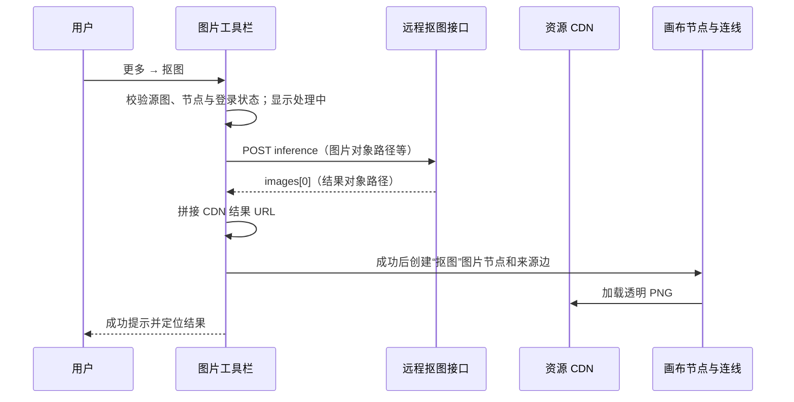
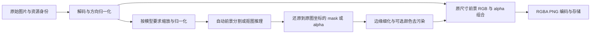

# 画布图片智能抠图：Liblib 功能分析与技术栈方案

编写日期：2026年11月11日。适用项目：Lumina-Muse。本文交付功能分析和待实施方案，本次未修改业务代码。

## 1. 结论

**Liblib 的画布抠图采用“前端提交图片 → 远程抠图接口 → 返回透明图片 → 创建派生图片节点”的方式。** 本次在页面实际加载的公开前端脚本中定位到 `POST https://bridge.xingliu.art/gateway/remove-background-api/inference`，并核对了普通图片工具栏到结果节点创建的调用链。这条调用链没有在浏览器里执行模型，也没有走普通生图的提示词生成流程。

下载已有结果后，确认文件是 **1186×1186、8-bit RGBA PNG**，透明通道包含0～255全部256级。界面上的黑灰棋盘格是容器的 CSS 背景，不是已经画进图片的背景。抠图需要真正改变输出文件的 alpha 通道，仅增加 CSS、遮罩预览或换一张背景图无法满足下载和下游引用。

**尚不能确定 Liblib 使用的是 BiRefNet、BRIA RMBG、自研模型还是其他服务，也不能确认其后端语言、推理框架、硬件或内部队列。** 接口路径和 `_mattingNode` 字段都不足以证明具体模型。下面将竞品已确认实现与我方建议分开说明。

Lumina-Muse 推荐在现有公共图片工具栏增加入口，沿用普通 `imageNode`、来源连线、图片结果保存与协作能力；推理能力优先由现有后端承接。模型可先评估官方 MIT 权重的 BiRefNet 通用／matting 变体。**本仓库目前没有可直接调用的图片抠图接口，通用生图接口也不能直接视为具备透明 PNG 输出能力。**

## 2. 参考界面与证据范围

参考页面：[Liblib 画布](https://www.liblib.tv/canvas?spaceId=14737399&projectId=e9d52dd14e24487ea2bf3995a75ce36e)。


| 证据 | 本次确认内容 | 不能据此确定的内容 |
| --- | --- | --- |
| 用户提供的三张截图 | 功能入口、多人主体示例、透明结果、源图与结果的连线 | 真实文件编码、具体模型、速度、所有用户的计费政策 |
| 当前页面 AX／DOM 与已有节点 | “更多”菜单确有抠图；已有结果是独立图片节点；结果资源位于 `tool/remove_background/`；容器使用棋盘格 CSS | 本轮没有重新提交推理，没有捕获一次新的完整请求／响应 |
| 页面加载的公开 JS | 接口地址、请求构造、返回解析、加载状态、普通画布派生节点调用链 | 服务器内部实现、模型版本、推理硬件、实际响应时延 |
| 下载的已有结果 PNG | 真实像素尺寸、RGBA 编码、透明与半透明像素 | 其他图片的效果，以及源图与结果逐像素保真程度 |
| 本仓库源码 | 现成图片工具栏、派生节点、任务、保存、协作与上传入口 | 不在本仓库中的后端已具备哪些新增处理能力 |

核查采用 `reverse-engineer-anything` 技能的证据区分方法。当前会话没有可用 REA／Context7 MCP，实际使用浏览器 AX／DOM、公开交付 JS 的静态检查、PNG 解码和上游官方资料，未生成 REA Evidence。资源 URL、SHA-256、定位单位和像素统计保存在[证据清单](assets/liblib-cutout/evidence-summary.json)。JS 资源会随发布变化，以下结论以清单中的版本为准。

本轮只查看已有抠图结果和菜单，没有重新发起抠图、删除节点或修改项目内容。文档中的“已确认”不代表完成了整个服务端的审计。

## 3. Liblib 已确认的实现

### 3.1 普通画布的执行流程



该图反映的是前端可见调用顺序。服务器内部是否经过任务队列、模型服务或外部供应商，当前未知。

1. 工具栏先检查当前图片 URL、节点 ID 和登录状态。
2. 设置本地 loading，显示“抠图处理中”类提示并开始记录编辑事件。
3. 使用当前图片构造抠图请求，等待 HTTP 调用返回。
4. 取返回对象的 `images[0]`；缺少结果时进入失败处理。
5. 通过资源 CDN 基址拼出图片 URL，设置结果时间及成功状态。
6. 普通画布提供 `onCreateImageNode` 回调，创建标签为“抠图”的新图片节点，添加源节点到结果节点的连线，选中并居中定位新节点。
7. 成功或失败均结束本地 loading，并显示相应提示。

**这个普通入口在接口成功后才创建结果节点。** 当前静态链路返回的是结果路径，前端没有在这里取得任务 ID 再轮询；结果数据中的 `taskInfo.taskId` 为空。它与“先下生图订单，再按任务 ID 轮询”的流程不同。

### 3.2 请求与返回的含义

实际前端构造的主要字段如下，图片路径和上下文 ID 已替换为说明性占位符：

```json
{
  "images": ["源图片在资源桶中的对象路径"],
  "mode": 1,
  "sourceStorage": "ALIYUN",
  "sourceBucket": "站点资源桶",
  "targetStorage": "ALIYUN",
  "targetBucket": "站点资源桶",
  "cid": "客户端上下文标识",
  "eid": "上下文标识"
}
```

普通图片节点传给工具栏的来源优先取 `originalUrl[0]`，缺失时再取当前 `url[0]`。前端随后从源 URL 中取 `pathname` 并去掉开头的 `/`，因此该请求提交的是对象路径，不是把截图、Canvas 像素或完整图片字节再次上传。查询参数不进入这个对象路径，预览缩略图的尺寸参数也不会作为模型输入路径的一部分。

这与 Liblib 自己的资源桶协议有关，**不能原样照搬到我方 COS URL 或外部图片 URL**。我方必须通过现有资源身份／上传流程解析来源，明确后端接受 URL、对象 key 还是资产 ID。

客户端成功分支使用的返回契约可概括为：

```json
{
  "images": ["tool/remove_background/结果标识.png"]
}
```

这是根据调用方读取字段整理的结构，未把它写成一次真实抓包响应。`mode: 1` 只能确认为请求参数，不能解读为特定模型、具体推理模式或“只保留一个主体”。

### 3.3 结果节点与工作流

公开脚本确认普通结果使用现有 `image` 类型，设置结果 URL、编辑动作、`showGenerator: false` 和 `_mattingNode: true`。位置复用画布的相邻放置与避让逻辑，来源边连接旧节点与新节点。用户得到的是独立图片资源，源图在普通回调成功的路径中继续保留。

工具栏还存在“没有创建回调时更新当前节点”的兜底路径；不能把这个兜底误写成普通画布总是覆盖源图。

另一个工作流执行分支会识别抠图标记，读取上游图片、调用相同接口，成功后更新已有抠图节点及尺寸并使下游过期。这说明“首次从工具栏派生”和“已有抠图节点重新执行”是两条相关路径，不能只根据工具栏截图设计完整的工作流重跑规则。

静态代码还确认了通用持久化链：创建节点和边分别产生 `nodeCreate`／`edgeCreate` 操作，合并进入画布同步队列，随后通过 `/api/canvas/nodes/batch` 提交项目、节点、连线及版本信息。卸载时存在 keepalive／sendBeacon 回退路径。**抠图推理返回图片资源，通用画布同步另行保存节点关系；两者不是同一次业务提交。** 本轮没有验证这次批量保存的网络结果，不能把前端已排队等同于服务端已经落库。

### 3.4 免费与处理速度

截图需求标题标注“不消耗积分”。已检查的普通抠图前端调用链直接请求独立推理接口，没有经过普通生图的估价／下单步骤；这与一个独立图片工具的产品形态相符。

**本轮未比较积分余额、套餐或配额，也没有验证服务端账本。** 因此可记录这项产品宣传，但不能断言所有账户、所有分辨率、所有调用方式都永久免费。即便不向用户扣积分，服务器推理、存储和带宽仍可能产生平台成本。

本轮没有新发推理请求，不提供“固定几秒完成”的结论。冷启动、排队、大图处理、并发限制及失败率都需要专项实测。

## 4. 透明图片的实测结果

已下载的[原始抠图结果](assets/liblib-cutout/verified-cutout-result.png)具有以下属性：

| 项目 | 实测值 |
| --- | --- |
| 文件编码 | PNG，IHDR color type 6，即 RGBA |
| 宽高 | 1186 × 1186 |
| 单通道位深 | 8-bit |
| 文件大小 | 691,211 bytes |
| alpha 范围／实际级数 | 0～255／256级 |
| 完全透明像素 | 1,025,706 |
| 部分透明像素 | 346,320 |
| 完全不透明像素 | 34,570 |
| 左上角 RGBA | `[255, 255, 255, 0]` |

这些统计由 PNG 的 IDAT 解压与行过滤还原得到，不是对界面截图做颜色猜测。透明像素仍可存放白色 RGB；因为 alpha 为0，显示时不会变成白底。

结果图片祖先容器的 `background-image` 为黑灰 `repeating-conic-gradient`，用于显示透明区域。导出文件中不应烘焙这个棋盘格。

页面的图片池预览一度报告 `naturalWidth = 444`，下载原文件却为1186像素。**不可拿画布预览尺寸、节点显示宽高或缩略图的 `naturalWidth` 冒充原始分辨率。** 我方应读取实际输入资源的宽高，并在输出元数据中明确结果宽高。

此样本拥有软 alpha，但仅凭软 alpha 不能证明玻璃、烟雾、婚纱或所有毛发都被正确还原。截图中的猫和气球都被保留下来，也提示自动前景范围可能与用户心里的“唯一主体”不同。

## 5. 算法原理：分割、抠图与透明合成

### 5.1 基础流程



这是一条可实现同类能力的工程流程，不代表已经读取了 Liblib 服务器的模型流水线。

**主体分割**回答“哪些像素属于前景”，可以输出二值或软 mask。适合先把人物、动物、商品等主体从背景里分离出来。

**Alpha matting**估计连续透明覆盖率，通常用混合关系表达：

\[
I = \alpha F + (1-\alpha)B
\]

其中 `I` 是原始像素，`F` 是前景颜色，`B` 是背景颜色，`α` 是覆盖率。发丝、毛发、运动模糊和透明材料需要更细的边界估计。给软分割 mask 加羽化，不等于准确恢复真实透明材质。

当原图已经混入背景颜色时，直接把原 RGB 配上新 alpha 可能出现白边或色边；更高质量通常还涉及前景颜色估计／去污染。不能把“透明通道有256级”写成“已经解决所有边缘质量问题”。

### 5.2 实现中容易遗漏的细节

| 问题 | 建议处理 |
| --- | --- |
| 缩放导致主体变形或位置偏移 | 保持宽高比；记录 padding／缩放，按相反变换把 mask 对齐原图 |
| EXIF 方向与坐标不同 | 解码时统一方向，图片与 mask 共用同一坐标系 |
| 只保留最大连通区域导致多人缺失 | 首版目标是自动前景集合，不默认只留最大区域；多人、多个商品分别验收 |
| 气球、道具被一起保留 | 作为自动主体判断的边界说明；如需指定对象，另评估交互式分割，不假装一键工具已支持 |
| 原图已有透明通道 | 不恢复原本完全透明的区域；固定软 alpha 合并策略，避免重复乘 alpha 导致边缘过淡 |
| 边缘白边／黑边 | 在白、黑和彩色背景下检查；缩放时明确预乘 alpha 与导出规则，必要时评估颜色去污染 |
| 图像尺寸改变 | 默认保留原始画布尺寸与主体坐标；自动裁边应是独立、明确的产品选项 |
| 输出全透明或全不透明 | 标记为可疑结果并检查样本与服务状态；两者不应一律被判失败，例如输入本来就是透明图 |
| PNG 转 JPEG | 禁止；JPEG 没有 alpha。WebP 可支持 alpha，但首版下载约定 PNG 更直接 |
| CDN 缩略图 | 缩略图与原图分离，确认转换保留 alpha；下载和下游引用使用真实结果资源 |

## 6. 技术栈判断与选型

### 6.1 Liblib 已看到什么

| 层次 | 可以确认的事实 | 未确认项 |
| --- | --- | --- |
| Web 交付 | 页面加载 `_next/static/chunks` 与 Turbopack 命名资源；公开组件代码使用 React Hook | 完整构建配置与精确依赖版本 |
| 界面组件 | 页面有 Mantine 的菜单 DOM／ID 特征，图片工具栏调用相应弹出菜单 | 不把 DOM 特征扩大成全部设计系统清单 |
| 画布 | 节点、连线、图像结果与图状态更新逻辑 | 不能仅凭外观判断画布底层全部实现及版本 |
| 网络边界 | 前端 HTTP POST 到独立抠图推理网关，成功读取结果路径 | 网关后的语言、推理引擎、模型供应商和任务调度 |
| 存储边界 | 请求显式声明 `ALIYUN` 源／目标存储与 bucket，结果通过资源 CDN 加载 | 服务端是否还有中间存储、缓存或多云策略 |
| 图片输出 | 已测样本为 RGBA PNG；棋盘格用 CSS 展示 | 其他输出格式、内部 mask 精度和后处理算法 |

**不要为复刻这一功能迁移我方现有框架。** Liblib 的 Next／Mantine 特征与抠图算法并无必然绑定，我方现有 React、TypeScript、Ant Design、React Flow 和 Vite 足以承载同样的交互。

### 6.2 模型与推理方式

以下是我方候选，不是对 Liblib 模型的归因。

| 候选 | 适用方向 | 许可及工程边界 |
| --- | --- | --- |
| [BiRefNet 官方模型](https://huggingface.co/ZhengPeng7/BiRefNet) | 自动主体分割的首轮质量验证 | 官方标准权重卡标 MIT；锁定具体权重、版本与预处理配置 |
| [BiRefNet-matting](https://huggingface.co/ZhengPeng7/BiRefNet-matting) | 毛发、软边等抠图效果对照 | 官方卡标 MIT；仍需用真实样本验证，不能承诺所有透明材质 |
| [rembg](https://github.com/danielgatis/rembg) | 快速验证、Python／HTTP 封装与可选后处理 | 工具代码为 MIT；各模型权重须分别核查，不依赖默认模型做授权判断 |
| [BRIA RMBG-2.0](https://huggingface.co/briaai/RMBG-2.0) | 取得商用许可后的质量对照 | 官方开放权重为 CC BY-NC 4.0，商用需另行取得授权；模型卡描述基于 BiRefNet 架构 |
| [IMG.LY background-removal](https://github.com/imgly/background-removal-js/blob/main/packages/web/README.md) | 浏览器端快速接入 | JS 包与其[数据包许可证](https://github.com/imgly/background-removal-js/blob/main/packages/web-data/LICENSE.md)需一并核查，不能当作闭源商用的默认免费依赖 |

BiRefNet 的任务与权重变体说明见[作者仓库](https://github.com/ZhengPeng7/BiRefNet)。分割权重输出灰度 mask，与真正 matting 任务和透明材质还原存在区别，应单独选择、单独评测。

**推荐主路线：现有后端承接图片处理，选定模型执行，输出长期可访问的透明 PNG。** 若现有模型平台已经能提供该能力，优先接入它；否则再评估在既有服务边界内增加推理适配。Python、PyTorch 或 ONNX Runtime 可以是推理实现候选，并不要求另建一个面向前端的独立服务或更换现有后端框架。

**浏览器端是备选路线。** 可评估 ONNX Runtime Web 与官方轻量权重，把推理放到 Worker，避免阻塞交互。其[官方文档](https://onnxruntime.ai/docs/tutorials/web/)区分 WebGPU 等 GPU 执行器与 WASM CPU 路径，GPU 算子支持并不完整；WebGPU 不可用时不能无条件保证同样效果与速度。

| 维度 | 服务端推理 | 浏览器端推理 |
| --- | --- | --- |
| 首次使用 | 主要加载业务界面；模型由服务部署 | 需要下载模型／运行时并初始化，冷启动可能明显 |
| 一致性 | 易固定模型、预处理和运行环境 | 受浏览器、设备内存、GPU 和算子支持影响 |
| 成本 | 平台承担计算、存储和带宽 | 计算转移到用户设备；仍有模型分发、结果上传与存储成本 |
| 数据流 | 可直接读取平台已有图片资源 | 可本地处理，但远程源图还需加载，结果仍需上传才能协作／恢复 |
| 工程复用 | 更容易接入现有任务、权限与结果体系 | 需处理 Worker、模型缓存、兼容性、内存与取消 |

不根据上游演示数字承诺本项目耗时。模型体积、P50／P95 时延、峰值 RAM／显存、并发和失败率都应按指定权重与真实目标设备测量。

## 7. Lumina-Muse 的最小接入方案

### 7.1 现有能力与真实缺口

以下路径按当前仓库源码核对；源码证据优先于旧方案文档中的实施状态。

| 需要的能力 | 可复用位置 | 使用边界 |
| --- | --- | --- |
| 图片工具入口 | [NodeToolbar.tsx](../packages/canvas-main/src/components/WorkflowBuilder/nodes/view/NodeToolbar.tsx)，现有扩图／裁剪／标注／重绘／打光入口 | 当前是平铺工具，Lib 的“更多”菜单不是我方现成结构；首版可直接复用工具条 |
| 当前源图身份与可用条件 | [lightingSource.ts](../packages/canvas-main/src/components/WorkflowBuilder/utils/lightingSource.ts)；[WorkflowBuilder.tsx](../packages/canvas-main/src/components/WorkflowBuilder/WorkflowBuilder.tsx) 的 `canRequestLighting`／`requestLighting` | 参考现有单选、可编辑、协作、源结果版本检查；当前打光资格仅支持生成图／上传图，不能据此宣称其他类型都支持 |
| 派生普通结果节点与来源边 | [useLightingGeneration.ts](../packages/canvas-main/src/components/WorkflowBuilder/hooks/useLightingGeneration.ts) 的 `submit` | 已有右侧放置、避让、来源线与分组接入；复用业务入口，不复制一套保存流程 |
| 创建节点、避让和创建边 | [nodeUtils.ts](../packages/canvas-main/src/components/WorkflowBuilder/utils/nodeUtils.ts) | 使用既有 `createNodeConfig`、`findAvailableNodePosition`、`createEdgeConfig` |
| 可靠图片任务提交 | [imageGeneration.ts](../packages/canvas-main/src/components/WorkflowBuilder/utils/imageGeneration.ts) 的 `submitPreparedImageOrder` | 仅在后端确认抠图支持现有 V2 图片订单／结果协议后复用，不把普通生图当成抠图 |
| 轮询与刷新恢复 | [useNodePolling.ts](../packages/canvas-main/src/components/WorkflowBuilder/hooks/useNodePolling.ts)、[generationRecovery.ts](../packages/canvas-main/src/components/WorkflowBuilder/utils/generationRecovery.ts) | 保持原请求 ID、结果历史与 owner；当前恢复流程对普通 `imageNode` 支持最完整 |
| 协作、保存与分组 | [CollaborationContext.tsx](../packages/canvas-main/src/components/WorkflowBuilder/contexts/CollaborationContext.tsx)、`WorkflowBuilder` 原保存入口 | 复用 `acquirePersistentNodeLease`、`flushPendingSave`、`preserveGenerationNode`、`addDownstreamNodeToGroup`；离线检查不是全部权限检查 |
| 上传 | [upload.ts](../packages/core/src/api/modules/upload.ts) 的 `uploadFile` | 直接上传原 File；若服务已返回长期资源，无需下载再上传一遍 |
| 图片显示与下载 | [ImageNodeView.tsx](../packages/canvas-main/src/components/WorkflowBuilder/nodes/view/ImageNodeView.tsx)、[dataUtils.ts](../packages/canvas-main/src/components/WorkflowBuilder/utils/dataUtils.ts) 的 `handleDownload` | 现有 ``／Blob 下载不主动重编码，需补透明棋盘展示及输出验证 |

当前未查到抠图业务接口或抠图模型能力。另有 [mediaProcess.ts](../packages/canvas-main/src/components/WorkflowBuilder/PlaylistPanel/api/mediaProcess.ts)，但 operation 仅支持 `AUDIO_SPEED`／`VIDEO_SEPARATE`，输出类型仅音视频，**不能直接给它塞一个假定已支持的图片 operation**。

现有“图片旋转与镜像”文档仍是方案，不作为已经落地的代码复用点；打光的派生图片链路则已经在源码中实现。

### 7.2 首版产品规则建议

| 项目 | 建议规则 |
| --- | --- |
| 入口 | 当前公共图片工具条增加“智能抠图”；是否统一收进“更多”另按现有界面范围确定 |
| 输入 | 首版明确支持生成图与上传图；只处理当前主图 `data.output`，不处理全部历史结果 |
| 选区 | 单图操作；框选、连线、其他编辑模式或当前图片生成中不提交 |
| 操作 | 一键自动判断前景集合，无提示词、无指定对象、无手动蒙版编辑 |
| 结果 | 普通 `imageNode`，命名“抠图结果”，保留源图并连接来源边 |
| 尺寸 | 默认保持原始像素宽高与主体坐标，不自动紧裁主体 |
| 输出 | 实际带 alpha 的 PNG；棋盘格仅是预览背景 |
| 后续 | 继续使用现有下载、预览、素材登记、保存、刷新恢复和下游图片引用 |
| 费用 | 产品侧可以设置不扣用户积分，但必须由后端明确能力、配额与计费规则 |

后续若要求裁剪、扩图、重绘结果也可抠图，应明确扩展来源资格并测试真实资源身份。不要因为它们都能显示 `` 就默认已覆盖。

### 7.3 先确定后端契约，再选择提交方式

**优先确认现有后端是否能把抠图作为现有图片任务能力提供。** 若可以，沿用 `submitPreparedImageOrder` → 原结果查询 → `useNodePolling` → 原画布保存；这样复用已有不确定响应处理、刷新恢复和协作 owner。结果节点可以像打光一样先作为占位出现。

若后端只能提供类似 Lib 的“单次请求直接返回结果 URL”接口，则保留源图，显示本次操作的处理中状态，成功后通过既有节点创建与连线入口派生结果。不要伪造普通生图任务 ID，也不要给一个没有任务查询能力的接口套用轮询。

两种方式都能实现同类产品体验，**节点出现时机与任务恢复能力不同**。本项目在后端契约未确认前不定死其中一种，也不新增第二套前端任务／保存体系。慢请求或必须跨刷新恢复的产品要求，应优先要求现有后端任务体系提供稳定身份和查询能力。

后端至少需要明确以下事项；这是待确认的契约清单，不是已经存在的新接口定义：

| 项目 | 必须说明的内容 |
| --- | --- |
| 输入身份 | 项目、源节点、当前结果版本；接受真实资产 ID／平台对象 key／URL 中的哪一种 |
| 图片规则 | 静态格式、像素和文件上限、EXIF、已有 alpha 的处理 |
| 结果 | 真实 PNG／RGBA、原始宽高、长期 URL／资源身份、是否保留独立 mask |
| 生命周期 | 直接返回还是任务；幂等标识、超时、查询、失败／取消的实际语义 |
| 权限 | 现有项目与素材访问权限，来源资源可读、目标项目可写 |
| 计费 | 不扣积分的具体范围、配额、并发及失败请求如何计数 |
| 来源读取 | 限定可读取的平台资源，不因传 URL 而开放任意地址抓取 |

独立 mask 对后续修边有价值，但 Lib 本次返回链路只确认了成品图片路径，不能写成竞品已提供 mask 下载。首版没有修边需求时，不必为此扩大对外接口。

### 7.4 接入顺序与一致性

1. **进入时检查**：沿用现有可编辑、单选、协作可用和源图片可用判断；冻结当前源图 URL／资产身份及版本，防止误处理历史第一张。
2. **提交前再检查**：源节点仍存在、当前主图未切换、本次操作未被取消；重复点击只产生一次请求。
3. **执行**：使用已确认的后端契约；任务型复用可靠提交与查询，直接返回型等待当前调用，保留原图。
4. **接收结果**：校验结果属于当前项目、源图快照和当前请求；源图切换、节点删除、切项目或操作失效后不盲目回填。
5. **创建／回填**：复用普通结果节点、避让、来源线和分组处理，使用结果自身资源身份，不沿用源图 `assetId`。
6. **保存与释放**：通过原画布保存链路确认结果，按现有租约流程释放。任务响应不确定时继续查询原请求，避免简单重发造成重复计算或节点。
7. **失败**：明确失败可提示重试；只清理本操作仍为空的占位，不删除他人接管或已有输出的节点；源图始终保留。

这里描述的是需要沿用的现有一致性要求，不要求在抠图组件里重新实现编辑锁、轮询、三方合并或自动保存。若后续实施需要改变架构、扩展任务协议或无法直接复用现有入口，应按项目开发规范13.2先说明最小改动及影响范围并取得确认。本次只交付方案，不实施这些变更；不新增快捷键。

## 8. 验收与验证计划

### 8.1 质量样本

| 样本 | 验收重点 |
| --- | --- |
| 单个人物、三视图／多人同框 | 人物完整，多主体不因“只留最大区域”丢失 |
| 猫、狗、细毛发 | 胡须、毛边、耳朵与爪子边缘，在深浅背景下检查 |
| 商品、孔洞、细线 | 主体内部空洞和小结构，避免误填与断裂 |
| 背景与主体颜色接近 | 模型是否把衣服／商品边界一起删除 |
| 气球、道具、阴影 | 自动保留范围可解释；阴影策略单独说明，不随意承诺去除或保留 |
| 玻璃、婚纱、薄纱 | 单独评估透明材质，不拿普通人物样本推断效果 |
| 旋转后带透明留白、已有透明 PNG | 原透明区不复活，主体坐标不偏移，尺寸策略一致 |
| 大图、异常图、动态格式 | 限制和错误提示明确，不静默只处理一帧 |

### 8.2 功能与可靠性

- 原图不被覆盖；结果、来源线和分组按约定创建，刷新后仍可恢复。
- 重复点击、网络超时、明确拒绝、结果为空、关闭页面和任务接管分别验证；不产生重复节点。
- 源图切换／删除／切项目后旧响应不覆盖新状态。
- 下载文件验证 PNG 签名、真实宽高和 alpha；用白、黑、彩色背景检查边缘；棋盘格不进入文件。
- 下游从当前抠图结果读取资源；若某模型入口会把透明图铺白或转 JPEG，应明确该入口的兼容边界。
- 只读／协作锁／离线草稿按现有规则生效，不借本功能更改快捷键。
- 有代表性样本测 P50／P95、最大内存／显存、冷启动、并发、费用和失败率；本轮未进行这些基准测试。

## 9. 证据定位与参考资料

公开脚本定位使用“解压后 UTF-8 文本的 Unicode 字符偏移，从0开始”，不是原始 TypeScript 行号。以下只列最短定位标识，完整资源身份见[证据清单](assets/liblib-cutout/evidence-summary.json)。

| 公开资源 | 定位标识／大致偏移 | 支持的结论 |
| --- | --- | --- |
| [42t5yty52ao0s.js](https://liblibai-web-static.liblib.cloud/liblibtv_online/static/_next/static/chunks/42t5yty52ao0s.js) | `removeBackgroundInference`，约17,284 | 推理路由配置与结果图片基址 |
| [2frpv3oy1r4lc.js](https://liblibai-web-static.liblib.cloud/liblibtv_online/static/_next/static/chunks/2frpv3oy1r4lc.js) | `bridgeHost`，约26,286 | 网关和资源 CDN 的环境配置 |
| [1ivbr5st_t6br.js](https://liblibai-web-static.liblib.cloud/liblibtv_online/static/_next/static/chunks/1ivbr5st_t6br.js) | 请求封装约10,788；结果 URL 拼接约15,674 | HTTP POST、推理埋点与资源路径拼接 |
| [05f6ugzajazaz.js](https://liblibai-web-static.liblib.cloud/liblibtv_online/static/_next/static/chunks/05f6ugzajazaz.js) | 模块 `613911`，约136,339之后 | 图片对象路径与存储字段的请求构造；该 helper 被画布调用 |
| [0cbdgcr2eh0sg.js](https://liblibai-web-static.liblib.cloud/liblibtv_online/static/_next/static/chunks/0cbdgcr2eh0sg.js) | 抠图处理约431,000～432,000 | 工具栏校验、loading、调用、成功派生与失败处理 |
| [023j1g8q9qb3t.js](https://liblibai-web-static.liblib.cloud/liblibtv_online/static/_next/static/chunks/023j1g8q9qb3t.js) | 创建回调约402,088；工具栏接线约407,311 | 普通图片结果节点、来源边、选中与居中 |
| [2fq5jewe1sw_h.js](https://liblibai-web-static.liblib.cloud/liblibtv_online/static/_next/static/chunks/2fq5jewe1sw_h.js) | 抠图执行分支约21,941 | 已有抠图节点的上游来源与重跑处理 |
| [2nir4qse8scxp.js](https://liblibai-web-static.liblib.cloud/liblibtv_online/static/_next/static/chunks/2nir4qse8scxp.js) | 节点入队约170,064；连线入队约188,688；同步队列约58,780 | 节点与边复用画布的批量增量同步 |

模型与执行器的选择依据来自各自官方仓库、模型卡和文档，详见第6节直接链接。模型权重、许可与执行器能力在实施前应按选定版本再次确认；这些上游资料不构成 Liblib 使用同一技术的证据。
