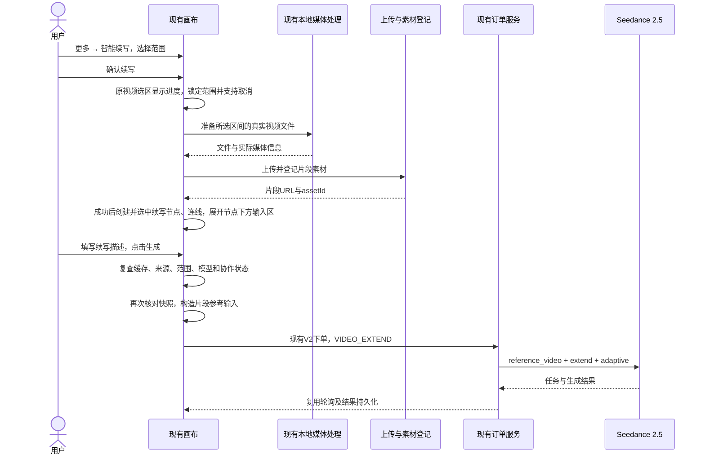

# 画布视频智能续写功能分析与技术方案

分析日期：2026-11-14。范围：需求、竞品公开实现、模型能力和本仓库接入方案；本文不代表功能已经实现，也未调用付费生成接口。

## 1. 推荐方案

采用 **选取参考片段 → 生成独立视频文件 → 上传并登记片段素材 → Seedance 2.5 原生视频延长 → 复用现有生成结果流程**。

画布交互保持“原视频 → 续写视频节点”两个节点。片段文件作为续写节点持有的派生素材，不覆盖原视频，不要求用户额外连接剪辑节点。

三个关键决策：

1. **只给模型传选中片段的真实文件。**原视频 URL 加 `start/end`、播放器循环播放范围或提示词中的时间范围，都不能替代真实截取。当前项目下单流程不会自动按这些时间字段截断视频。
2. **显式使用原生 `extend`。**项目已经有 `VIDEO_EXTEND` 和 Seedance 2.5 参数规范化逻辑，继续复用。普通视频参考加一句“续写”不等于已经切换到延长任务。
3. **先把返回视频当作完整生成成片。**模型参数 `duration` 是输出视频时长，不能直接命名为“新增时长”。不要收到结果后无条件再拼一次参考片段。

首期产品规则建议：参考片段 **`2 秒 ≤ 实际时长 < 15 秒`，实际画面达到 720p 以上**；默认选择源视频末尾约 4 秒，输出默认 720p、1 条，方向为向后续写。输出时长先按“成片时长”展示，具体可选值复用当前模型配置。

用户未指定最短时长，以上 2 秒取自 Seedance 2.5 非编辑任务下限。Lib 当前公开代码采用 4–30 秒；这里按本需求采用更短的输入上限，两个规则不能混写。

## 2. 证据范围与 Lib 实现分析

本次使用三类证据：用户截图、Lib 公开页面及静态前端代码、Seedance 官方文档。浏览器交互连接不可用，未操作用户项目，也未抓到 Lib 实际生成请求或服务端处理日志。因此可以确认前端选段和建节点行为，不能确认 Lib 的裁切引擎、上传接口、模型供应商内部映射及最终拼接策略。

### 2.1 截图与公开代码还原的操作流程

1. 选中视频节点，在“更多”中点击“智能续写”。
2. 原节点出现“请截取续写前置视频”提示和时间轴。
3. 拖动左右边界或整体移动选区，预览选中内容；截图显示 `6.15 秒`。
4. 点击“确认续写”，创建连接到源视频的新生成节点。
5. 新节点展示参考缩略图、来源和时间范围、续写输入区；截图设置为 `2.5 / 全能参考 / Auto / 720P / 5s / 1个`。
6. 用户补充后续内容，再点击生成。


“前置视频”是本次生成的上下文，**续写起点是选中片段的末尾**。例如从 60 秒源视频中选 `20–24 秒`，含义是接着第 24 秒的状态发展，不是接着原片第 60 秒发展。

### 2.2 公开前端代码能确认什么

| 项目 | 公开代码确认的行为 | 对本项目的启示 |
|---|---|---|
| 选区长度 | 最短 4 秒，最长 30 秒，源视频至少 4 秒 | 这是当前 Lib 前端规则；本需求另设 `<15 秒` |
| 初始选区 | `0` 到 `min(源时长, 30)` | 我们为降低输入成本，推荐默认末尾约 4 秒 |
| 选区操作 | 左右拖柄、整体移动、时长显示两位小数 | 复用现有片段选择 UI |
| 确认动作 | 新建空视频生成器和源到目标的连线 | 确认选区不直接触发付费生成 |
| 续写信息 | 保存来源节点、连线 ID 和时间范围 | 需要持久化结构化信息，不能只写提示词 |
| 模型能力 | 要求声明 `supportVideoContinuation` 且允许视频输入；优先 `star-video2.5` | 入口应受实际模型能力控制 |
| 模式和比例 | 复用 `mixed2video`，将比例限制为 `adaptive` | “全能参考”是界面模式名，不能据此推断原厂子任务 |
| 退出续写 | 清除续写扩展，删除扩展指定的匹配连线 | 只处理本次功能创建的关系 |

Lib 目标节点持久化字段的公开片段如下，**这是竞品结构，不是本项目已有接口**：

```ts
submissionExtension: {
  kind: 'video-continuation',
  version: 1,
  sourceNodeId,
  sourceToTargetEdgeId,
  range: { startSec, endSec }
}
```

文案还包含“源视频已变更”“续写内容已变更”“视频片段准备失败”“裁剪视频合规认证失败”等错误分支，说明其产品考虑了片段准备和失效处理；文案本身不能证明具体裁切发生在浏览器还是服务端。

截图中的 `6.15 秒`、缩略图 `6.2s` 和提示词 `00:00–00:06` 不应作为精确参数。当前公开代码对摘要起点取整、终点向上取整，与截图可能存在版本或选区差异。节点标注的 `150×286` 也不能证明源文件像素不足 720p，应读取真实媒体信息。

## 3. 产品规则与模型规则

以下官方能力针对标准 Seedance 2.5，核查日期为 2026-11-14。模型目录名为 `doubao-seedance-2-5`，官方示例固定版本为 `doubao-seedance-2-5-260628`；实际接入仍由本项目模型列表和服务端配置决定。

| 项目 | Seedance 2.5 官方要求 | 本功能首期建议 |
|---|---|---|
| 任务 | 全模态任务下的 `extend` 子任务 | 固定向后续写 |
| 输入视频时长 | 非编辑任务单条 2–30 秒；编辑任务为 4–30 秒 | **2 秒以上且严格小于 15 秒**，仅限制选中片段 |
| 输入数量 | 最多 10 条视频，视频总时长不超过 30 秒 | 仅 1 个续写片段；其他视频输入首期禁用 |
| 输入清晰度 | 支持 480p、720p、1080p、4K，另有尺寸约束 | 源片段达到 720p，不靠放大低清视频通过 |
| 输入格式 | MP4 / MOV；H.264 或 H.265 | 片段统一 MP4 + H.264，存在音轨时使用 AAC |
| 输入帧率 | 24–60 FPS | 转码后满足此范围；VFR 等情况统一为合适的 CFR |
| 输入文件大小 | 每个不超过 200 MB | 对实际片段再次校验此上限 |
| 输入尺寸 | 宽高比 0.4–2.5；每边 300–6000 px；总像素 407,696–8,295,044 | 同时满足产品清晰度与官方尺寸限制 |
| 输出分辨率 | 480p / 720p / 1080p，默认 720p | 默认 720p；1080p 按当前模型配置开放 |
| 输出宽高比 | 延长任务必须 `adaptive`，继承待延长视频比例 | 锁定“跟随参考视频” |
| 输出时长 | `duration` 为生成视频时长，支持 4–30 秒或 `-1` | 复用可用配置，界面写“成片时长” |
| 输出格式 | MP4 / MOV | 首期 MP4；MOV 需验证播放器和下载链路兼容性后开放 |

720p 需要确定可执行的产品口径。建议按**旋转校正后的显示画面短边 ≥720 px**校验，例如 `1280×720`、`720×1280`、`720×720`；这是本产品建议，不是官方对所有比例的 720p 定义。超宽画面是否采用另一清晰度口径，应在产品规则中单独确定。

模型 `resolution: '720p'` 控制输出清晰度，不能证明输入素材已经满足 720p。`node.data.width/height` 可能是画布展示尺寸，也不能拿来校验输入。

素材准入复用现有登记与认证链路；官方对含真人人脸的参考图/视频另有接入限制，应按当前账号及素材能力确认，不能把所有可在浏览器播放的视频都视为可直接提交的素材。

## 4. 时长、续写锚点和结果定义

需要区分四个时间量：

| 名称 | 含义 | 示例 |
|---|---|---|
| 原视频时长 | 画布原素材的完整长度 | 60 秒 |
| 选中范围 | 原素材时间轴中的区间 | `[20, 24)` 秒 |
| 参考输入时长 | 实际上传片段的探测时长 | 约 4 秒，以编码结果为准 |
| 成片时长 | 模型返回视频的时长 | 例如请求 9 秒，实际值以结果为准 |

请求成片 9 秒不自动等于“新增 9 秒”。官方任务锁定说明称相关素材会成为输出时间轴上的一段；这意味着结果不能一律视为纯新增尾段，也不代表前置片段逐帧、逐字节不变。

**首期结果定义：保存模型原始返回的完整成片。**如产品后续增加“新增 5 秒”或“保留完整原视频并接上续写”功能，必须先验证供应商实际返回语义，再设计截尾和拼接：

- 用固定样本测量输入保留长度、续写开始位置、返回总时长和音频边界。
- 若可靠确认返回为“参考前缀 + 新增内容”，才能截取新增部分，接到用户指定的原视频位置。
- 中间片段续写时，需要另行定义原视频选区之后的内容是舍弃还是保留；首期不自动改写原片。
- 不通过 `输入时长 + 期望新增时长` 的简单换算承诺精确新增秒数；该换算只能在接口实测和产品验收后启用。

截图显示“参考约 6.2 秒、设置 5s”，不足以证明它的 5s 是新增时长，也不能证明 Lib 做了何种拼接。

## 5. 技术栈与数据流

| 层级 | 复用技术/模块 | 本功能补充 |
|---|---|---|
| 交互 | React、TypeScript、现有画布节点与工具栏、Ant Design 菜单 | 增加智能续写入口和专用选区意图 |
| 时间轴 | `VideoClipContent` | 续写范围、校验文案、确认动作 |
| 本地媒体处理 | 已有 `@ffmpeg/ffmpeg` / FFmpeg WASM 及 `separateVideoLocal.ts` 生命周期 | 增加真实时间截取，输出独立片段 |
| 上传与画布保存 | 现有上传、`useMediaProcess` 处理流程、协作上下文 | 将结果存到续写节点的派生片段字段 |
| 素材登记 | `registerMediaAsset`、`useSeedanceMediaAssets` | 支持目标节点持有的派生素材，避免污染源节点 |
| 参数与下单 | `buildVideoGenerationOrder`、`prepareVideoGenerationParams`、V2 订单 | 将片段作为唯一续写视频输入，使用 `VIDEO_EXTEND` |
| 任务结果 | 现有请求记录、轮询、恢复与资源持久化 | 沿用，不另建任务系统 |



确认续写后，在原视频选区工具栏显示截取、上传和素材检查的进度，处理中锁定选区、禁止重复确认，并支持取消。片段准备成功后，才将续写节点和连线加入画布、选中新节点并显示节点下方输入区。失败或取消时保留原选区并支持重新确认，不留下半成品节点或连线。准备成功不会自动下单；用户填写描述、调整风格或参考顺序后点击生成，复用有效片段缓存并复查素材状态，不在下单路径中重新截取。旧节点缓存缺失时仍保留重新准备入口。

若首期需要先验证模型效果，可手动使用现有真实剪辑节点连接续写节点，形成“源 → 片段 → 结果”三节点。它适合验证，但与 Lib 双节点交互不同，不作为正式交互方案。

## 6. 前端交互与持久化

### 6.1 入口与选区

- 普通视频节点、上传视频节点和已产生有效视频输出的剪辑节点使用一致入口。无输出、处理中、不可编辑或模型不可用时沿用现有禁用方式。
- 默认选择源视频末尾约 4 秒；源时长在 2–4 秒之间时选择全部。源视频不足 2 秒不能进入。
- 源视频可以超过 15 秒，校验对象是选中并实际截取的片段。较长文件仍受本地处理内存限制。
- 选区右端即续写锚点；预览循环播放该区间，并展示精确到至少两位小数的长度。
- 使用独立的续写意图参数复用 `VideoClipContent`，不要全局修改既有视频编辑的 4–30 秒约束。当前组件只在 `mode === 'edit'` 时应用 `durationLimits`，直接传新限制并不会对普通剪辑生效。
- 严格小于 15 秒的判断采用真实时间值和输出探测值；`14.999`、`15.000` 不能先四舍五入成相同数字再判断。

### 6.2 续写节点

复用普通视频生成节点，不增加新节点类型。节点标题“续写 {源名称}”；参考区显示选段缩略图和实际时长；提示前缀展示“对 {来源} 的 {起止时间} 片段进行续写”。来源与范围由结构化数据派生，用户只编辑续写描述。

MVP 固定一个参考视频，其他视频连入时提示冲突，避免原视频和选中片段同时进入订单。图片、音频等附加参考首期不开放，后续按模型能力评估。

### 6.3 建议的数据结构

下面是**拟新增的应用侧字段类型**，对应普通节点 `data.videoContinuation`，不是已存在的接口，也不是直接发给模型的参数。沿用现有节点保存机制，最终类型放入现有类型文件：

```ts
type VideoContinuation = {
  version: 1,
  sourceNodeId: string,
  sourceToTargetEdgeId: string,
  sourceUrl: string,              // 创建选区时的来源快照
  startSec: number,
  endSec: number,
  prepared?: {
    inputSignature: string,      // 来源、范围、编码配置的稳定标识
    url: string,                 // 已上传的真实片段
    assetId?: string,            // 该片段自己的素材ID
    durationSec: number,        // 实际探测值，不使用选区摘要
    width: number,
    height: number,
    fps: number,
    hasAudio: boolean
  }
}
```

复用现有保存、复制、撤销和协作机制；复制节点时必须按现有 ID 重映射规则处理来源和连线，无法建立正确关系时提示重新选段。`Blob`、`File`、对象 URL、Worker、控制器和处理进度只保留在运行时，不进入项目持久化数据。

源视频被替换、来源连线被删除、范围变化、编码配置变化时使片段缓存失效。描述或输出清晰度变化通常无需重新截取，但需要刷新本次生成快照与费用估算。复用已上传片段时仍需确认素材可访问、登记有效，不能只检查字段存在。

旧字段 `videoSegment` 表示片段编辑，当前会强制进入 `MULTIMODAL_EDIT / edit`；不能把续写直接存到该字段并期待它按 `extend` 提交。

## 7. 真实视频截取方案

### 7.1 为什么需要独立文件

现有下单从上游节点 `output` 组装 `referVideo`。播放器上的 `clipStart/clipEnd` 只控制播放区间，既不改变文件 URL，也没有自动转换成供应商视频范围参数。

例如原视频 60 秒、选中 `20–24 秒`，正确输入应是一个可独立播放的约 4 秒文件。原视频 URL 即使附带 `#t=20,24`，也不能证明模型只读取 4 秒。

### 7.2 复用路径及需要补充的能力

仓库已有两类相关能力：

1. `useVideoNodeActions.clipVideo`：通过视频播放、Canvas 和 `MediaRecorder` 录制后上传，并创建剪辑节点。它不是返回片段文件的纯处理函数。
2. `separateVideoLocal.ts`：已为音视频分离和画面裁剪封装读取文件、WASM、媒体探测、取消、超时和清理；**当前尚无时间截取分支**。

正式方案建议在第二条现有处理链路补充时间截取，再扩展 `useMediaProcess` 的处理、上传和协作生命周期。不要复制一套 FFmpeg 加载器、上传器或保存流程。该操作先作为本地处理能力接入；现有后台媒体处理接口没有已确认的时间截取操作，不能虚构一个枚举直接发给后台。

`useMediaProcess` 目前把所属节点的 `output` 当作来源，校验和锁也围绕该节点，结果默认创建新节点与连线。因此**空续写节点不能原样调用它完成本需求**。需要在现有入口明确区分 `sourceNodeId/sourceUrl` 与结果归属的目标节点：读取与内容快照校验指向源，进度与派生片段缓存归目标；续写分支写入目标缓存，不执行默认的新增结果节点逻辑。普通分离、裁剪分支保持既有行为。

确认选区时，片段准备与登记使用来源节点的现有租约，在内存中准备待创建节点的数据；处理成功后才将完整节点与连线加入画布并保存。已有续写节点重新准备或复查缓存时，分别取得来源与目标节点租约，以借用本页已持有的单节点租约；处理期间检查租约，结束时均释放。下单仍使用既有生成租约与保存流程，接单后不在整个模型推理期间持续占用原视频处理锁。来源/目标删除、内容变化、租约失效均停止旧任务回写。

现有 `MediaRecorder` 路径可以辅助效果验证，但不宜直接作为生产质量承诺：它存在固定 30FPS、非帧精确截取、浏览器后台节流、音轨捕获失败后静默丢失、部分浏览器输出 WebM 等问题。Seedance 2.5 官方接受 MP4/MOV，WebM 不能改扩展名后提交。

### 7.3 截取与输出要求

- 用媒体探测得到原始时长、帧率、轨道起始时间、旋转和实际尺寸。已有 `getVideoDimensions` 会把时长取到 0.1 秒，不能单独承担严格边界校验。
- 按选区解码并重新编码需要的区间，重置输出时间戳；不要只在任意关键帧做流复制后宣称帧精确。
- 时间范围映射到可编码的帧边界；编码后重新探测，确认实际视频时长在 `[2,15)` 内。临界值不满足时要求缩短或重新截取，不能直接带着超限文件下单。
- 输出 MP4、H.264、适合浏览器播放的像素格式；有音轨时保留选段音频并使用 AAC，无音轨时允许静音输入，不伪造已保留声音。
- 保留源宽高比，不放大低清素材凑门槛；高分辨率素材可按产品清晰度口径缩小到 720p 级别，仍需满足官方尺寸限制。
- 对旋转、非方形像素、HDR/高位深等特殊素材沿用现有明确支持范围；不在此次需求中悄悄加入色彩转换承诺。
- 最后检查容器、编码、FPS、实际尺寸、文件大小、音画同步和可独立播放性；片段时长使用探测值写入参考输入。

WASM 仍需读取原文件，截取 4 秒并不保证只下载 4 秒。当前本地处理限制输入 256 MiB、输出 512 MiB，且文件、WASM 内存和输出会同时占用内存；这与模型单文件 200 MB 限制是不同层面的约束。大文件、移动端内存不足或 CORS 不允许读取时先明确失败，不回退提交完整原视频。

若以后需要处理超大素材，再在现有媒体处理服务中扩展服务端截取；这属于额外能力，首期不假设它已存在。

## 8. 派生片段登记：双节点方案的必要扩展

这是本需求最容易漏掉的接入点。

现有 `useSeedanceMediaAssets` 在确认时重新读取真实画布节点与连线；`registerMediaAsset` 要求被登记 URL 与源节点当前 `output` 一致，登记结果还会写回该节点。现有生成入口也会比较输入快照与真实节点输出。

因此，仅把传给 `buildVideoGenerationOrder` 的上游 `output` 换成片段 URL，再原样调用 `verifyMedia()`，会产生两类问题：检查直接失败；或登记到原视频素材 ID，却把它与片段 URL 一起提交。

双节点方案需要在现有流程中做有限扩展：

1. 时间截取输出和上传结果归续写节点 `videoContinuation.prepared` 所有，不修改源节点 `output/assetId`。
2. 现有素材登记入口增加派生片段的归属与有效性检查，复用相同登记接口；登记出的 ID 写入续写节点对应片段缓存，不能走“写回原视频节点”的分支。
3. 保留真实图的来源校验：源节点存在、URL 快照相同、来源连线匹配、选区及模型未改变。
4. 所有检查通过后，仅在本次订单素材快照中，用真实片段的 `url/assetId/duration` 替换指定来源。`buildVideoGenerationOrder` 继续处理标准参考输入，不在其中重新下载和裁切视频。
5. 标准素材分支原有的 URL 一致性与登记回写约束保持有效；不为通过续写校验而全局放宽它们。

这两处新增能力——时间截取、派生素材归属——需要明确实现和测试；不能把它们标成“现成接口直接调用”。实现仍在现有媒体处理、素材登记和生成链路内，不另建任务体系。

## 9. 模型参数与订单对接

### 9.1 应用侧继续使用 V2 订单

复用 `buildVideoGenerationOrder`，模型 `name/version` 来自当前模型列表。应用调用现有服务，原厂凭证和供应商字段映射继续留在服务端。

下列仅展示**现有订单 `params` 内的关键字段形状**；真实 `ResItemVo` 和其他字段由原构建函数产生，`params/clientParams` 仍按既有约定序列化为 JSON 字符串：

```ts
{
  classType: GEN_CLASS_TYPE.VIDEO_EXTEND, // 当前值为9
  omni_reference_task_type: 'extend',
  ratio: 'adaptive',
  resolution: '720p',
  duration: 9,                         // 示例：成片时长，不是新增9秒
  referVideo: [{
    id: clipAssetId,
    type: RES_ITEM_TYPE.VIDEO,
    title: referenceLabel,
    description: referenceLabel,
    referImage: '',
    referVideo: uploadedClipUrl,
    referAudio: '',
    duration: actualClipDuration
  }]
}
```

不得同时传原视频和片段；不得把 `startSec/endSec` 当作已经支持的供应商裁切字段；不得将原视频素材 ID 填入片段参考。

### 9.2 原厂语义

服务端映射后需要满足：至少一个 `content.role = reference_video`、`omni_reference_task_type = extend`、`ratio = adaptive`，且提示词明确表达向后延长。

提示词示例：

> 接着参考视频1的末尾向后续写，保持黑猫外观、房间布置、光线和镜头运动连续。黑猫从桌面跳到窗台，镜头缓慢跟随，避免重新从片头开始。

引用名称由现有参考标签与提示词转换逻辑产生，不把画布节点名称或 Lib 的 `{{Video 1}}` 语法直接当作原厂占位符。

显式 `extend` 也不能消除提示词意图校验。官方可能异步返回 `InvalidParameter.TaskTypeMismatch`；模型配置、参数和提示词需要一致。

现有 `REFER` 模式遇到 Seedance 2.5 视频输入时会显式设置 `reference`。所以不能只保留普通参考模式、改一段前缀文字，就认为原生延长已经启用。

首期不启用 Draft 草稿生成：官方 Draft 仅支持 480p，与本入口默认 720p 的正式成片规则不同。检测到现有全局 Draft 设置开启时提示关闭后再生成，不静默修改其他节点的全局设置。

## 10. 成本与费用展示

节省输入成本的有效措施是减少**实际送入模型的视频时长**，再控制输出清晰度、成片时长和生成数量。默认 1 条，不为比较效果自动重复提交。

Seedance 2.5 官方含视频输入的估算公式为：

```text
估算token = (输入视频秒数 + 输出视频秒数)
           × 输出宽度 × 输出高度 × 输出帧率 ÷ 1024
费用还需考虑最低token门槛及当前计价规则
```

注意公式使用输出帧率和输出尺寸。将输入从 1080p 缩到 720p 主要降低传输、编码及文件体积成本，不能仅凭此公式承诺模型计费下降。

核查当日标准版官方含视频输入价格为：480p/720p 每百万 token 42 元，1080p 每百万 token 46 元。官方价格表示例中，720p、16:9、输出 5 秒、参考 2–4 秒的费用均为 8.16 元；参考 30 秒时为 31.75 元。**存在最低计费门槛，参考片段越短不一定继续降价**。该例仅解释视频输入计价，不能用来承诺本功能延长任务的可用输入/输出时长组合。

价格会变更，项目渠道价格也可能不同；Lib 截图中的 460 积分不能直接换算为我们的成本。最后以服务端报价与任务实际 `usage.completion_tokens` 对账。

现有费用估算请求包含 `hasVideo`、输出 `duration/resolution` 等，但没有参考视频实际时长和延长任务类型字段。要准确展示本功能报价，需**扩展现有估算接口契约**，使其与下单一致地使用实际片段时长、任务类型、输出配置和数量；不在前端硬编码官方单价作为结算金额。

## 11. 异步、协作与失败处理

| 场景 | 处理要求 |
|---|---|
| 读取、截取或上传失败 | 复用现有错误与进度机制，保留选区供重试；不提交完整原视频代替 |
| 处理期间取消或节点删除 | 中止处理、释放 Worker/对象 URL/锁；迟到结果不回写 |
| 来源被替换或连线变化 | 片段缓存失效，提示重新选段 |
| 片段准备期间选区、模型变化 | 中止本轮或丢弃迟到结果，不能按旧快照下单 |
| 片段登记失败或失效 | 复用现有登记检查；失败不扣生成费用 |
| 协作状态、租约变化 | 使用现有处理/生成锁及保存机制，旧持有者不得提交或回写 |
| 离线草稿未同步 | 沿用现有禁止远程操作规则 |
| 点击生成多次 | 复用提交中标记和现有请求记录，避免重复订单 |
| 下单响应未知或断网 | 复用现有请求恢复与查询；不要立即换新请求 ID 重下单 |
| 模型异步失败 | 按现有订单状态展示错误，保留描述和选区；不自动付费重试 |
| 返回结果完成 | 复用结果资源持久化；原厂链接有效 24 小时、2.5 下载最多 100 次，不能只保存临时地址 |

至少在开始处理前、片段上传/登记后、真正下单前核对来源、连线、范围、模型及目标节点快照。校验失败时结束本轮操作，不将新旧状态混合提交。

生成入口保留本次完整生成配置快照与最终比对：包括用户描述与引用顺序、应用风格、模型/版本、输出时长、分辨率、数量、声音设置，以及订单构建器从本地设置读取的 `draft/smartEnhance`。已有续写节点重新准备片段期间允许修改描述与生成设置，不因此丢弃有效片段；点击生成后若在异步校验期间修改上述配置，则结束旧提交、保留片段缓存并要求重新点击生成，真正下单的参数由通过最终校验的同一快照构造。

## 12. 仓库落点与改造任务

以下均为分析时的现有文件。路径相对于仓库根目录；文件内容可能随并行开发变化，实现前需以最新版本核对。

| 文件 | 已有能力 | 本需求工作 |
|---|---|---|
| [`nodes/view/VideoNodeView.tsx`](../packages/canvas-main/src/components/WorkflowBuilder/nodes/view/VideoNodeView.tsx) | `VideoClipContent`、视频交互 | 菜单入口、续写选区意图和限制 |
| [`nodes/VideoNodeWithBaseNode.tsx`](../packages/canvas-main/src/components/WorkflowBuilder/nodes/VideoNodeWithBaseNode.tsx) | 参数、素材检查、提交、片段编辑状态 | 续写状态展示、准备片段、快照检查和延长模式 |
| [`nodes/UploadNodeWithBaseNode.tsx`](../packages/canvas-main/src/components/WorkflowBuilder/nodes/UploadNodeWithBaseNode.tsx) / [`nodes/VideoClipNodeWithBaseNode.tsx`](../packages/canvas-main/src/components/WorkflowBuilder/nodes/VideoClipNodeWithBaseNode.tsx) | 上传/剪辑视频节点 | 对有效视频复用相同续写入口 |
| [`hooks/useVideoNodeActions.ts`](../packages/canvas-main/src/components/WorkflowBuilder/hooks/useVideoNodeActions.ts) | 现有节点操作、剪辑上传、节点创建与协作 | 复用建节点/连线流程，避免复制；不把 `clipVideo` 当作纯文件函数 |
| [`utils/separateVideoLocal.ts`](../packages/canvas-main/src/components/WorkflowBuilder/utils/separateVideoLocal.ts) | WASM 加载、读取、探测、取消、超时、清理 | 补时间截取及输出验证 |
| [`hooks/useMediaProcess.ts`](../packages/canvas-main/src/components/WorkflowBuilder/hooks/useMediaProcess.ts) | 处理、上传、锁、保存与结果写入 | 区分来源与目标、复用多节点租约、支持派生缓存写入而不新增第三节点 |
| [`hooks/useSeedanceMediaAssets.ts`](../packages/canvas-main/src/components/WorkflowBuilder/hooks/useSeedanceMediaAssets.ts) / [`utils/registerMediaAsset.ts`](../packages/canvas-main/src/components/WorkflowBuilder/utils/registerMediaAsset.ts) | 素材校验、登记和 ID 回写 | 增加目标持有派生素材的分支，保留原素材不变量 |
| [`utils/videoGeneration.ts`](../packages/canvas-main/src/components/WorkflowBuilder/utils/videoGeneration.ts) | 标准参考输入及 V2 订单构造 | 消费准备好的片段快照，保证唯一视频输入 |
| [`core/utils/seedance25Video.ts`](../packages/core/src/utils/seedance25Video.ts) / [`core/api/modules/order.ts`](../packages/core/src/api/modules/order.ts) | `VIDEO_EXTEND`、`extend`、`adaptive` | 优先直接复用既有映射，不写第二套 |
| [`utils/costEstimate.ts`](../packages/canvas-main/src/components/WorkflowBuilder/utils/costEstimate.ts) / [`core/api/modules/costEstimate.ts`](../packages/core/src/api/modules/costEstimate.ts) | 费用估算请求 | 与服务端约定片段时长和任务类型 |
| [`hooks/useVideoNodePolling.ts`](../packages/canvas-main/src/components/WorkflowBuilder/hooks/useVideoNodePolling.ts) / [`utils/generationRecovery.ts`](../packages/canvas-main/src/components/WorkflowBuilder/utils/generationRecovery.ts) | 轮询、任务恢复 | 继续复用，不新增独立续写轮询 |

后端工作是核对已有 `VIDEO_EXTEND` 到供应商的映射、确认派生片段登记可用、补全费用估算契约及结果持久化。仅从前端仓库不能断言这些后端能力已全部联调通过。

不需要为首期新增 JavaScript 视频生成 SDK，也不需要新建一套生成服务。前端负责选段和准备真实素材，模型生成由现有服务调用承担。

## 13. 实施顺序与验收

### 13.1 实施顺序

1. **模型契约验证**：使用一个合格短视频和既有延长模式，确认后端映射、任务类型、返回总时长、输入保留范围与音频行为；先明确“成片时长”语义，再实现承诺新增秒数的交互。验证任务需按实际生成操作发起，本次文档分析未产生此费用。
2. **媒体与派生素材能力**：在现有处理器增加时间截取，完成片段上传、探测、登记及目标归属；先确保 URL 与 assetId 都属于真实片段。
3. **画布交互接入**：更多菜单、范围选择、续写节点和连线、提示前缀、缓存失效、已有延长模式和费用估算。
4. **异步和持久化验证**：取消、协作、网络未知状态、刷新恢复、结果转存及边界验收。

### 13.2 验收矩阵

| 维度 | 用例 | 通过标准 |
|---|---|---|
| 片段真实性 | 60 秒源视频选 20–24 秒 | 上传文件约 4 秒，内容来自该区间；订单中没有 60 秒原片 |
| 时长下界 | 1.99 秒、2.00 秒 | 前者阻止，后者在编码实际值合格时可用 |
| 时长上界 | 接近 15 秒、15.00 秒；含帧边界误差 | 编码后实际值 `<15` 才可用，显示取整不影响判断 |
| 长源视频 | 大于 15 秒的源视频选合格短片段 | 不因源总时长直接拒绝；仍遵守本地文件处理上限 |
| 清晰度 | 横竖屏 720p、低清源、画布显示很小的高清源 | 按真实显示像素判断，不按节点尺寸、不靠放大通过 |
| 格式 | MP4/MOV、浏览器可能产生的 WebM、带旋转源 | 提交结果是经验证的可用 MP4；不假改扩展名 |
| 声音 | 有声、静音、视频/音轨不同起始时间 | 有声片段音画同步；不能静默丢音后仍显示已保留 |
| 素材 ID | 原视频与派生片段分别登记 | 片段自己的 ID 对应片段 URL；原节点未被污染 |
| 任务参数 | 普通参考模式与视频续写模式 | 本功能最终提交 `VIDEO_EXTEND / extend / adaptive` |
| 连续性 | 人物、主体、动作、镜头和环境声 | 沿选区末尾发展，人工检查接缝；不承诺每次都完全无缝 |
| 结果时长 | 固定输入、多组输出时长 | 记录实际总长及保留段位置；不把总长直接标成新增秒数 |
| 费用 | 相同输出、不同合格片段长度 | 估算使用实际输入时长并考虑门槛，与服务端账单可对照 |
| 状态变化 | 截取时替换原片、改范围、删连线或节点；改描述、输出或全局生成设置 | 旧片段不会登记到错误节点，旧提交停止，不混用新旧配置 |
| 重复操作 | 双击生成、断网后恢复 | 无重复付费请求，沿用既有任务恢复 |
| 保存与重开 | 保存后刷新、复制节点、协作打开 | 来源和选区可恢复；无法恢复时要求重选，不悄悄变成普通参考 |
| 输出归档 | 原厂临时链接过期前完成转存 | 项目引用持久资源，重新打开能播放和下载 |

### 13.3 上线前必须拿到的结论

- 当前接入渠道实际支持标准 Seedance 2.5 原生 `extend`，模型配置与 V2 订单映射一致。
- 不同参考长度、不同输出时长组合下的完整成片语义已通过样本验证；产品不会把“成片时长”误写成“新增时长”。
- 本地处理在目标浏览器的速度、内存和编码能力可接受；不支持的素材有明确反馈。
- 派生素材登记和费用估算契约已联调；源素材、片段素材和生成结果能分别追踪。

## 14. 资料来源

### Lib 公开页面与前端证据

- [用户提供的 Lib 画布链接](https://www.liblib.tv/canvas?guideSource=home-feature-grid&spaceId=15487101&projectId=601a1b07ad1e41a388288ff2fd576a8c)。本次取得公开页面 HTML，未登录或触发生成。
- [选区限制与续写结构](https://liblibai-web-static.liblib.cloud/liblibtv_online/static/_next/static/chunks/1z26dum3zz2mm.js)，模块 `241360`：4–30 秒、初始选区、范围验证及续写元数据。
- [选区 UI 与确认后建节点](https://liblibai-web-static.liblib.cloud/liblibtv_online/static/_next/static/chunks/2so_z2p2fyuag.js)：拖柄、两位小数时长、空生成节点及来源连线。
- [模型适用性与图操作](https://liblibai-web-static.liblib.cloud/liblibtv_online/static/_next/static/chunks/1mqzcom_byqzk.js)：能力筛选、`mixed2video` 和 `adaptive` 约束。
- [续写中文文案](https://liblibai-web-static.liblib.cloud/liblibtv_online/static/_next/static/chunks/279e98c4-wyu1.js)：来源失效、片段准备及认证失败等分支。
- [默认模型配置](https://liblibai-web-static.liblib.cloud/liblibtv_online/static/_next/static/chunks/0d2r8wu1do1fg.js)：`star-video2.5`。

静态资源是当前公开部署的实现快照，后续可能替换，不能代表所有历史版本或服务端实现。

### Seedance 官方资料

- [Seedance 2.5 模型目录](https://ark.volcengine.com/models/doubao-seedance-2-5.md)：模型名与版本。
- [Seedance 2.5 使用教程](https://ark.volcengine.com/region:cn-beijing/docs/seedance-2-5)：任务分类、参数限制、输入规格、输出时长与格式。
- [视频延长示例](https://ark.volcengine.com/region:cn-beijing/docs/seedance-2-5#2.5_extend)：原生延长、`adaptive` 和输出时长设置。
- [创建视频任务接口](https://ark.volcengine.com/region:cn-beijing/docs/create-video-generation-task-api)：请求和素材要求。
- [提示词指南：任务锁定](https://ark.volcengine.com/region:cn-beijing/docs/seedance-2-5-prompt-guide#task-locked)：素材与输出时间轴的关系。
- [官方计价](https://ark.volcengine.com/region:cn-beijing/docs/model-pricing#2864f00a)及[价格示例](https://ark.volcengine.com/region:cn-beijing/docs/model-pricing#sd25_price)：token 公式、含视频输入价格和最低门槛。最低 token 详细表未成功取得，本文不反推或编造通用门槛数值。
- [查询视频任务](https://ark.volcengine.com/region:cn-beijing/docs/get-video-generation-task-api)：实际用量、输出帧率与临时视频链接期限。

仓库分析遵循 [`docs/Skills.md`](Skills.md) 第十三节：沿用既有架构、流程及代码。以上为设计分析，当前代码落地情况见下节；未执行构建或提交。


## 实现落地记录（2026-11-15）

已在上传视频、生成视频和视频剪辑结果节点接入“更多 → 智能续写”。选段时间轴复用现有剪辑组件，默认取末尾约 4 秒，可拖动两端或整体移动；确认后创建独立的普通视频生成节点与来源连线，保留原视频。

点击新节点“生成”时，现有本地媒体处理器用 FFmpeg WASM 将选区转为独立 H.264/AAC MP4，重新探测实际时长、尺寸、帧率和音轨，再上传并通过现有素材登记接口检查。在 `VIDEO_EXTEND / extend / adaptive` 请求中，指定来源仅使用派生片段的 URL、素材 ID 与时长；派生缓存存于目标的 `videoContinuation.prepared`，不写原节点 `output/assetId`。生成、恢复和结果轮询沿用普通视频流程，返回结果不自动拼接原视频。

输入规则为实际短边至少 720px、时长不少于 2 秒且严格小于 15 秒；默认输出 720p、1 条，成片时长沿用模型配置。草稿开启、来源替换/删除、锁失效、取消或准备期间参考连线、素材、引用顺序、描述及参数变化时停止提交。复制续写节点会清除旧片段缓存及旧关系 ID，要求重新从来源选段，防止退回完整原视频下单。本地源文件沿用现有 256MB 限制；HDR/高位深或非方形像素视频会明确拒绝，不静默降级。

参考缩略图支持沿用普通视频节点的删除操作：断开来源连线、清除选区及派生缓存，恢复普通参考模式，保留用户提示词。续写预设提示标签可独立删除，删除状态随节点保存，下单及字数统计不再加入该预设描述，所选片段继续用于原生延长。模型菜单展示全部视频模型，不支持智能续写的模型置灰并显示原因，禁止点击、初始化或从缓存恢复为不可用模型。

续写节点使用普通视频节点的参考栏、添加参考、风格库和运镜入口，支持参考图及上游文本、参考排序与删除。额外素材沿用普通素材登记与模型限制，只有指定原片跳过普通登记并以截取片段单独登记；标准订单构建器同时接收派生视频、其他参考、应用风格和运镜提示，不丢弃新增内容。费用估算也使用同一组参考，指定视频按选区时长计入。模式菜单完整显示，智能续写状态仅“视频续写”可选。

验证覆盖真实 FFmpeg 非零起点截取、带/不带音轨和源时间戳偏移，三类节点菜单到下单接线、低清校验、上传期间的来源/连线/节点/锁变化、取消、缓存复用和空白复制保护。浏览器核对了真实组件的菜单、时间轴及输入面板。尚未发起收费模型生成；服务端 `extend` 映射、最终成片总时长与音频效果仍需在已配置 Seedance 2.5 的环境中完成一次实际任务联调。
